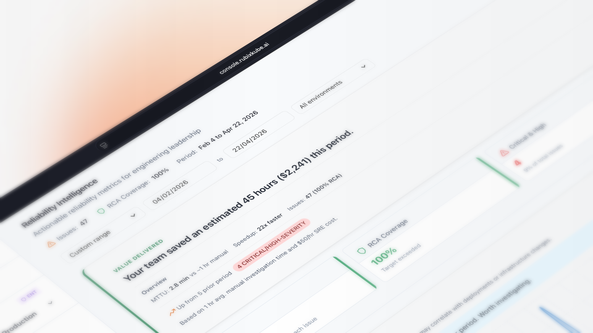

# RubixKube documentation

This repository holds the public documentation for RubixKube, published at [docs.rubixkube.ai](https://docs.rubixkube.ai).

[](LICENSE)
[](https://docs.rubixkube.ai)
[](https://console.rubixkube.ai)



## What RubixKube does

RubixKube helps your team run infrastructure with an agent. Observers in your environments and the tools you already use report what breaks. RubixKube turns that into incidents. Rubix, the agent, looks into each one, writes an RCA with its evidence, and suggests Tasks: a Fix, plus Follow-ups for later.

You choose how much Rubix can do without asking: Observe, Assist or Auto. Rubix can be wrong, so every RCA shows its evidence and lets you rate it.

Here's an example. A new `orders-api` version raises its database pool, connections run out, and `payments-api` starts crash looping. Rubix finds the cause and suggests a Fix: set `DB_POOL_SIZE` back to 10.

It's for teams who look after services in production. You can work in the console, in Slack, or from your own AI tools over MCP.

## Get started

1. Sign up at [console.rubixkube.ai](https://console.rubixkube.ai) and name your organization.
2. [Connect a source](https://docs.rubixkube.ai/getting-started/connect-your-environment): Kubernetes, AWS, Google Cloud, a server, or a tool like Datadog by webhook.
3. See your first incident, and ask Rubix a question.

The [Quickstart](https://docs.rubixkube.ai/getting-started/quickstart) has the details, and [What's new](https://docs.rubixkube.ai/getting-started/whats-new) lists recent changes.

## What's in the docs

| Section | What you'll find |
| :-- | :-- |
| [Get started](https://docs.rubixkube.ai/getting-started/overview) | Overview, what's new, quickstart, connect a source |
| [Core concepts](https://docs.rubixkube.ai/concepts/how-rubixkube-works) | Incidents, RCAs, Tasks, environments, observers and more |
| [Work in the console](https://docs.rubixkube.ai/using/incidents) | Incidents, RCAs, Tasks, chat, Automations, Analytics, Environments |
| [Connect a source](https://docs.rubixkube.ai/environments/kubernetes) | Kubernetes, AWS, Google Cloud, servers and VMs |
| [Customize and Settings](https://docs.rubixkube.ai/using/skills) | Skills, Commands, Agents, Hooks, Modes, Models, Members and more |
| [Tutorials](https://docs.rubixkube.ai/tutorials/first-incident) | Your first incident, talking to your infrastructure, custom skills and integrations |
| [Integrations](https://docs.rubixkube.ai/integrations/overview) | Alert sources by webhook, Slack, MCP, tools Rubix can read, and your own |
| [Rubix CLI](https://docs.rubixkube.ai/cli/overview) | Install, configure, commands |
| [Support](https://docs.rubixkube.ai/support/troubleshooting) | Troubleshooting, FAQ, system status, glossary |

## Run the docs locally

The site is built with [Mintlify](https://mintlify.com). You need Node.js 18 or higher.

```bash
npm i -g mint
mint dev
```

Then open http://localhost:3000.

## Contributing

- **Typos and small fixes.** Open a pull request.
- **Larger changes.** File an [issue](https://github.com/rubixkube-io/docs/issues/new/choose) first so we can agree on scope.
- **Product bugs.** Report them at [rubixkube-io/community](https://github.com/rubixkube-io/community/issues/new/choose) with steps to reproduce.

See the [Contributing Guide](CONTRIBUTING.md), [Code of Conduct](CODE_OF_CONDUCT.md) and [Security Policy](SECURITY.md).

## Links

- [rubixkube.ai](https://rubixkube.ai)
- [Console](https://console.rubixkube.ai)
- [System status](https://rubixkube.ai/status)
- [GitHub](https://github.com/rubixkube-io)

## License

The documentation in this repository is released under the [MIT License](LICENSE). The RubixKube platform has its own [terms of service](https://rubixkube.ai/legal).

connect@rubixkube.ai
