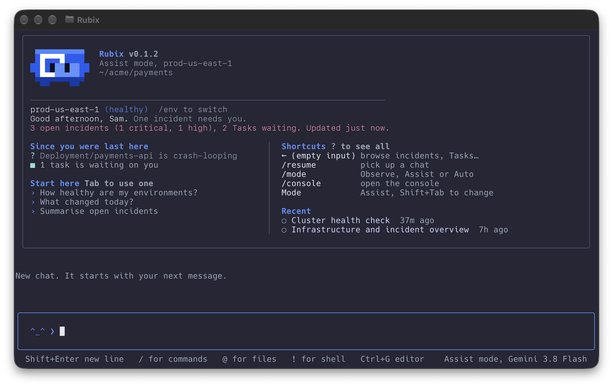

Chat is where you ask Rubix things and work through them together, without leaving the terminal. Run `rubix` with no command to open it.

<Frame>
  
</Frame>

## When you'd use this

- **You want to know how things stand.** The home card greets you with how things stand, what changed since you were last here, and a few starter questions. Press Tab to use one.
- **You're looking into one incident.** Type `@INC-12` and ask what caused it. Rubix starts from that incident.
- **You have a file Rubix should see.** Name it with `@./path`. Screenshots and PDFs are uploaded to the chat, and other files go in as text.
- **Rubix wants to change something.** You answer the approval with one key, right there.

## Ask and follow up

Type a question and press Enter. Shift+Enter starts a new line. Rubix shows its work as it goes, then the answer. Links Rubix writes to incidents, RCAs and Tasks show as cards.

Keep asking in the same chat. Rubix remembers the conversation. You can type while Rubix is answering: Enter queues the message, and the up arrow edits the first one in the queue. Ctrl+C stops a reply.

Chats are shared with the console. `/resume` picks an earlier chat, `rubix chat -s <id>` opens one from the shell, and `/new` starts a fresh one. Rubix gives each chat its title.

## Approvals and questions

What Rubix can do without asking depends on the mode. Change it with `/mode`, or press Shift+Tab to go through Observe, Assist and Auto. You can't go above your organization's highest mode. See [Modes](/using/modes).

When Rubix needs approval, the request shows above the input. Press a key:

| Key | What happens |
| --- | --- |
| `y` | Approve this once |
| `a` | Approve this tool for the rest of the chat |
| `n` | Decline |

When Rubix asks a question, answer with the number of a choice or type your own answer. Esc skips it. Choices and buttons Rubix sends work the same way. If Rubix wrote a plan, `/plan execute` runs it and `/plan drop` sets it aside.

## Add context with @

Type `@` anywhere in a message for a list of open incidents, Tasks, RCAs, environments and files in the current folder. Keep typing to narrow it, then pick one.

| You pick | It goes in as | Rubix gets |
| --- | --- | --- |
| An incident, RCA or Task | `@INC-12`, `@RCA-4`, `@TSK-30` | That record |
| An environment | `@env:prod-us-east-1` | That environment |
| A file | `@./deploy.yaml` | The file as text, up to 256 KB |
| An image or PDF | `@./screenshot.png` | The file, uploaded to the chat, up to 20 MB |

Chat opens in a folder only after you trust it. See [Install and sign in](/cli/installation#trust-the-folder).

## Pick an environment

`/env prod-us-east-1` points Rubix at that environment. `/env` on its own lists them. The environment goes with your next message, as `/env` does in the console, and the CLI remembers it for the next chat.

## Model, effort and style

- `/model` picks the model for this chat, from the ones your organization has. New chats start on the Primary model. See [Models](/using/models).
- `/effort` sets how hard the model reasons: auto, or one of the model's levels.
- `/style` sets how much Rubix says while it works: quiet, normal or verbose.

## Write in your editor

Ctrl+G opens the message in your editor: `$VISUAL`, then `$EDITOR`, then `vi`. Save and close it, and the text comes back to the input, ready to send. It's easier than the input line for a long question or pasted YAML.

## Run a shell command

Start a line with `!` to run it in your shell, such as `!kubectl get pods -n payments`. It runs in the folder you started `rubix` in and stops after 30 seconds. The output shows in the chat, and Rubix doesn't see it until you send it: `/send` sends the last command and its output to Rubix. Esc leaves shell mode.

## Rubix in pixels

A small pixel Rubix sits in the home card's header. `/pet` puts it above the input, where it shows what Rubix is doing: thinking, working, waiting for you (it waves), done (it hops) or failed (it shakes). It sleeps when no environment is connected. `/pet` again hides it, and the CLI remembers which you chose.

<Note>
  Set `RUBIX_MASCOT=0` or `NO_COLOR` to see plain text instead. The pixel Rubix also stays off when the output isn't a terminal.
</Note>

<CardGroup cols={2}>
  <Card title="Browse" icon="table-list" href="/cli/browse">
    Lists of incidents, RCAs and Tasks, full screen.
  </Card>
  <Card title="Commands" icon="list" href="/cli/commands">
    Every slash command and key.
  </Card>
  <Card title="Chat prompts" icon="message" href="/tutorials/chat-prompts">
    Good questions to ask Rubix.
  </Card>
  <Card title="Modes" icon="sliders" href="/using/modes">
    What Rubix can do without asking.
  </Card>
</CardGroup>
