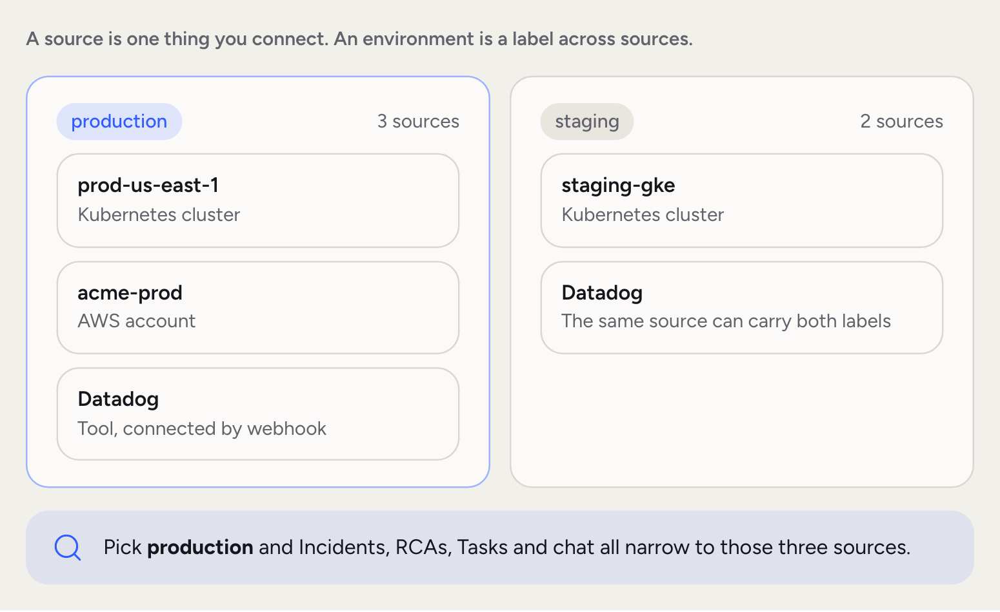
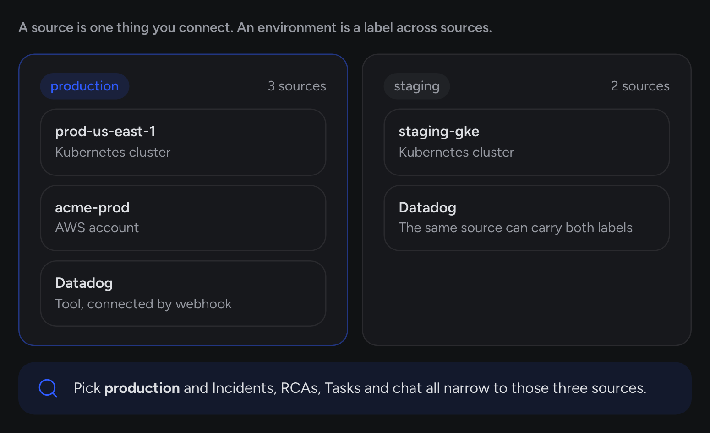
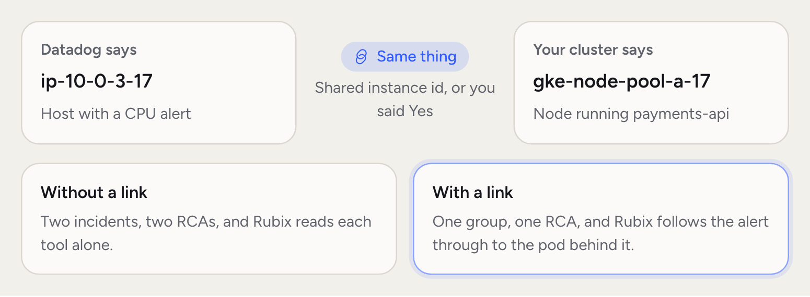
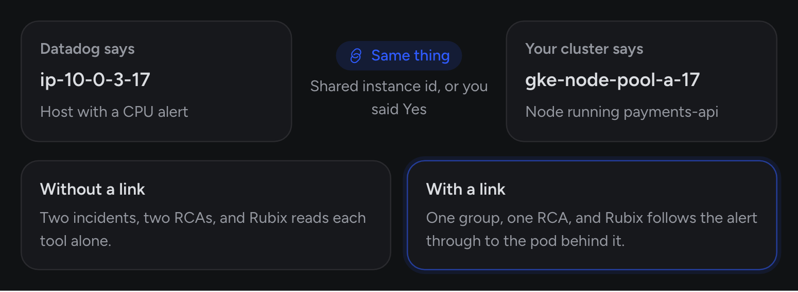

Two words matter on this page. A **source** is one thing you connect: a Kubernetes cluster, a cloud account, a machine or a tool. An **environment** is a label you put on sources, such as `staging` or `production`, so you can work across them.

Say your `production` label covers the `prod-us-east-1` cluster, the AWS account behind it and the Datadog account watching both. That's three sources and one environment. Every part of the product (Chat, Incidents, RCAs, Tasks) respects the environment you pick.

<Frame>
  
  
</Frame>

## What counts as a source

- **Kubernetes cluster.** One EKS, GKE, AKS or self-managed cluster, with an [observer](/concepts/observer-agent) inside it.
- **Cloud account.** One AWS account or Google Cloud project, watched by an observer.
- **Machine.** A Linux or macOS host with an observer installed.
- **Connected tool.** Datadog, PagerDuty, Grafana, Sentry, Jira, Linear, Observe or [your own webhook](/integrations/webhooks).

Connected tools have no observer. You point the tool at a webhook address from **Environments > Connect**, and the source appears when the first message arrives. A built-in automation turns each message into an incident or a recovery.

## Multi-source organizations

An organization is the top-level container. Inside it you can mix sources freely.

A representative setup looks like:

- One `prod-us-east-1` Kubernetes cluster, labelled `production`.
- One `staging-gke` Kubernetes cluster, labelled `staging`.
- One AWS account, labelled `production`.
- One Datadog account that covers both labels.

All four feed the same knowledge graph and the same memory. A chat question like "what changed in `orders-api` in the last hour" spans them. An RCA that starts on a pod can read from the AWS account and Datadog too, because Rubix reads every source it can reach.

## Source properties

Every source carries a small set of things that shape how RubixKube works with it.

| Property | Purpose |
| --- | --- |
| **Name** | Label used across the product. Rename it from the source's menu |
| **Type** | Kubernetes, AWS, Google Cloud, machine or connected tool |
| **Environments** | The labels on this source. Admins add and remove them on its page |
| **Configuration** | Detection rules, timing, ignore lists and privacy. Kubernetes observers have all four |
| **Links** | Which other sources describe the same thing |

Configuration can be set for the organization, for an environment label or for one source. Settings made higher up can be locked, and the source shows where each value came from.

## How it scales

<Steps titleSize="h3">
  <Step title="One source">
    You see the whole product right away. Topology, incidents, chat, RCAs, Tasks.
  </Step>
  <Step title="A few sources">
    Links between them start to pay off. Rubix follows a problem from a Datadog alert to the pod behind it.
  </Step>
  <Step title="Many sources">
    Environment labels keep it tidy. Pick one to see only that part of your estate, and set configuration by label instead of source by source.
  </Step>
</Steps>

## Links between sources

Two sources often describe the same thing. A Datadog host and a Kubernetes node, say. RubixKube finds those links so an incident on one can reach what the other knows.

The **Correlate sources** automation runs on a schedule and when you connect something. Shared ids, such as a node's instance id, confirm a link in code. When only the names match, Rubix asks. You see a question on the source's page, and you answer Yes, No or Skip. Your answer is final.

<Frame>
  
  
</Frame>

Links change what happens to incidents. When sources are linked, a tool's alert joins the observer's group for the same thing, and it waits up to 3 minutes for the observer's incident before starting an RCA of its own. Critical incidents skip that wait.

## Common questions

<AccordionGroup>
  <Accordion title="How many environments can I connect?">
    Individual allows one, Business allows up to three, and Enterprise has no limit. See [Pricing](https://rubixkube.ai/pricing).
  </Accordion>
  <Accordion title="Does correlation across sources work automatically?">
    Partly. Links with shared ids confirm on their own. Links based on names wait for your answer. Rubix can read every source you've connected either way.
  </Accordion>
  <Accordion title="Can I group sources by team or region?">
    Yes. Environment labels are yours to name. An admin creates one from a source's page, and a source can carry several.
  </Accordion>
  <Accordion title="What happens if an observer disconnects?">
    After 5 minutes without a heartbeat the source reads disconnected. After 24 hours it's archived. Its incidents and RCAs stay available, and the observer keeps trying to reconnect. New incidents from it stop until it does.
  </Accordion>
  <Accordion title="Can I delete a source without losing history?">
    No. Deleting a source deletes its history and metrics, and it can't be undone. For a connected tool, its incidents, webhook and automation go too. An observer keeps running until you uninstall it.
  </Accordion>
</AccordionGroup>

## Related concepts

<CardGroup cols={2}>
  <Card title="Observers" icon="eye" href="/concepts/observer-agent">
    What you install to watch a cluster, account or machine.
  </Card>
  <Card title="Environments in the console" icon="server" href="/using/environments">
    How to manage, label and configure sources day to day.
  </Card>
  <Card title="Connect your environment" icon="plug" href="/getting-started/connect-your-environment">
    How to connect your first source.
  </Card>
  <Card title="Integrations" icon="puzzle-piece" href="/integrations/overview">
    Connect the tools you already use.
  </Card>
</CardGroup>
