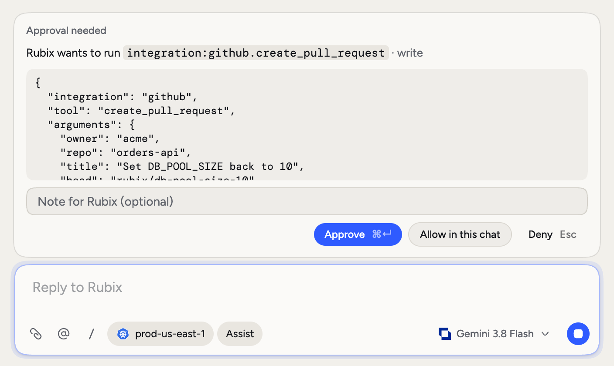
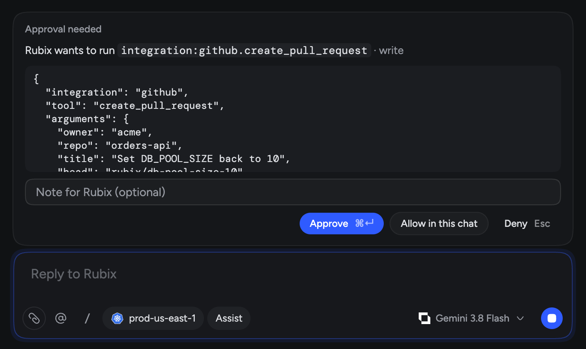
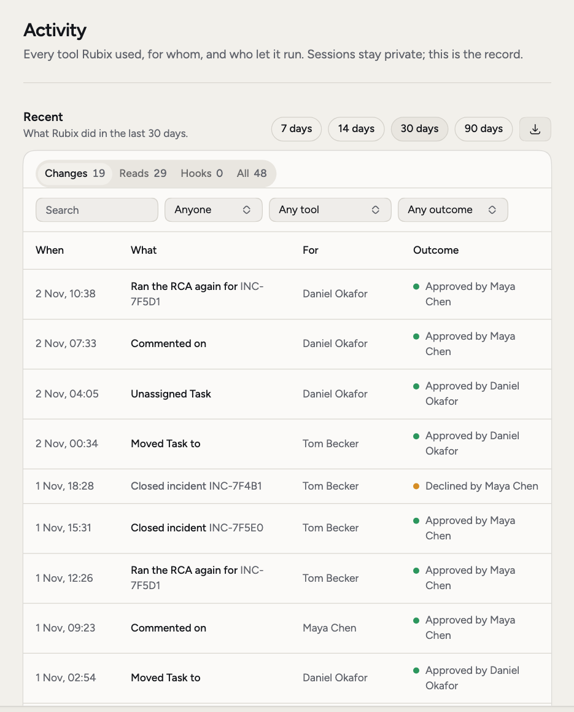
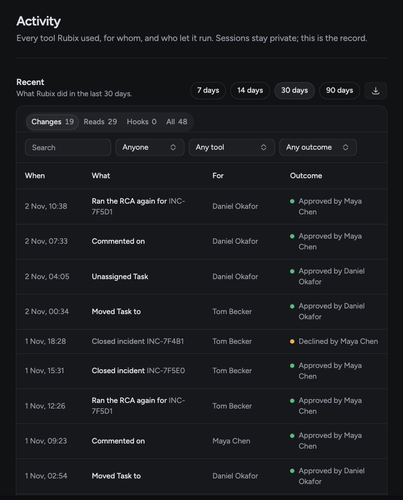

This page tells you what RubixKube can reach, what Rubix can change, and what gets recorded, so you can decide how far to trust it. If your question isn't answered here, email [security@rubixkube.ai](mailto:security@rubixkube.ai).

## What Rubix can do

You choose how much Rubix does on its own. There are three modes.

| Mode | Reads | Changes | Destructive actions |
| --- | --- | --- | --- |
| **Observe** | Runs | Blocked | Blocked |
| **Assist** | Runs | Asks each time | Asks each time |
| **Auto** | Runs | Runs without asking | Asks each time |

New organizations start in Observe, with Assist as the highest mode anyone can use. Admins change both in **Settings > Modes**. People can switch a chat's mode up to that highest mode, never above it. See [Modes](/using/modes).

<Frame>
  
  
</Frame>

<Warning>
  In Auto, Rubix makes changes without asking. Only destructive actions stop for a person. Allow Auto only if you're comfortable with that for everything Rubix can reach.
</Warning>

A few more rules apply in every mode.

- **Allow in this chat.** When Rubix asks, you can approve one tool for the rest of the chat. This never applies to destructive actions, which ask every time.
- **No answer means no.** If nobody answers an approval in time, the change doesn't run.
- **Automations have nobody to ask.** An automation's Rubix step only reads, unless it's set to make changes and your highest mode is Auto. Anything that needs approval is refused. Add an approve step before it if a person should decide.
- **RCAs only read.** An RCA investigation can't change anything. Custom agents in **Customize > Agents** only read too.
- **Hooks.** On Business and Enterprise, a hook in **Customize > Hooks** can check Rubix's tool calls through a URL or a model. It can block a change, or require approval even in Auto.

Rubix judges each tool from the labels on the tool itself. A tool with no labels is judged from a reviewed list of read tools, or for integrations from its name. If you connect a tool whose labels are wrong, Rubix relies on those labels, so review what you connect.

Rubix makes changes through connected tools. If you connect GitHub or GitLab, one of those changes can be a pull request. It's a change like any other for the mode, and the review and merge then happen in your own pipeline.

## What an observer can reach

An observer is the only part of RubixKube that runs in your environment. What it can reach depends on the type.

### Kubernetes

The observer uses a `ServiceAccount` bound to a `ClusterRole`. It doesn't need cluster-admin. It isn't read-only in the Kubernetes sense either, so here's exactly what the role grants.

| Access | Resources | What the manifest says it's for |
| --- | --- | --- |
| `get`, `list`, `watch` | Pods, services, endpoints, nodes, namespaces, events, ConfigMaps, **Secrets**, persistent volumes and claims, service accounts | Monitoring |
| `get`, `list`, `watch` | Deployments, replicasets, daemonsets, statefulsets, ingresses, network policies, jobs, cronjobs, autoscalers, storage classes, volume attachments | Monitoring |
| `get`, `list`, `watch` | Roles, role bindings, cluster roles, cluster role bindings | Read-only security analysis |
| `get`, `list`, `watch` | Custom resource definitions | Monitoring |
| `get`, `list` | Pod and node metrics | Metrics, if metrics-server is available |
| `get`, `list` | `pods/log` | On-demand log collection |
| **`create`** | **`pods/exec`** | Advanced troubleshooting when needed |
| `create`, `patch` | Events | Alerts about configuration failures |

It also gets a role in its own namespace to manage Leases, for choosing a leader and listing running observer pods.

So its service account can read every Secret in the cluster and can open an exec session in any pod. Here's what the observer's code does with that today.

- **Secrets.** It watches Secrets by metadata only, so their content doesn't reach it for change tracking. Its built-in Kubernetes tools return a Secret's key names and never its values.
- **Exec.** Its built-in tools don't use `pods/exec`.
- **Its own tools only read.** Rubix reaches the cluster through those tools. If you add your own MCP servers through the `mcp-config` ConfigMap, what those do is up to you.

The pod runs as a non-root user, with a read-only root filesystem, no added Linux capabilities and no privilege escalation.

#### Review and trim the manifest

The install command applies a manifest from a URL. You can download it and read it first.

```bash
curl -o observer.yaml "https://api.rubixkube.ai/install/observer.yaml?apiKey=YOUR_API_KEY"
kubectl apply -f observer.yaml
```

The file is plain Kubernetes YAML, so you can edit it before you apply it. Two trims are safe.

- Remove the `pods/exec` rule. The built-in tools don't use it.
- Remove `secrets` from the first rule. The observer then logs a line and skips Secret change tracking, and everything else keeps working.

Keep the rules for pods, nodes, deployments, services and replicasets, because detection depends on them.

<Warning>
  The file holds your API key in a Kubernetes `Secret`, so treat it as a credential. Keep your edited copy too. Applying a fresh manifest from the URL puts every rule back.
</Warning>

### Cloud accounts

The install script sets up read access.

- **AWS.** It shows a minimal IAM policy with only describe, get, list and similar read actions. You can use the `ReadOnlyAccess` managed policy instead.
- **Google Cloud.** It creates a service account with viewer roles, such as `compute.viewer`, `monitoring.viewer` and `logging.viewer`.

### Machines

The installer needs root, and the observer runs as a root service on the host. Rubix can ask it to run shell commands for diagnosis. The observer checks each command against its list of allowed commands and blocked patterns. Treat it like any other service running as root on that machine.

## Network

Nothing outside your network connects in to an observer. It opens two outbound connections.

| Endpoint | Purpose | Connection |
| --- | --- | --- |
| `api.rubixkube.ai:443` | Registration, heartbeats, settings | HTTPS, outbound |
| `nats.rubixkube.ai:4222` | Incidents, topology, requests from Rubix | Authenticated connection, outbound only |

With several replicas, Kubernetes observer pods also talk to each other on port 8090 inside their namespace.

Browser and API traffic uses HTTPS.

## Hide sensitive values

The Kubernetes observer replaces sensitive values in your cluster, before logs or tool results reach RubixKube. It's on by default. `jane@example.com` is sent as `<email:3f9a1c>`, and the same value always gets the same tag.

Open the source, then **Configuration > Privacy**. You can see what's hidden (keys, tokens, passwords, emails, cards, public IPs), turn each kind on or off, and add patterns of your own. If you turn it off, credentials and personal data in logs are sent as they are.

This works by matching patterns, so a value in an unusual format can get through. **Configuration > Ignore** stops problems being raised for a namespace or workload, and it doesn't hide those pods from the topology.

## What RubixKube stores, and where

RubixKube stores the following for your organization.

- Incidents and their evidence, which can include log lines and tool results.
- RCAs, Tasks, comments and chats.
- Topology, inventory and metrics from your sources.

Logs can contain whatever your applications write, so assume some application data reaches RubixKube unless your privacy rules hide it.

Data is stored in Google Cloud `us-central1`. RubixKube runs as a hosted service, so an observer needs to reach the two endpoints above. There's no air-gapped option.

By default Rubix runs on Google's Gemini models through Vertex AI. What Rubix reads, including evidence and tool results, goes to the model. On Business and Enterprise, you can add your own provider in **Settings > Models**, and then that provider receives it. See [Models](/using/models).

## Your organization

Each record belongs to one organization. Members have one of two roles, admin or user. Admins control modes, members and sources.

Deleting a source deletes its history and metrics. Deactivating an organization deletes nothing. To ask about deleting your organization's data, email [security@rubixkube.ai](mailto:security@rubixkube.ai).

## Rubix can be wrong

An RCA is an investigation by a model, so treat it as a strong lead. Some checks help you judge it.

- **Evidence.** Each finding cites the tool result behind it, and code checks that quotes match what the tools returned.
- **Verdicts.** The report says whether the cause was found, is probable, or wasn't determined.
- **Confidence.** Code caps it at 0.95, and holds it at 0.5 when the cause isn't settled or the claims aren't cited.
- **Your rating.** Answer **Was this the cause?** on the RCA. Rubix reads it next time.

See [Root cause analysis](/concepts/root-cause-analysis).

## What's on the record

**Settings > Activity** lists Rubix's tool calls, and admins can open it. Each row shows what ran, on what, for whom, the outcome (Ran, Blocked, Needed approval or Failed) and who or what decided. Filter by Changes, Reads or Hooks, and export as CSV or JSON.

<Frame>
  
  
</Frame>

Incidents and Tasks keep their own history next to their comments: who changed what, and when, with Rubix and automations named as well as people.

## Certifications and questionnaires

For certifications, compliance questions or a security questionnaire, email [security@rubixkube.ai](mailto:security@rubixkube.ai). Our [security policy](https://github.com/rubixkube-io/docs/blob/main/SECURITY.md) explains how to report a vulnerability. Check live status on [System status](/support/system-status).

## Common questions

<AccordionGroup>
  <Accordion title="Does Rubix ever change things without a person?">
    Yes, if you allow it. In Auto, Rubix makes changes without asking, and destructive actions still ask. An automation can make changes when it's set to and your highest mode is Auto. In Observe, and by default, Rubix makes no changes.
  </Accordion>
  <Accordion title="Is the observer read-only?">
    Its built-in tools only read. Its Kubernetes permissions are wider: it can read Secrets, create `pods/exec`, and create and patch events. On a machine it runs as root. The sections above have the details.
  </Accordion>
  <Accordion title="Can I run RubixKube in an air-gapped environment?">
    No. Observers need outbound access to `api.rubixkube.ai:443` and `nats.rubixkube.ai:4222`. Private networks work as long as those two endpoints are reachable.
  </Accordion>
  <Accordion title="Where is my data stored?">
    In Google Cloud `us-central1`.
  </Accordion>
  <Accordion title="Is there a way to limit what the observer sees?">
    On Kubernetes, yes. Trim the manifest, use **Configuration > Privacy** to hide values, and use **Configuration > Ignore** to stop incidents for a namespace or workload.
  </Accordion>
</AccordionGroup>

## Related concepts

<CardGroup cols={2}>
  <Card title="Modes" icon="sliders" href="/using/modes">
    Set what Rubix can do.
  </Card>
  <Card title="Observers" icon="eye" href="/concepts/observer-agent">
    What runs in your environment.
  </Card>
  <Card title="Root cause analysis" icon="magnifying-glass" href="/concepts/root-cause-analysis">
    How evidence works end to end.
  </Card>
  <Card title="Activity" icon="clock-rotate-left" href="/using/settings">
    Where Rubix's tool calls are recorded.
  </Card>
</CardGroup>
