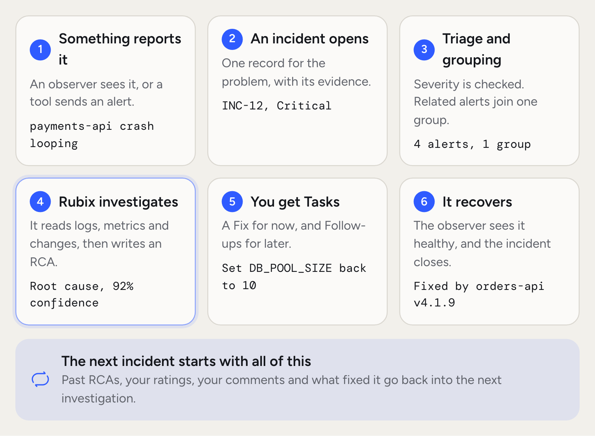
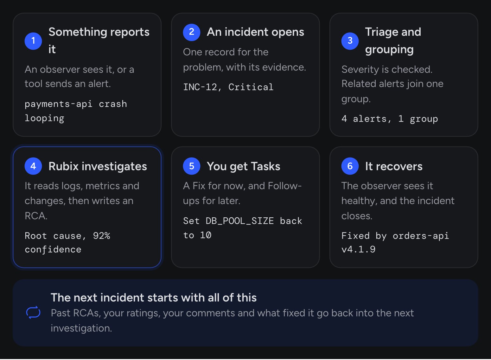

RubixKube helps your team run infrastructure with an agent. Observers and connected tools report what breaks. RubixKube turns that into incidents, and **Rubix**, the agent, investigates them.

This page is the five-minute tour of how the pieces fit. Each piece has its own page, linked as you go.

<Frame>
  
  
</Frame>

## The short version

Here's the loop, using an ordinary example. A new `orders-api` version raises its database pool. Connections to `orders-db` run out, and `payments-api` starts crash-looping.

<Steps titleSize="h3">
  <Step title="Something reports what broke">
    The [observer](/concepts/observer-agent) in `prod-us-east-1` sees the crash loop. If you connected Datadog, PagerDuty or another tool, its alerts arrive by webhook as well.
  </Step>
  <Step title="RubixKube opens an incident">
    Each report becomes an [incident](/concepts/incidents), or counts as another sighting of one that's already open.
  </Step>
  <Step title="It's triaged and grouped">
    Triage sets the severity and decides what happens next. Incidents with the same cause or on the same resource join one group, so you get one investigation instead of five.
  </Step>
  <Step title="Rubix investigates">
    Rubix reads logs, metrics, recent changes and past incidents, then writes a [root cause analysis](/concepts/root-cause-analysis). Every finding cites the evidence behind it, and the RCA says so when it can't settle the cause.
  </Step>
  <Step title="Rubix suggests Tasks">
    The RCA suggests [Tasks](/concepts/tasks): a Fix for now, such as setting `DB_POOL_SIZE` back to 10, and Follow-ups so it doesn't happen again.
  </Step>
  <Step title="You decide how much Rubix does">
    You pick how much Rubix does on its own. In [Observe](/using/modes) it reads. In Assist it asks before every change. In Auto it changes things without asking, and destructive actions still ask.
  </Step>
  <Step title="It's remembered">
    The observer sees the recovery, and RubixKube records what fixed it. The next RCA on the same thing starts with that history, including how your team rated it.
  </Step>
</Steps>

## Why it's a loop

Most tools see your infrastructure for the first time every time you log in. Dashboards don't remember, and every incident starts from scratch.

RubixKube keeps what it learns. Your team's comments, your answers to "What fixed it?" and your ratings on RCAs are all stored in [RubixKube's memory](/concepts/memory-engine), so the next incident starts with more context than the last one did.

## What you see, and when

<Steps titleSize="h3">
  <Step title="When you connect a source">
    The observer reports what's running. The [knowledge graph](/concepts/knowledge-graph) fills with your services, nodes and how they connect, and the source's page shows it.
  </Step>
  <Step title="When something breaks">
    An incident appears, and the incident page shows when the RCA will start and how far along it is. Critical incidents start right away. Lower severities wait a few minutes in case the problem clears by itself.
  </Step>
  <Step title="After a few incidents">
    Past RCAs come up in new investigations. Rubix treats a past cause as a lead to test, and the new report says whether it held.
  </Step>
  <Step title="Ongoing">
    Every answer you give feeds the next run. A problem that keeps coming back is marked Recurring, and Rubix asks you to decide instead of investigating it again and again.
  </Step>
</Steps>

## Where each piece fits

Only the observer runs near your workload. Everything else runs in RubixKube, and you never install, upgrade or patch it.

| Piece | What it does | Where it runs |
| --- | --- | --- |
| [Observers](/concepts/observer-agent) | Watch a cluster, cloud account or machine and report what breaks | In your environment |
| [Connected tools](/integrations/overview) | Send alerts by webhook, and give Rubix more to read | Your existing tools |
| [Memory](/concepts/memory-engine) | Keeps incidents, RCAs, Tasks and what your team said | RubixKube |
| [Knowledge graph](/concepts/knowledge-graph) | Connects your resources, incidents, changes and RCAs | RubixKube |
| [Rubix](/using/rubix-chat-agent) | Investigates, answers in chat, and uses [skills](/concepts/skills) and tools | RubixKube |
| [Automations](/using/automations) | Run triage, grouping, RCAs and the steps you build | RubixKube |

Rubix is one agent, and you can add your own read-only specialists in **Customize > Agents**. Rubix hands them focused questions. [Custom integrations](/tutorials/add-custom-integrations) add tools Rubix can use.

## Where you start

<CardGroup cols={2}>
  <Card title="Incidents" icon="triangle-exclamation" href="/concepts/incidents">
    Read next if you want to know what happens to each report.
  </Card>
  <Card title="Quickstart" icon="rocket" href="/getting-started/quickstart">
    Read next if you want to see it running against a real environment.
  </Card>
  <Card title="Safety and control" icon="shield-halved" href="/concepts/guardrails">
    Read next if you want to know what Rubix can reach and change.
  </Card>
</CardGroup>

## Common questions

<AccordionGroup>
  <Accordion title="Is this another monitoring tool?">
    No. Monitoring tells you something is wrong. RubixKube looks into what's wrong and why, and suggests what to do about it. Every RCA cites the evidence it came from, and Rubix can be wrong, so you can check it and rate it.
  </Accordion>
  <Accordion title="Does RubixKube replace Prometheus, Datadog, or similar?">
    It doesn't have to. Those systems stay in place. Connect them and their alerts become incidents next to what your observers report. See [Integrations](/integrations/overview).
  </Accordion>
  <Accordion title="What can I connect?">
    Kubernetes clusters (EKS, GKE, AKS, self-managed), AWS accounts, Google Cloud projects, Linux and macOS machines, and tools such as Datadog, PagerDuty, Grafana, Sentry, Jira, Linear and Observe. Any other tool can use [your own webhook](/integrations/webhooks).
  </Accordion>
  <Accordion title="Can two incidents overlap?">
    Yes. Related ones join a group and share one RCA. Unrelated ones each get their own, and each RCA can read the same knowledge graph.
  </Accordion>
  <Accordion title="How is my data handled?">
    Each record belongs to one organization. [Safety and control](/concepts/guardrails) lists what's collected, where it's stored and what's recorded.
  </Accordion>
</AccordionGroup>
