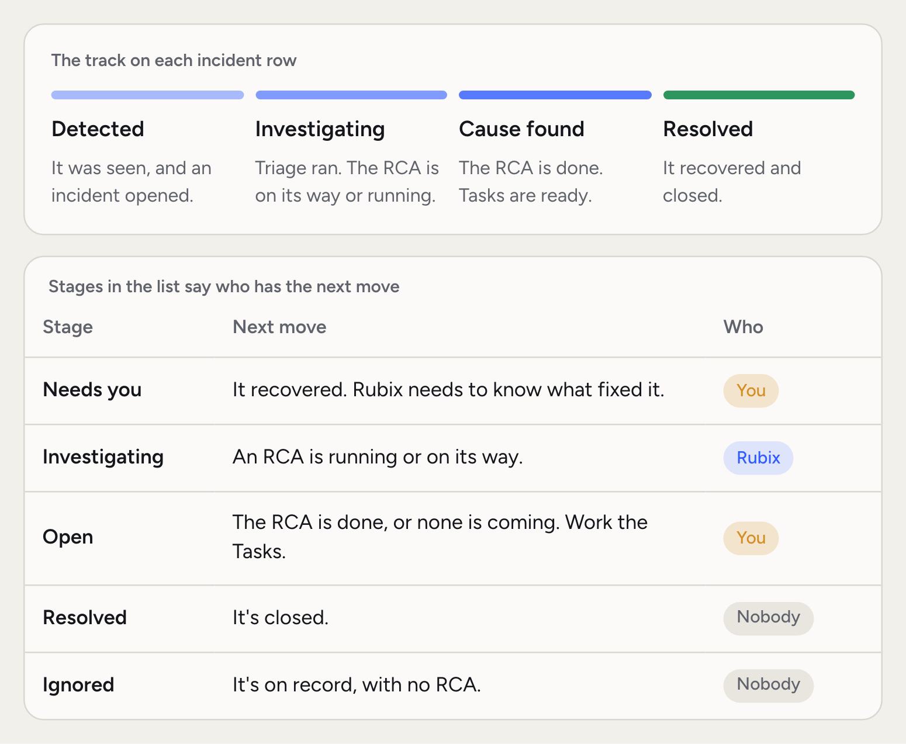
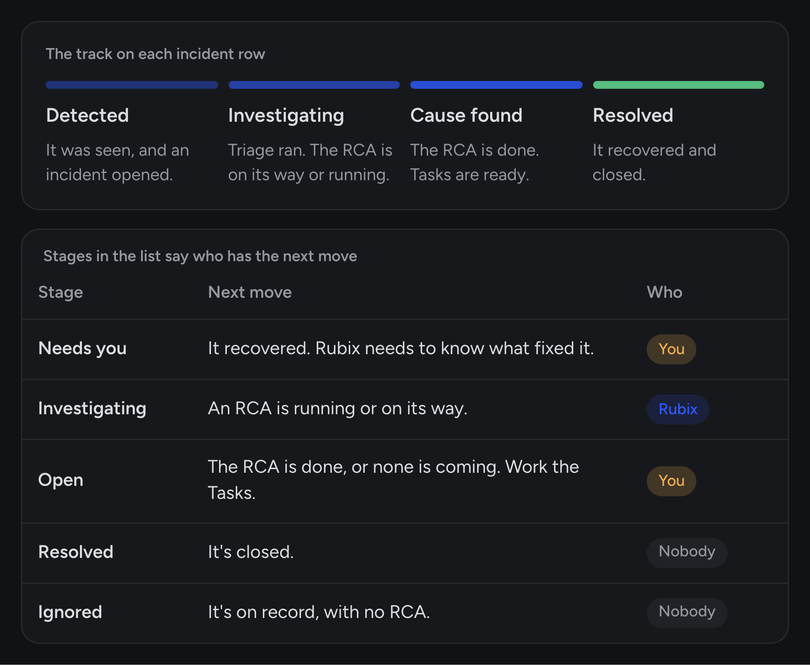
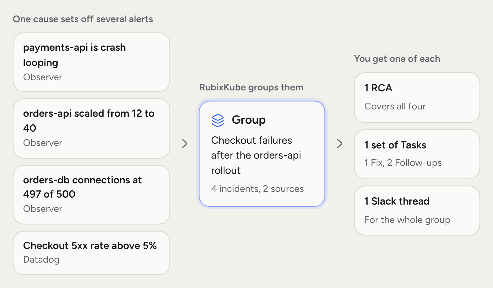
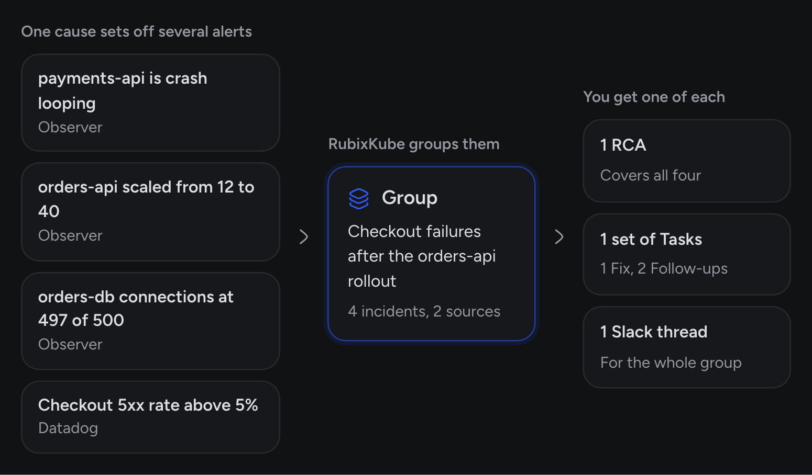

An incident is RubixKube's answer to the question "what should I look at right now?" It's something that broke, shown with the evidence behind it and the resources it affects.

Incidents come from three places. An observer rule fires, a connected tool sends an alert by webhook, or someone on your team reports one. All three look the same once they arrive, and all three go through the same steps.

<Frame>
  
  
</Frame>

## What makes an incident

- **Where it came from.** An observer, a connected tool, a person or an agent. The incident says which.
- **Severity.** Low, Medium, High or Critical.
- **Evidence.** What the observer or tool sent: the event, logs and recent changes it saw.
- **Scope.** An incident names the affected resource and the source it lives on.
- **A short code.** INC-12, unique in your organization. Use it in chat, or with any tool that takes an incident.

## How incidents differ from alerts

| Aspect | An alert from one tool | A RubixKube incident |
| --- | --- | --- |
| Trigger | One rule in one tool | An observer rule, an alert from any connected tool, or a person |
| Repeats | Fires again | Counts as another sighting of the open incident |
| Related problems | One alert each | Join one group, with one RCA |
| Context | What that tool knows | Evidence from every source Rubix can read |
| Follow-through | Requires a human to correlate | An RCA starts on its own and suggests Tasks |

## The incident lifecycle

<Steps titleSize="h3">
  <Step title="Detected">
    A rule fires or an alert arrives. The incident opens and subscribers get notified on the channels you set in [Notifications](/using/notifications).
  </Step>
  <Step title="Triaged and grouped">
    Triage can change the severity and impact, hold the RCA, or mark the alert as known. Related incidents join a group.
  </Step>
  <Step title="Investigated">
    After a short wait by severity, Rubix writes an [RCA](/concepts/root-cause-analysis). The incident page shows when it will start and how far along it is.
  </Step>
  <Step title="Worked">
    The RCA suggests [Tasks](/concepts/tasks). Your team picks them up, or asks Rubix for help in chat.
  </Step>
  <Step title="Recovered and closed">
    Recovery has its own section below. An incident stays open until someone closes it, unless your organization turned on auto-close.
  </Step>
</Steps>

In the list, each incident sits under **Needs you**, **Investigating**, **Open**, **Resolved** or **Ignored**. Needs you means it recovered and RubixKube is asking what fixed it.

## Groups

When one cause breaks several things, you don't want several investigations. Incidents join a group when they're on the same resource, or share a cause, within 30 minutes on one source. The list shows it as one row marked **Group**, with a stack icon.

<Frame>
  
  
</Frame>

A group has one RCA for all its members. In our example, `payments-api` crash-looping and a Datadog alert on `orders-db` end up together, if the Datadog source and the cluster are [linked](/concepts/environments#links-between-sources).

The **Classify incidents** automation handles bursts. When many incidents arrive at once from one source, it folds them into one group. If a member breaks again after its group's Fix, it leaves the group and gets looked at on its own.

## Recovery

Observers keep checking every open incident. Connected tools send their own recovery messages, and those resolve the incident.

<Steps titleSize="h3">
  <Step title="The observer sees it healthy">
    It checks every minute. A first healthy reading shows the incident as **Verifying**, and any RCA that hasn't started waits to see if the recovery holds.
  </Step>
  <Step title="It stays healthy">
    After 10 minutes healthy, the observer reports the recovery and the changes it saw. RubixKube records why: fixed by a change, recovered on its own, or the resource was removed.
  </Step>
  <Step title="Someone confirms, if needed">
    When the reason isn't clear, the incident moves to Needs you and asks **What fixed it?**. Your answer is kept for next time.
  </Step>
  <Step title="It closes">
    Turn on **Close incidents when they recover** in **Settings > Incidents** to close recovered incidents on their own. It's off by default.
  </Step>
</Steps>

If a closed incident comes back, RubixKube opens a new incident linked to the old one. A problem that keeps coming back and has already had 3 RCAs in 7 days is marked **Recurring**. Rubix stops investigating it and asks you to snooze it, ignore it or run the RCA again. You can change these numbers in **Settings > Incidents**.

## Severity, and how it is set

Severity starts with whoever reported the problem, and triage can change it.

<AccordionGroup>
  <Accordion title="The rule or the alert" icon="bell">
    An observer rule has its own severity. A connected tool's handler maps the tool's priority to ours. A Datadog Warn opens one severity lower than an Alert.
  </Accordion>
  <Accordion title="Triage" icon="filter">
    The **Triage incident** automation reads the incident and can raise or lower the severity and set the impact.
  </Accordion>
  <Accordion title="What severity changes" icon="clock">
    It decides how long the RCA waits. Critical starts right away, High waits 2 minutes, Medium 5, Low 10. You can change these waits in **Settings > Incidents**.
  </Accordion>
</AccordionGroup>

## What to do with an incident

- **Read.** Open it. Skim the evidence, the affected resources and the RCA when it lands.
- **Investigate.** Click **Ask Rubix** to ask questions. The chat starts with the incident in view.
- **Route.** Assign a Task to a teammate, or leave a comment and mention them. Mention @Rubix in a comment to bring Rubix in.
- **Close or ignore.** Close it when it's done. If it's expected, **Ignore** keeps that exact problem on record without an RCA.

## Common questions

<AccordionGroup>
  <Accordion title="Why did I not get an incident for this?">
    Usually one of four reasons. No rule matched. The problem cleared during the observer's hold. Its namespace or workload is on the source's ignore list. Or it counted as another sighting of an open incident on the same resource.
  </Accordion>
  <Accordion title="Can I turn incidents off for a resource?">
    Yes, on Kubernetes. Open the source, then **Configuration > Ignore**, and add namespaces or workloads. Problems there don't raise incidents, and their pods stay in the topology.
  </Accordion>
  <Accordion title="How fast is detection?">
    An observer holds a new problem for at least 30 seconds, so things that fix themselves don't flood the list. By default it reports after 3 checks or 5 minutes, and some rules wait longer, such as 2 minutes for a pending pod. You can change the timing in **Configuration > Timing**.
  </Accordion>
  <Accordion title="Does every incident get an RCA?">
    No. A group shares one RCA. An incident that recovers before its RCA starts doesn't get one, and neither does one triage marks as known or one that's Recurring. You can start one yourself with **Run the RCA again**. An RCA that can't settle the cause is still published, and it says so.
  </Accordion>
</AccordionGroup>

## Related concepts

<CardGroup cols={2}>
  <Card title="Root cause analysis" icon="magnifying-glass" href="/concepts/root-cause-analysis">
    How an incident becomes a report with cited evidence.
  </Card>
  <Card title="Incidents in the console" icon="triangle-exclamation" href="/using/incidents">
    The page where you work with incidents.
  </Card>
</CardGroup>
