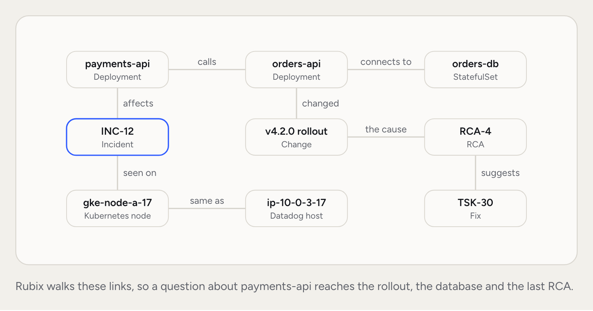
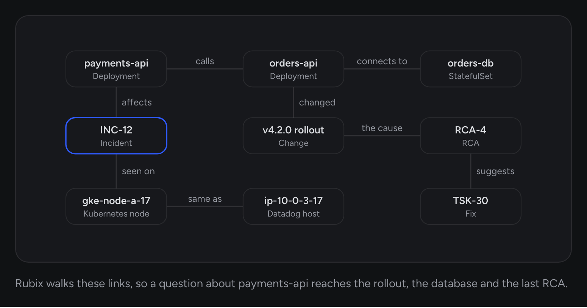

The knowledge graph is what RubixKube knows about your systems. It holds the resources across every source you connect, the relationships between them, and the incidents, RCAs and Tasks they've been part of. Rubix reads it during chats and RCAs.

Because it's a graph, you can ask questions that cross boundaries: a Kubernetes pod talking to an RDS instance, or a VM behind a load balancer. Those questions get answered because the things are linked.

<Frame>
  
  
</Frame>

## What lives in the graph

- **Resources.** Pods, deployments, services, EC2 instances, nodes, and everything in between.
- **Relationships.** Manages, hosts, routes-to, runs-on. Each comes from what an observer sees.
- **Incidents and RCAs.** Each incident, the RCA that explains it, and the resources they affect.
- **Tasks.** What was suggested, tied to its incident and RCA.
- **Changes.** The changes credited with fixing a problem, tied to the resource they touched.
- **Links.** Which things in different sources are the same thing.
- **Reads.** What each connected tool can read, so an RCA knows where to look.

## How the graph stays current

<Steps titleSize="h3">
  <Step title="Topology arrives from observers">
    Each observer sends its full topology, then the changes. Resources that disappear from the topology fall out of the graph.
  </Step>
  <Step title="Events add history">
    Incidents, RCAs, Tasks and recoveries each add to the graph as they happen.
  </Step>
  <Step title="Links join sources">
    When two sources describe the same thing, a [link](/concepts/environments#links-between-sources) connects them in the graph.
  </Step>
</Steps>

## Why a graph and not a table

Three kinds of question that tables struggle with.

<AccordionGroup>
  <Accordion title="What's connected" icon="share-nodes">
    "What sits next to `orders-db`?" Answered by walking the relationships from that resource.
  </Accordion>
  <Accordion title="Across sources" icon="shuffle">
    "Is this Datadog host the node `payments-api` runs on?" Answered through a link between the two sources.
  </Accordion>
  <Accordion title="Past incidents" icon="timeline">
    "What has broken around `orders-api` before?" Answered by walking from the resource to its incidents and RCAs.
  </Accordion>
</AccordionGroup>

## What you can do with the graph directly

The graph powers the product, and you can ask it questions yourself.

- **Chat.** Ask in plain language. Rubix searches the graph.
- **The source's page.** Environments shows what's running on each source and what each thing connects to.
- **Your AI tools.** The [MCP server](/integrations/mcp) offers `search_knowledge`, `ask_knowledge`, `similar_incidents` and `what_changed`.

## Privacy and scope

The graph is scoped to your organization. Every node belongs to one organization. See [Safety and control](/concepts/guardrails).

## Common questions

<AccordionGroup>
  <Accordion title="Is the graph a CMDB?">
    The resource part overlaps with what a CMDB holds. The graph also links resources to incidents and RCAs, and observers keep it up to date, so nobody has to.
  </Accordion>
  <Accordion title="Can I see the whole graph as one picture?">
    Not as one picture. Each source's page shows its own resources and connections, and Rubix reads across all of them.
  </Accordion>
  <Accordion title="How does RubixKube handle multi-region and multi-account setups?">
    Each cluster or cloud account you connect is its own source. Links join them where they share ids, or where you confirm a match.
  </Accordion>
</AccordionGroup>

## Related concepts

<CardGroup cols={2}>
  <Card title="Observers" icon="eye" href="/concepts/observer-agent">
    What keeps the graph current.
  </Card>
  <Card title="RubixKube's memory" icon="database" href="/concepts/memory-engine">
    The history that sits alongside the live graph.
  </Card>
  <Card title="Sources and environments" icon="server" href="/concepts/environments">
    What feeds the graph, and how sources link up.
  </Card>
</CardGroup>
