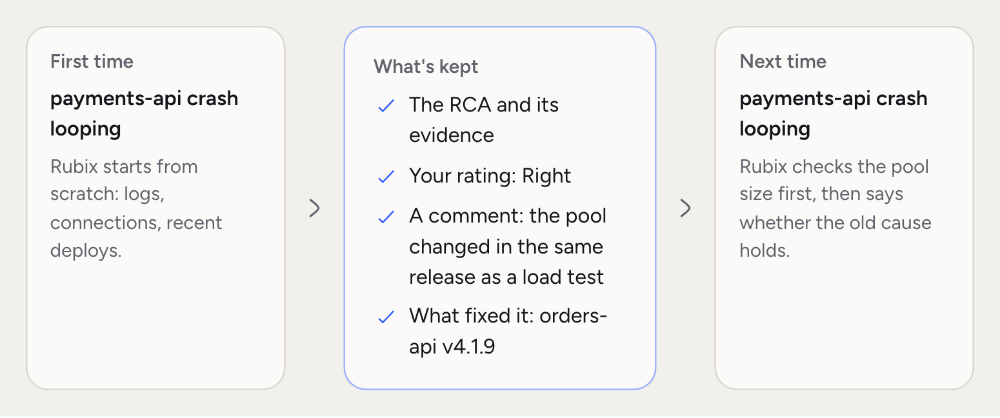
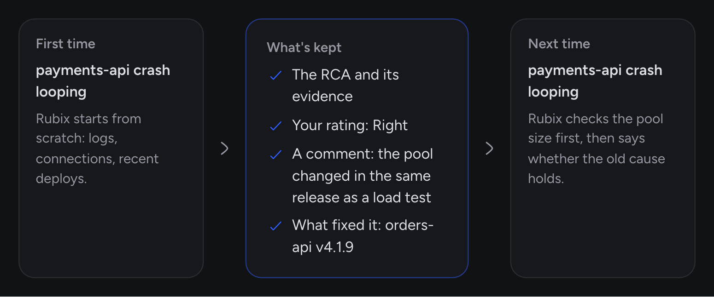

Most infrastructure tools see your stack for the first time every time you log in. RubixKube remembers. Its memory turns each incident into something your team and Rubix can use next time.

It belongs to your organization, and the more incidents you work through, the more it has to offer.

## What the memory stores

- **Incidents.** What broke, the evidence, the history of who did what.
- **RCAs.** Every report, with its verdict and citations.
- **Tasks and outcomes.** What was suggested, what was done, and whether a Fix held.
- **Your team's words.** Comments on incidents, plus answers to "What fixed it?".
- **Ratings.** Whether people said an RCA was Right, Partly right or Wrong, and what the cause really was.
- **Topology.** What's running on each source, and what changed.

## How memory helps the next incident

Every incident adds to what Rubix starts with next time.

<Frame>
  
  
</Frame>

<Steps titleSize="h3">
  <Step title="Past RCAs become leads">
    When a problem shows up again, the RCA starts with past RCAs on the same thing and how they were rated. Rubix tests each past cause against live data and says whether it held.
  </Step>
  <Step title="Your ratings count">
    A past RCA rated Wrong sends the next investigation to a deeper run. What you said it really was goes with it. Triage can use trusted past RCAs to mark an expected problem as known, so no RCA runs.
  </Step>
  <Step title="Context survives staff turnover">
    What the team knows gets written down instead of staying in one engineer's head. When they move on, the context stays.
  </Step>
</Steps>

## A concrete example

`payments-api` starts crash-looping. The first time, Rubix works through it from scratch: the logs, `orders-db` connections, recent deploys. It finds that a new `orders-api` version raised its database pool. The Fix is setting `DB_POOL_SIZE` back to 10, and someone comments that the pool setting changed in the same release as a load test.

Weeks later the same thing happens. The new RCA starts with the old one, its rating and that comment. Rubix checks the current pool size first, because that's what the last RCA points to, and says whether the old cause holds this time.

## Privacy and scope

<AccordionGroup>
  <Accordion title="Your memory is yours" icon="lock">
    Each record belongs to one organization. RCAs read your organization's history, and nothing else. See [Safety and control](/concepts/guardrails).
  </Accordion>
  <Accordion title="Sensitive content" icon="eye-slash">
    On Kubernetes, the observer hides passwords, tokens, emails and similar values before logs or tool results leave your cluster. Change what's hidden in **Configuration > Privacy** on the source's page.
  </Accordion>
  <Accordion title="Export" icon="file-export">
    Each RCA exports as Markdown from its menu. Admins can export Rubix's activity as CSV or JSON from **Settings > Activity**.
  </Accordion>
  <Accordion title="Deleting a source" icon="trash">
    Deleting a source deletes its history and metrics, and it can't be undone.
  </Accordion>
</AccordionGroup>

## How to get the most out of memory

Small habits make the memory far more useful.

- **Comment on the incident.** One or two sentences on what worked and why, plus anything a newcomer wouldn't know. Rubix reads comments.
- **Rate the RCA.** Answer **Was this the cause?**. If it's wrong, say what it really was.
- **Answer "What fixed it?".** It takes a moment, and it's how RubixKube credits the right change.
- **Teach it your runbooks.** Write them down as [skills](/concepts/skills), and Rubix loads them when they fit the problem.

## Common questions

<AccordionGroup>
  <Accordion title="Can I query the memory directly?">
    Yes, through Chat. Questions like "have we seen this before" or "what did we do last time" work well. Your AI tools can ask the same through the [MCP server](/integrations/mcp).
  </Accordion>
  <Accordion title="What about infrastructure that no longer exists?">
    Removed resources fall out of the live [knowledge graph](/concepts/knowledge-graph). Past RCAs still name them, so you can read an old incident as it was. Deleting the source is different, because that deletes its history.
  </Accordion>
  <Accordion title="Does memory help across sources?">
    Yes, inside your organization. Rubix can search all your past incidents and RCAs, and links between sources tie them together.
  </Accordion>
</AccordionGroup>

## Related concepts

<CardGroup cols={2}>
  <Card title="Knowledge graph" icon="diagram-project" href="/concepts/knowledge-graph">
    The live model of your stack, next to the memory.
  </Card>
  <Card title="Root cause analysis" icon="magnifying-glass" href="/concepts/root-cause-analysis">
    How RCAs use what the memory holds.
  </Card>
</CardGroup>
