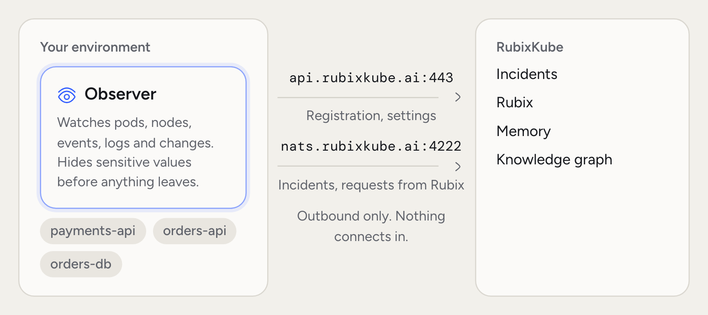
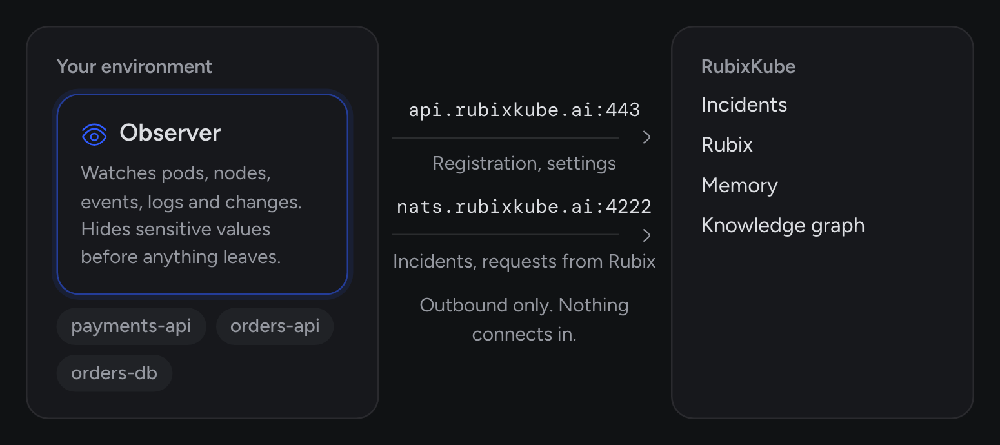

An observer is the only part of RubixKube that runs near your workload. Everything else lives in RubixKube and works from what the observer sends.

There's one kind for Kubernetes and one for machines and cloud accounts. Each discovers what's running, reports what breaks, and answers Rubix when it needs to look closer. Tools such as Datadog don't need an observer. They [connect by webhook](/integrations/overview).

<Frame>
  
  
</Frame>

## What an observer does

- **Discovers topology.** It builds a map of services, nodes and how they connect, and sends the changes.
- **Reports incidents.** Its rules decide what's broken, and it sends each [incident](/concepts/incidents) with its evidence.
- **Checks recovery.** Every minute it checks whether open incidents have become healthy.
- **Answers Rubix.** During a chat or an RCA, Rubix asks it for logs, metrics and resources.
- **Hides sensitive values.** The Kubernetes observer replaces passwords, tokens and similar values before logs or tool results leave your cluster.

The Kubernetes observer's own tools only read. Its permissions go further than that, and [Safety and control](/concepts/guardrails) lists them.

## Where it runs, and how small

| Source | Install shape | Footprint |
| --- | --- | --- |
| Kubernetes | `kubectl apply` manifest into the `rubixkube-system` namespace | Requests 256Mi memory and 250m CPU. Limits 768Mi and 1 CPU. Sized for clusters up to about 50 nodes |
| AWS, Google Cloud | Install script | Runs as a service or a container, watching the account |
| Linux or macOS machine | Install script | Runs as a service on the host |

Above about 50 nodes, raise the memory limit or run more replicas. The source's page says which.

## What an observer sees

Each source type has a different set of signals, but the shape is consistent.

<AccordionGroup>
  <Accordion title="Kubernetes" icon="dharmachakra">
    - Pods, nodes, deployments, services and replicasets, watched live.
    - Changes to deployments, statefulsets, daemonsets, nodes, services and autoscalers.
    - Changes to ConfigMaps and Secrets, by name only. The observer doesn't see what changed inside them.
    - Logs and metrics, read when Rubix asks.
    - Service error rates and latency, where the metrics exist.
  </Accordion>
  <Accordion title="AWS" icon="aws">
    - EC2, EBS, load balancers, Lambda and RDS.
    - CloudWatch alarms and logs.
    - CloudTrail write events.
  </Accordion>
  <Accordion title="Google Cloud" icon="google">
    - Compute Engine.
    - Cloud Logging.
    - Audit logs.
  </Accordion>
  <Accordion title="Linux or macOS machine" icon="server">
    - CPU, memory and disk.
    - Systemd services and restarts.
    - Process crashes and OOM kills.
    - Journald and syslog.
  </Accordion>
</AccordionGroup>

## How an observer decides what to report

Not everything that looks wrong is worth an incident. On Kubernetes, three things decide, and you can change each in **Configuration** on the source's page.

<Steps titleSize="h3">
  <Step title="Rules">
    A rule says what counts as broken: a crash loop, an OOM kill, a pod that won't start or can't be placed, a high error rate, slow responses, or memory growing towards its limit. Turn rules on or off in the **Detection** tab.
  </Step>
  <Step title="Hold">
    A new problem waits at least 30 seconds. By default it's reported after 3 checks or 5 minutes, whichever comes first. A shorter hold floods the list with things that fix themselves. Change it in the **Timing** tab.
  </Step>
  <Step title="Ignore lists">
    Problems in the namespaces and workloads you list aren't raised. Their pods stay in the topology. Change them in the **Ignore** tab.
  </Step>
</Steps>

## Outbound network requirements

An observer needs two outbound endpoints.

- `api.rubixkube.ai:443` (HTTPS) for registration, heartbeats and settings.
- `nats.rubixkube.ai:4222` (TCP, authenticated, outbound only) for incidents, topology and requests from Rubix.

Nothing outside your network connects in. Rubix's requests arrive over the connection the observer opened. If you run several replicas, the pods also talk to each other on port 8090 inside the namespace.

If an endpoint isn't reachable, the observer keeps trying to reconnect.

## Common questions

<AccordionGroup>
  <Accordion title="Does an observer need privileged access to my cluster or cloud?">
    It doesn't need cluster-admin, and the Kubernetes pod runs as a non-root user with a read-only root filesystem. The `ClusterRole` is still broad: it can read Secrets and create `pods/exec`. On a machine, the observer runs as root. Cloud installers set up read-only access. [Safety and control](/concepts/guardrails) has the details, including how to review the manifest first.
  </Accordion>
  <Accordion title="Can I run several observers in one source?">
    One per cluster, cloud account or machine is the normal setup. On a big Kubernetes cluster, run up to 5 replicas with `?replicas=` on the install address or with `kubectl scale`. One pod is chosen as leader and hands each workload to one pod.
  </Accordion>
  <Accordion title="How often does an observer talk to RubixKube?">
    Continuously. The connection on port 4222 stays open. A heartbeat goes over HTTPS every 60 seconds.
  </Accordion>
  <Accordion title="What happens if an observer is unreachable?">
    After 5 minutes without a heartbeat the source reads disconnected. After 24 hours it's archived.
  </Accordion>
  <Accordion title="Can I upgrade the Kubernetes observer without downtime?">
    Yes. Apply the manifest again. It upgrades the observer and keeps the source, and the Deployment rolls the new pod out.
  </Accordion>
</AccordionGroup>

## Related concepts

<CardGroup cols={2}>
  <Card title="Knowledge graph" icon="diagram-project" href="/concepts/knowledge-graph">
    What observers keep current.
  </Card>
  <Card title="Safety and control" icon="shield-halved" href="/concepts/guardrails">
    What an observer can reach, in full.
  </Card>
  <Card title="Connect your environment" icon="plug" href="/getting-started/connect-your-environment">
    Install your first observer.
  </Card>
</CardGroup>
