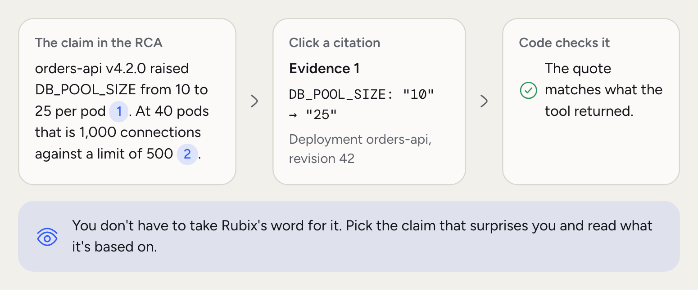
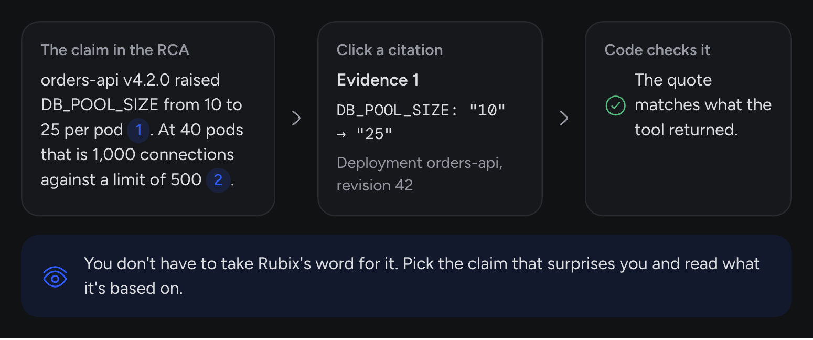
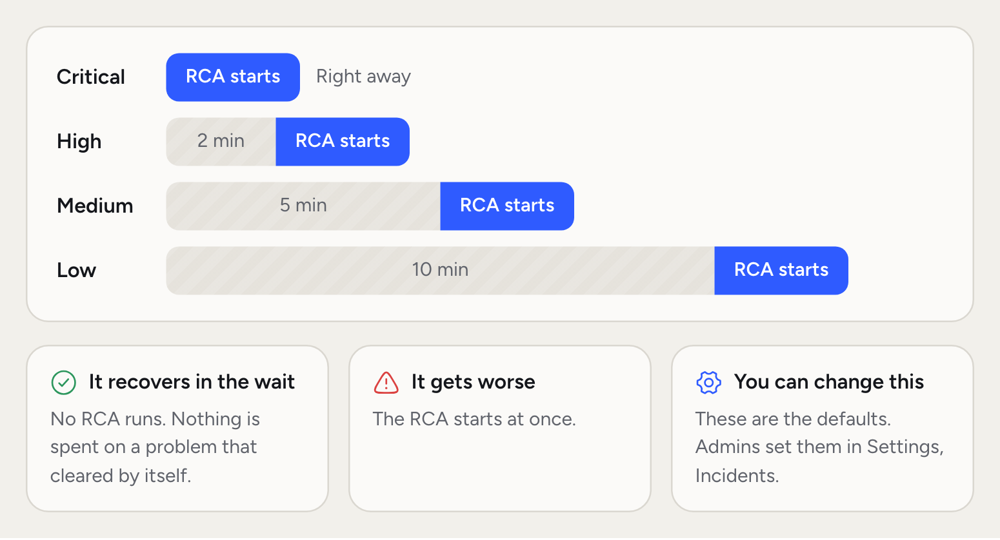
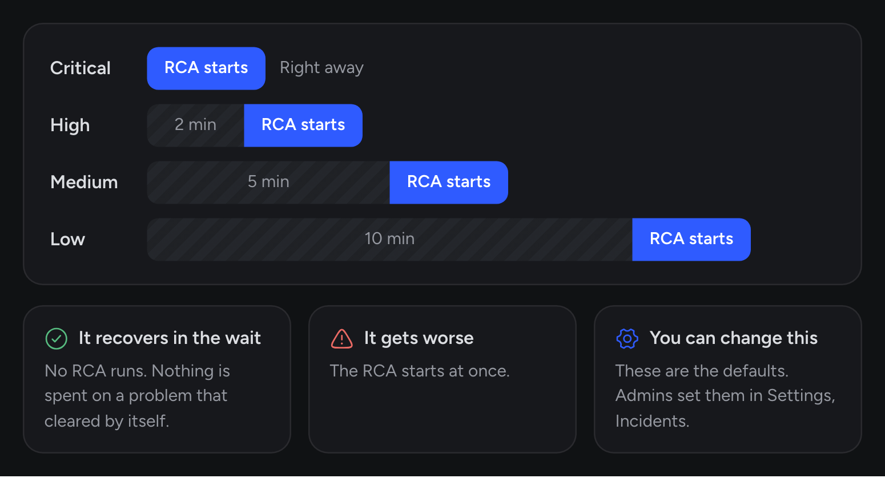
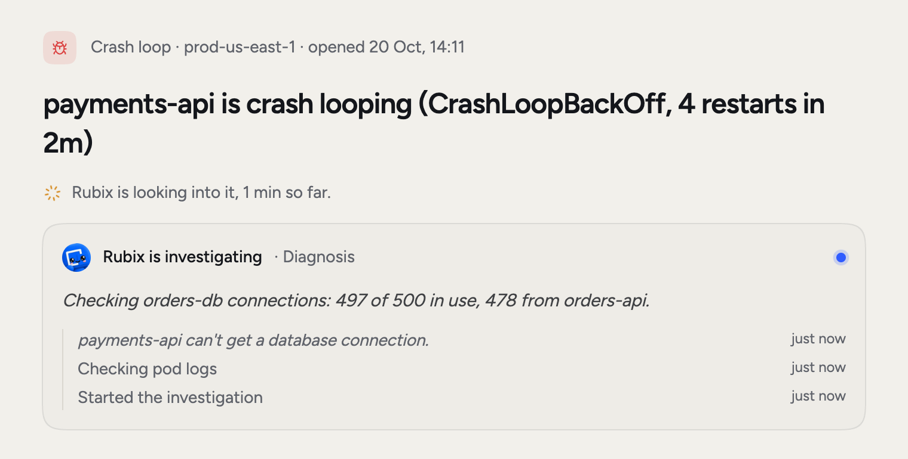
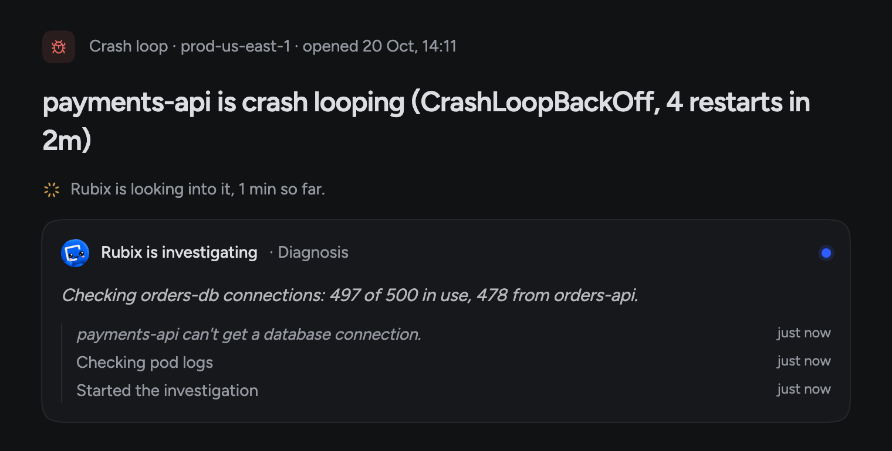

A root cause analysis (RCA) is the report Rubix writes for an [incident](/concepts/incidents) or a group. It's what your team acts on and refers back to later.

Every RCA is built on cited evidence. Each finding points to the tool result, log or change that supports it. Rubix can be wrong, so every RCA shows its evidence and lets you rate it.

<Frame>
  
  
</Frame>

## What a report contains

<AccordionGroup>
  <Accordion title="Verdict and confidence" icon="gauge">
    Whether Rubix settled the cause, and how sure it is. See the table below.
  </Accordion>
  <Accordion title="Root cause" icon="diagram-project">
    What happened and why, with the evidence behind each step, so you can verify instead of trust.
  </Accordion>
  <Accordion title="Fix and Tasks" icon="wrench">
    The steps to fix it, and the [Tasks](/concepts/tasks) Rubix suggests. An RCA can suggest none.
  </Accordion>
  <Accordion title="Impact and current state" icon="eye">
    Who and what was affected, and where things stand now.
  </Accordion>
  <Accordion title="Contributing factors, rollback and timeline" icon="timeline">
    What made it worse, how to undo the Fix, and the order things happened in.
  </Accordion>
  <Accordion title="What limited the investigation" icon="circle-question">
    What Rubix couldn't see or settle. A source it couldn't read is named here, with what to check.
  </Accordion>
</AccordionGroup>

### Verdicts

| The report says | The incident shows | What it means |
| --- | --- | --- |
| Root cause found | Root cause | The tool results show the cause directly |
| Probable cause | Likely cause | They point to it, but one link isn't shown |
| Cause not determined | Not determined | They don't settle it |

An unsettled RCA is still published, with what Rubix found and what it ruled out. Confidence is capped at 0.95. It's held at 0.5 when the verdict is Cause not determined or the claims aren't cited.

## When an RCA starts

An RCA doesn't start the second an incident opens. Many problems clear by themselves, and an RCA on those is wasted work.

<Frame>
  
  
</Frame>

Incidents from an observer then get a little longer, up to 10 minutes, for the observer to report a recovery. Critical skips that too. The incident page tells you when the RCA will start and what it's waiting for.

Change the waits in **Settings > Incidents**.

<Frame>
  
  
</Frame>

## How an RCA is built

<Steps titleSize="h3">
  <Step title="Scope the incident">
    Start from the incident or group, with its evidence, comments and every member. For a group, one RCA covers them all.
  </Step>
  <Step title="Gather context">
    Pull past RCAs on the same thing and how your team rated them, the sources Rubix can read, and the links between them.
  </Step>
  <Step title="Investigate">
    Rubix tests each explanation against live data from your sources, and rules out what doesn't hold. A past RCA or a comment is a lead to test, not a finding. Investigations only read. The RCA can't change anything.
  </Step>
  <Step title="Check the answer">
    Code checks that quotes match what the tools returned, and sets the limits on confidence.
  </Step>
  <Step title="Publish">
    The report lands on the incident. If the RCA can't finish, it retries. If it still stops, the incident says so and you can run it again.
  </Step>
</Steps>

## What makes an RCA easy to check

- **Specific claims.** "`orders-api` raised `DB_POOL_SIZE` to 25 at 14:02" beats "a config change". The specific fact is the claim.
- **Direct citations.** Each claim shows the tool result it came from, quoted.
- **The same sections.** Root cause, Fix, Impact, Rollback, in the same order every time.

## How to read an RCA well

<Steps titleSize="h3">
  <Step title="Read the verdict and the Fix first">
    If the verdict is Root cause found and the Fix looks right, go to the Tasks.
  </Step>
  <Step title="Check one or two citations">
    Pick the claims that surprise you. Confirm each matches the underlying data.
  </Step>
  <Step title="Read what limited it">
    A missing source can change the answer. Connect it and run the RCA again.
  </Step>
  <Step title="Rate it">
    Under the root cause, answer **Was this the cause?** with Right, Partly right or Wrong. For Partly right or Wrong, say what it really was. Rubix reads that the next time it looks at a problem like this. A Right raises the report's confidence, up to 0.95, and a Wrong from anyone stops it rising.
  </Step>
</Steps>

## Common questions

<AccordionGroup>
  <Accordion title="Why did my incident not get an RCA?">
    It recovered before the RCA started, triage found it was known and expected, or it's Recurring. The incident says which. You can start one with **Run the RCA again**.
  </Accordion>
  <Accordion title="How long does an RCA take?">
    It depends on how much there is to check. A larger group or a problem that keeps coming back gets a deeper investigation, and that takes longer. The incident page shows progress while it runs.
  </Accordion>
  <Accordion title="Can I rerun an RCA with new context?">
    Yes. Add what you know as a comment on the incident, then choose **Run the RCA again** from its menu. Rubix reads the comments. It skips every automated wait.
  </Accordion>
  <Accordion title="Can I export an RCA?">
    Yes. Use **Export as Markdown** on the report's menu.
  </Accordion>
</AccordionGroup>

## Related concepts

<CardGroup cols={2}>
  <Card title="Incidents" icon="triangle-exclamation" href="/concepts/incidents">
    Where RCAs start. Every RCA belongs to an incident or a group.
  </Card>
  <Card title="Tasks" icon="list-check" href="/concepts/tasks">
    What happens once the RCA suggests a Fix.
  </Card>
</CardGroup>
