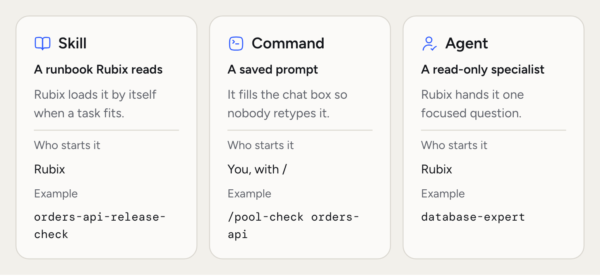
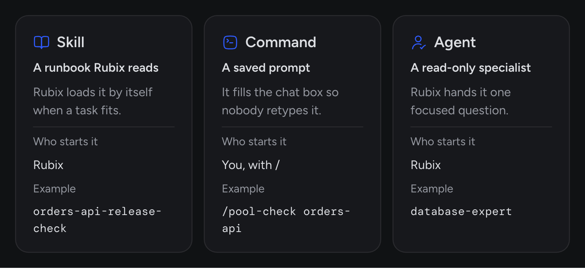

Skills are short, structured runbooks Rubix loads when it needs them. A skill turns "the way we do post-deploy verification on this team" or "the standard weekly cost review" into something Rubix follows consistently, every time, for everyone.

Skills use `SKILL.md`, the file from the **open Agent Skills** format, which tools such as Claude Code also read. You can upload a `SKILL.md` file you already have.

<Frame>
  
  
</Frame>

## Why skills

- **Consistent work.** The same runbook, regardless of who's asking.
- **Shared knowledge.** What one person knows becomes something everyone gets. New members have it on day one.
- **Used in RCAs too.** Rubix can load your skills during an investigation, so your runbooks shape the RCA.
- **Portable format.** A `SKILL.md` is a plain file you can keep in a repo.

## Anatomy of a skill

A skill is a short block of YAML plus plain-English instructions. Minimal shape:

```markdown
---
name: post-deploy-verification
description: Compare error rate, latency and resource usage for a service against the last stable window.
---

1. Take a baseline from the last 30 minutes of the previous stable deployment.
2. Take the current window (10 minutes after the new rollout).
3. Compare error rate, p95 latency, CPU and memory.
4. Flag any metric worse than 20% against baseline.
5. Summarize in one short paragraph.
```

The skill editor in **Customize > Skills** has these fields:

| Field | Purpose |
| --- | --- |
| **Name** | Unique handle. Lowercase letters, numbers and dashes |
| **When to use it** | One sentence. Rubix reads this to decide when the skill fits |
| **Agent** | **Any agent**, or one of your custom agents |
| **Tools it may use** | A list stored with the skill. It doesn't limit tools today, see Safety boundaries below |
| **Instructions** | Plain-English runbook. Numbered steps work best |

## Built-in skills and custom skills

<AccordionGroup>
  <Accordion title="Built-in skills" icon="star">
    Shipped and maintained by RubixKube, and available in every organization. They cover Kubernetes, AWS, Google Cloud, machines, incidents and reviewing RCAs.

    See them in [Skills](/using/skills).
  </Accordion>
  <Accordion title="Custom skills" icon="pen">
    Written by your team for your work, and scoped to your organization. A custom skill with the same name as a built-in one replaces it.

    Walkthrough: [How to add custom agent skills](/tutorials/add-custom-agent-skills).
  </Accordion>
</AccordionGroup>

## How a skill is used

Rubix sees the name and the **When to use it** line of every enabled skill. When a question or an investigation matches one, Rubix loads its instructions and follows them. So a clear description matters more than anything else on the page.

To run something by name, use a command. [Commands](/using/customize) are `/` shortcuts for your team's playbooks.

## Safety boundaries

A skill doesn't give Rubix any new access. Anything a skill tells Rubix to change still goes through the chat's [mode](/using/modes): Observe blocks it, Assist asks, and Auto goes ahead, with destructive actions still asking.

The **Tools it may use** field doesn't enforce anything today, so don't rely on it to keep Rubix away from a tool. Use modes and [Hooks](/using/customize) for that.

## Design principles for good skills

- **One clear job.** Post-deploy verification, handover notes, cost review. Not "general ops".
- **Numbered steps.** Write instructions like a senior engineer's handover note. Imperative, ordered.
- **Specific thresholds.** "20% worse than baseline" beats "significantly worse". Rubix follows the number.
- **A clear "when".** Write **When to use it** the way someone would ask for it.

## Common questions

<AccordionGroup>
  <Accordion title="Which agent runs skills?">
    Rubix, in chat and in RCAs. A skill set to one of your custom agents is only for that agent.
  </Accordion>
  <Accordion title="Can I port a skill from another tool?">
    Yes. Upload the `SKILL.md`. The name, description and instructions come across. Check any tool names in the instructions, since yours can differ.
  </Accordion>
  <Accordion title="What are the limits?">
    A description can be 1,024 characters, and instructions 16 KB.
  </Accordion>
</AccordionGroup>

## Related concepts

<CardGroup cols={2}>
  <Card title="Skills in the console" icon="store" href="/using/skills">
    Turn built-in skills on and off, and manage your own.
  </Card>
  <Card title="How to add custom agent skills" icon="plus" href="/tutorials/add-custom-agent-skills">
    Step-by-step guide to writing your first skill.
  </Card>
</CardGroup>
