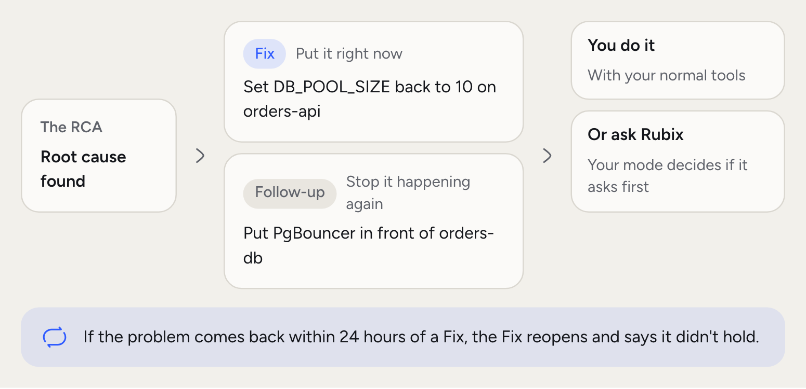
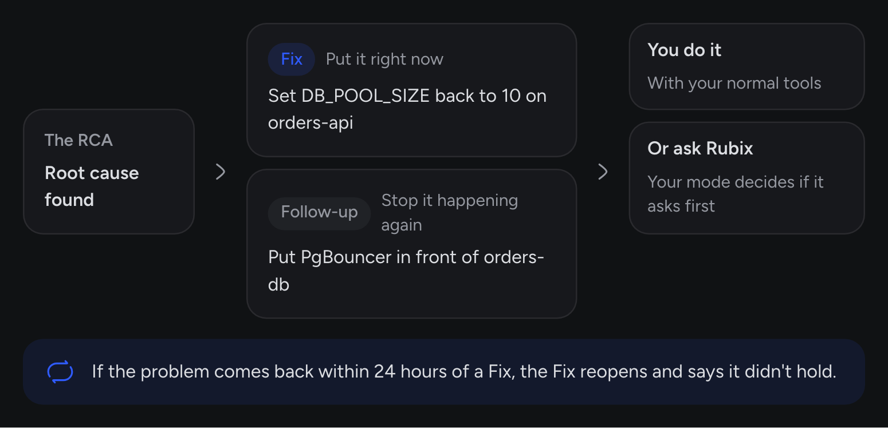

A Task is a piece of work. Most come from an RCA, and anyone on your team can add one. There are two kinds. A **Fix** deals with the cause now. A **Follow-up** stops it happening again.

A Task doesn't run by itself. Someone on your team does the work, or asks Rubix to, and [modes](/using/modes) decide what Rubix can change. An RCA that found nothing worth doing suggests no Tasks, and that's normal.

<Frame>
  
  
</Frame>

## What a Task carries

- **Kind.** Fix or Follow-up.
- **Why Rubix suggested it.** The reasoning from the RCA, on the Task's page.
- **Priority.** Critical, High, Medium or Low.
- **Owner.** The person it's assigned to.
- **Where it came from.** The incident and RCA behind it.
- **A short code.** TSK-30, unique in your organization.

## The lifecycle of a Task

<Steps titleSize="h3">
  <Step title="Todo">
    The RCA or a person creates the Task. It shows on the incident and on the Tasks page.
  </Step>
  <Step title="Assigned">
    Someone takes it, or it's given to them.
  </Step>
  <Step title="In progress">
    Work has started. From here it can move to **Waiting** when it's blocked, or **Review** when someone needs to check it.
  </Step>
  <Step title="Completed, Failed or Cancelled">
    The Task is done. When the incident resolves, RubixKube records the Task's outcome.
  </Step>
</Steps>

If the problem comes back within 24 hours of a Fix, that Fix reopens and its outcome says it didn't hold.

## What can be a Task

Anything your team needs to do because of an incident. In our example:

<AccordionGroup>
  <Accordion title="A Fix" icon="wrench">
    Set `DB_POOL_SIZE` back to 10 on `orders-api`.
  </Accordion>
  <Accordion title="A Follow-up" icon="list-check">
    Add an alert on `orders-db` connections, and review pool settings when `orders-api` changes.
  </Accordion>
</AccordionGroup>

## How a Fix gets done

You have two ways.

- **Do it yourself.** Follow the steps, using your normal tools, then move the Task along.
- **Ask Rubix.** In chat, ask Rubix to make the change through its connected tools. The [mode](/using/modes) decides what happens: Observe blocks it, Assist asks you first, and Auto goes ahead, with destructive actions still asking.

Rubix can also create, assign and move Tasks. Those count as changes too, so the same mode rules apply.

## Good to know

The Task page keeps its status history, with who moved it and when, next to its comments. When Rubix makes a change, the tool call also appears in **Settings > Activity**. See [Safety and control](/concepts/guardrails).

## Common questions

<AccordionGroup>
  <Accordion title="Can Tasks run without a person?">
    Tasks don't run. Rubix can change things without asking only in Auto mode, and destructive actions still ask. See [Safety and control](/concepts/guardrails).
  </Accordion>
  <Accordion title="What if a Fix doesn't work?">
    Move the Task to Failed and add a comment, so the next RCA can read why. You can also run the RCA again from the incident.
  </Accordion>
  <Accordion title="Can I add my own Tasks?">
    Yes. Use **Add task** on the incident, or **New task** on the Tasks page.
  </Accordion>
  <Accordion title="Does a Task have a rollback?">
    A Task doesn't carry one. The RCA report has a Rollback section when Rubix suggests one. Read it before you make the change.
  </Accordion>
</AccordionGroup>

## Related concepts

<CardGroup cols={2}>
  <Card title="Safety and control" icon="shield-halved" href="/concepts/guardrails">
    What Rubix can change, and what gets recorded.
  </Card>
  <Card title="Tasks in the console" icon="list-check" href="/using/tasks">
    Where you assign and track Tasks.
  </Card>
</CardGroup>
