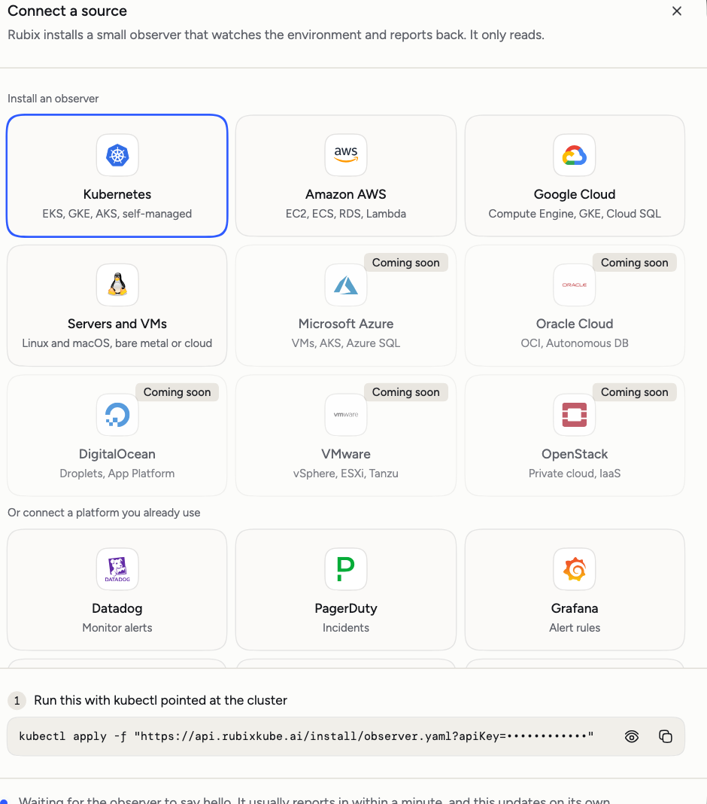
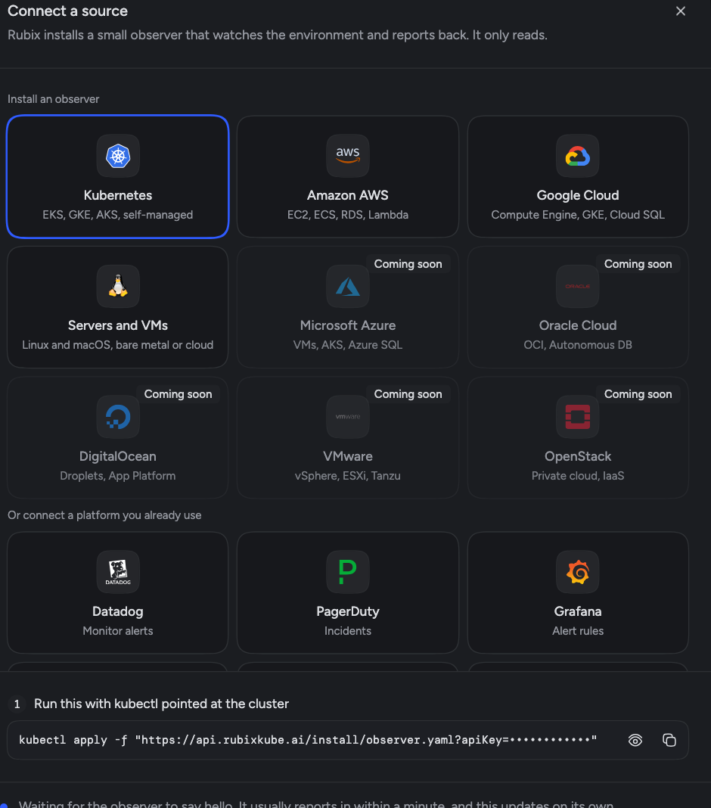

RubixKube needs something to watch. A source is a Kubernetes cluster, cloud account, machine or tool. You can connect two kinds: an observer you install, or a tool that sends alerts by webhook. An observer is a good place to start, because Rubix can then read what's running.

Only admins connect sources. Open **Environments** and choose **Connect**, or pick a tile on the Welcome page.

<Frame>
  
  
</Frame>

## Install an observer

An observer runs next to your systems, watches them and reports back to RubixKube. Pick one of these in the dialog:

| Tile | What it covers |
| --- | --- |
| [Kubernetes](/environments/kubernetes) | EKS, GKE, AKS, self-managed |
| [Amazon AWS](/environments/aws) | EC2, ECS, RDS, Lambda |
| [Google Cloud](/environments/gcp) | Compute Engine, GKE, Cloud SQL |
| [Servers and VMs](/environments/vm) | Linux and macOS, bare metal or cloud |

The console shows the exact command, with your key in it. Copy it from there.

<Tabs>
  <Tab title="Kubernetes">
    With `kubectl` pointed at the cluster, run the command from the dialog:

    ```bash
    kubectl apply -f "https://api.rubixkube.ai/install/observer.yaml?apiKey=rk_YOUR_API_KEY"
    ```

    To check it, look for a `Running` pod:

    ```bash
    kubectl get pods -n rubixkube-system
    ```
  </Tab>
  <Tab title="AWS or Google Cloud">
    The command depends on where the observer will run. To create a new AWS EC2 or Google Compute Engine instance, run this from a machine signed in to the cloud account:

    ```bash
    curl -fsSL "https://api.rubixkube.ai/install/observer.sh" | bash
    ```

    To run it on the machine you're on, add `sudo`, because that install needs root:

    ```bash
    curl -fsSL "https://api.rubixkube.ai/install/observer.sh" | sudo bash
    ```

    Paste your key when the script asks for it, then answer its questions. On your own machine the observer runs in Docker, so check it with:

    ```bash
    sudo docker ps --filter name=rk-observer
    ```

    The [AWS](/environments/aws) and [Google Cloud](/environments/gcp) pages have every step.
  </Tab>
  <Tab title="Server or VM">
    On the server, run this. It needs root:

    ```bash
    curl -fsSL "https://api.rubixkube.ai/install/observer.sh" | sudo bash
    ```

    Paste your key when the script asks for it. Choose to install, on this machine, as a VM or host. On Linux, check it with:

    ```bash
    sudo systemctl status rk-observer
    ```

    On macOS it runs as the launchd service `ai.rubixkube.observer`.
  </Tab>
</Tabs>

The dialog waits for the observer to say hello, usually within a minute. When it does, you'll see that the source is connected, and you can add it to an environment there. Choose **Open it** to see the source.

<Warning>
  Treat your key like a password. It ties the observer to your organization. Anyone with it can connect an observer to your organization.
</Warning>

### What an observer needs

Observers need outbound access to `api.rubixkube.ai:443` and `nats.rubixkube.ai:4222`.

On Kubernetes, the observer is one pod in the `rubixkube-system` namespace. It requests 256Mi of memory and 250m of CPU, with limits of 768Mi and 1 CPU. That suits clusters up to about 50 nodes. Above that, the source page tells you how many pods to run.

Its role allows `get`, `list` and `watch` on most resources, including Secrets, plus reading pod logs, `pods/exec` and writing events. Read the manifest at the install URL before you apply it if you want the whole list. [Safety and control](/concepts/guardrails) has more detail.

## Connect a tool by webhook

Tools you already use can open incidents here. In the same dialog, under **Or connect a platform you already use**, you'll find Datadog, PagerDuty, Grafana, Sentry, Jira, Linear and Observe.

<Steps>
  <Step title="Name it">
    Pick the tile, name the source and choose **Make its webhook**.
  </Step>
  <Step title="Copy the URL">
    The URL is shown once, and anyone with it can post to it. Store it somewhere safe.
  </Step>
  <Step title="Add it to the tool">
    The dialog says where the webhook goes in that tool. For Datadog and Observe, it also gives you a payload to paste.
  </Step>
  <Step title="Wait for the first message">
    The source registers itself on the first message. The dialog also turns on the automation that turns the tool's events into incidents.
  </Step>
</Steps>

The dialog can also set up reading from the tool, so Rubix can look things up in it during an RCA. See the [Integrations overview](/integrations/overview) for every tool. To send your own events, see [Your own webhook](/integrations/webhooks).

## Add sources to environments

An environment, such as staging or production, is a label across sources. A cluster and the Datadog monitors that watch it can share one. Your plan sets how many you can use: Individual has 1, Business has 3, and Enterprise is set for your organization.

## What Rubix can do once connected

The observer watches and reports. What Rubix can change is a separate choice, set by mode: Observe, Assist or Auto. New organizations start in Observe. See [Modes](/using/modes).

## Remove a source

Open the source, then choose **Delete source** from its menu and type its name to confirm.

<Warning>
  Deleting can't be undone. For an observer source, its history and metrics are deleted, and the observer keeps running until you uninstall it. For a tool, its incidents, history, webhook and automation are deleted, and you should remove the webhook from the tool too.
</Warning>

To uninstall an observer from Kubernetes, run `kubectl delete -f` with the same URL you installed from. Everywhere else, run the install script again and choose **Uninstall Observer**.

## Next

<CardGroup cols={2}>
  <Card title="Your first incident" icon="triangle-exclamation" href="/tutorials/first-incident">
    See what happens when something breaks.
  </Card>
  <Card title="Environments" icon="server" href="/using/environments">
    Work with sources and labels.
  </Card>
  <Card title="Integrations overview" icon="plug" href="/integrations/overview">
    Connect the tools Rubix can read.
  </Card>
  <Card title="Troubleshooting" icon="wrench" href="/support/troubleshooting">
    Fix a source that won't connect.
  </Card>
</CardGroup>
