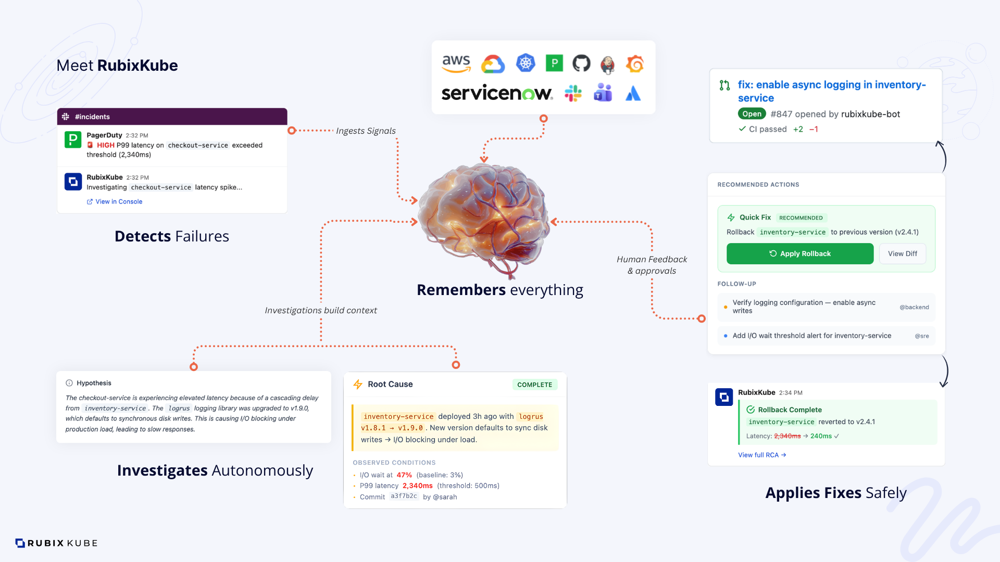
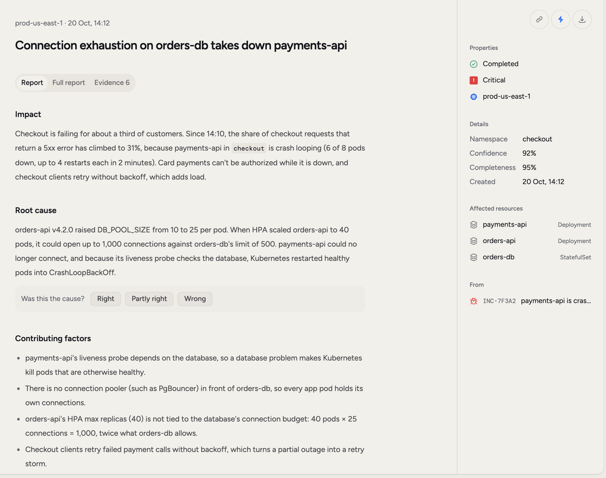
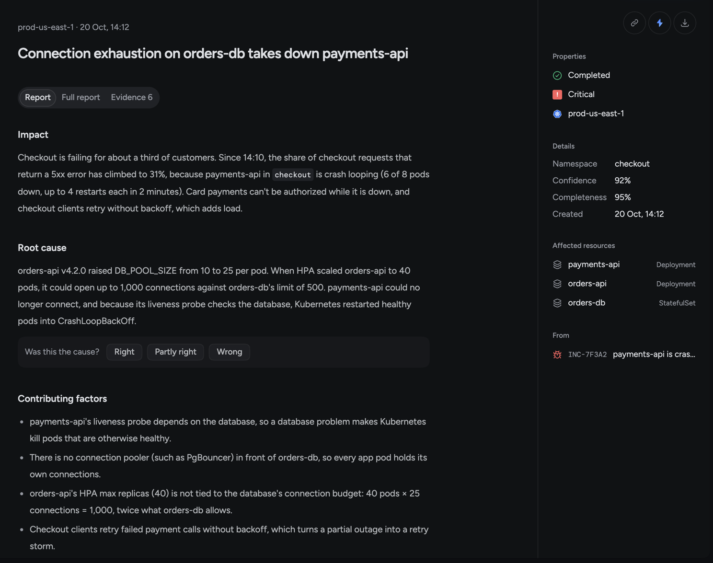

RubixKube helps your team run infrastructure with an agent. This page explains what it does and walks through one real-looking incident, so you know what to expect before you connect anything.

The product is RubixKube. The agent is Rubix.

<Frame>
  
</Frame>

## How it works

<Steps>
  <Step title="Something reports a problem">
    Observers run in your Kubernetes clusters, cloud accounts and servers. Tools you already use, such as Datadog or PagerDuty, send alerts by webhook. Each of these is a source.
  </Step>
  <Step title="RubixKube opens an incident">
    It sets severity and impact, and groups incidents that share a resource or a cause, so one problem doesn't turn into twenty RCAs.
  </Step>
  <Step title="Rubix investigates">
    After a short wait that depends on severity, Rubix reads what it can reach and writes an RCA. The RCA gives the cause, the evidence, and how sure Rubix is.
  </Step>
  <Step title="Rubix suggests Tasks">
    A Fix for the cause, and Follow-ups to stop it happening again. Your team assigns them and works through them.
  </Step>
  <Step title="The observer watches for recovery">
    When the resource is healthy again, RubixKube records it and asks what fixed it. You can turn on closing incidents automatically in **Settings > Incidents**.
  </Step>
</Steps>

## One incident, start to finish

Acme Payments runs `orders-api`, `payments-api` and `orders-db` in `prod-us-east-1`. Here's a normal Tuesday.

A new `orders-api` version goes out and raises its database pool. `orders-db` runs out of connections. `payments-api` can't connect, and it starts crash looping.

The observer in the cluster sees the crash loop and reports it. An incident opens: "payments-api is crash looping". The incident page shows when the RCA starts and what it's waiting for.

Rubix reads the pod's logs and events and what changed before the crash. It connects the new `orders-api` version to the exhausted connections. The RCA names that as the root cause and cites the logs and events it used.

The RCA suggests a Fix: "Set `DB_POOL_SIZE` back to 10". Someone on the team takes the Task. They ask Rubix to open the pull request, Rubix asks for approval first, and they approve it.

After the change rolls out, `payments-api` stops crashing. The observer sees it stay healthy and reports the recovery. RubixKube asks what fixed it, the team answers, and the incident closes. Next time something similar happens, Rubix can read this RCA.

<Frame>
  
  
</Frame>

## What Rubix can change

That depends on the mode. A mode is set in **Settings > Modes**, and each chat can move up to the highest mode your organization allows.

| Mode | What Rubix does |
| --- | --- |
| **Observe** | Reads and investigates. Nothing that changes anything runs. |
| **Assist** | Can change things, and asks a person before each change. |
| **Auto** | Changes things without asking. Destructive changes always ask. |

A new organization starts in Observe, and Assist is the highest mode until an admin changes it. RCAs are read-only in every mode.

## When Rubix gets it wrong

Rubix can be wrong, so every RCA shows its evidence and says how sure it is. An RCA says **Root cause**, **Likely cause** or **Not determined**. When it can't tell, it says so. You can rate a stated cause with **Was this the cause?**, and read the evidence yourself.

## A system that learns your stack

Most tools see your infrastructure fresh every time. RubixKube keeps what it learns, so the next incident starts with more to go on.

<CardGroup cols={2}>
  <Card title="Day one" icon="play">
    Your sources are connected, and RubixKube maps what's running in them.
  </Card>
  <Card title="Week one" icon="diagram-project">
    Links between sources build up, so a Datadog alert and a pod in your cluster read as the same thing.
  </Card>
  <Card title="Month one" icon="brain">
    New investigations read past RCAs, and what your team said fixed things.
  </Card>
  <Card title="Always" icon="infinity">
    Your comments and ratings stay with your organization and shape what Rubix does next.
  </Card>
</CardGroup>

See [RubixKube's memory](/concepts/memory-engine) and the [knowledge graph](/concepts/knowledge-graph).

## What you can connect

One organization can mix any of these.

<CardGroup cols={2}>
  <Card title="Kubernetes" icon="dharmachakra" href="/environments/kubernetes">
    EKS, GKE, AKS and self-managed clusters. One `kubectl` command.
  </Card>
  <Card title="AWS" icon="aws" href="/environments/aws">
    Run the observer on a machine you have, or on a new EC2 instance.
  </Card>
  <Card title="Google Cloud" icon="google" href="/environments/gcp">
    Run the observer on a machine you have, or on a new Compute Engine instance.
  </Card>
  <Card title="Servers and VMs" icon="server" href="/environments/vm">
    Linux with systemd, or macOS.
  </Card>
  <Card title="Alert sources" icon="bell" href="/integrations/overview">
    Datadog, PagerDuty, Grafana, Sentry, Jira, Linear, Observe, or your own webhook.
  </Card>
  <Card title="Tools Rubix can read" icon="plug" href="/integrations/catalog">
    GitHub, GitLab, Notion, New Relic and more.
  </Card>
</CardGroup>

## Who it's for

RubixKube is for teams who look after services in production: platform, infrastructure and SRE engineers, and developers who run what they ship. If your team spends its time working out why something broke, this is the part Rubix takes on.

You can work where you already are: the console, Slack, or your own AI tools over MCP.

## Plans

| Plan | Environments | Investigations a month | Users |
| --- | --- | --- | --- |
| **Individual** | 1 | 10 | 1 |
| **Business** | 3 | 100 | 5 |
| **Enterprise** | Set for your organization | Set for your organization | Set for your organization |

Slack, Automations, Hooks, Webhooks, your own models, custom integrations and Members come with Business and Enterprise. See [pricing](https://rubixkube.ai/pricing).

## Next

<CardGroup cols={2}>
  <Card title="Quickstart" icon="rocket" href="/getting-started/quickstart">
    Get to your first incident.
  </Card>
  <Card title="How RubixKube works" icon="diagram-project" href="/concepts/how-rubixkube-works">
    The full path of an incident.
  </Card>
  <Card title="Modes" icon="shield-halved" href="/using/modes">
    Set what Rubix can do on its own.
  </Card>
  <Card title="What's new" icon="sparkles" href="/getting-started/whats-new">
    What changed recently.
  </Card>
</CardGroup>
