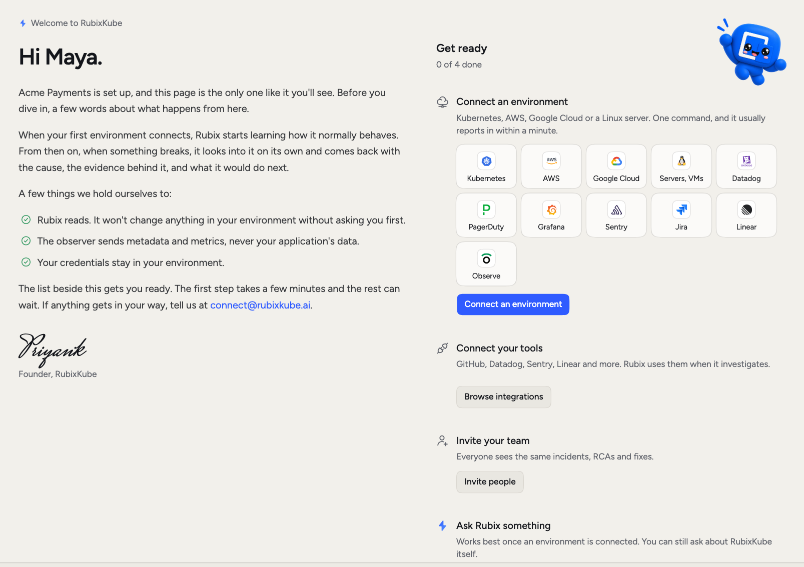
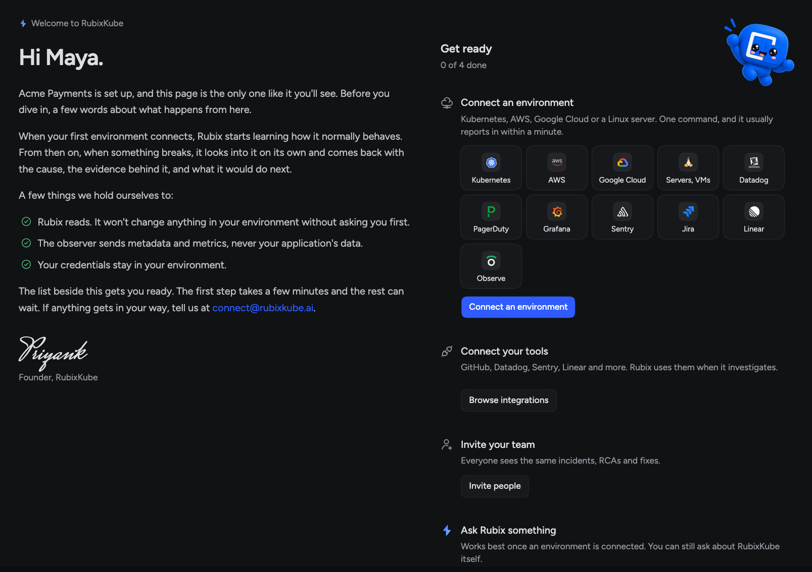

This is the fast path from a new account to your first answer from Rubix. Connecting your first source takes a few minutes.

<Steps>
  <Step title="Sign up">
    Go to [console.rubixkube.ai](https://console.rubixkube.ai) and sign in with your email, Google or GitHub. New to RubixKube? Choose **Create an account**. If you sign up with an email address, confirm it from the link we send you.
  </Step>
  <Step title="Name your organization">
    Your team works in it together, so it's usually your company's name. New organizations start on the Individual plan: 1 environment, 10 investigations a month and 1 user. See [pricing](https://rubixkube.ai/pricing) for the other plans.

    You land on the Welcome page. Its **Get ready** list is the rest of this guide, and Home keeps showing your progress until the list is done.

    <Frame>
      
      
    </Frame>
  </Step>
  <Step title="Connect a source">
    Under **Connect an environment**, pick a tile. For Kubernetes, run the command the console gives you, with `kubectl` pointed at your cluster. It usually reports in within a minute, and the dialog updates on its own.

    [Connect a source](/getting-started/connect-your-environment) covers the other kinds, including alerts from tools like Datadog.
  </Step>
  <Step title="Connect your tools">
    This one can wait, but Rubix does better work with more to read. Under **Connect your tools**, choose **Browse integrations** and connect GitHub, Datadog, Sentry, Linear or others. Rubix uses them when it investigates.
  </Step>
  <Step title="See your first incident">
    Open **Incidents**. When an observer or a connected tool reports a problem, it shows up here. Each row says where things stand.

    The RCA doesn't start right away unless the incident is critical. The wait depends on severity, and the incident page tells you when the RCA starts. When it's done, the incident shows the cause and any Tasks Rubix suggests.

    Nothing broken yet? That's fine. Choose **New incident** to report one by hand, or follow [Your first incident](/tutorials/first-incident). Rubix picks up a reported incident like any other, and its RCA counts as an investigation.
  </Step>
  <Step title="Ask Rubix">
    Go to Home and ask something. These are good first questions:

    ```text
    How healthy is my environment right now?
    What changed in the last day?
    Is anything close to running out of memory or disk?
    ```

    New organizations start in Observe mode, so Rubix reads and investigates but changes nothing. You can change that in [Modes](/using/modes).
  </Step>
</Steps>

On a Business or Enterprise plan, the list also has **Invite your team**. See [Members](/using/members).

<Note>
  Stuck? Write to connect@rubixkube.ai and include your Organization ID. It's in **Settings > General**.
</Note>

## Next

<CardGroup cols={2}>
  <Card title="Your first incident" icon="triangle-exclamation" href="/tutorials/first-incident">
    Follow an incident through its RCA and Fix.
  </Card>
  <Card title="What RubixKube does" icon="circle-info" href="/getting-started/overview">
    The full picture, with a worked example.
  </Card>
  <Card title="Chat with Rubix" icon="messages" href="/using/rubix-chat-agent">
    Get more from a session.
  </Card>
  <Card title="Slack" icon="slack" href="/integrations/slack">
    Get incidents where your team talks.
  </Card>
</CardGroup>
