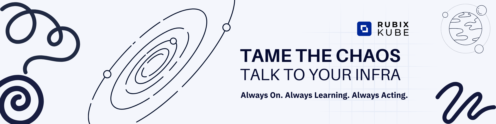
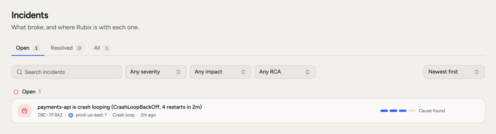
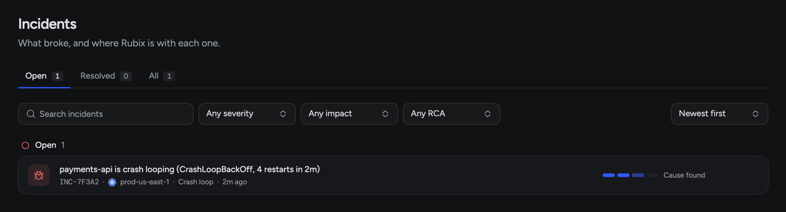
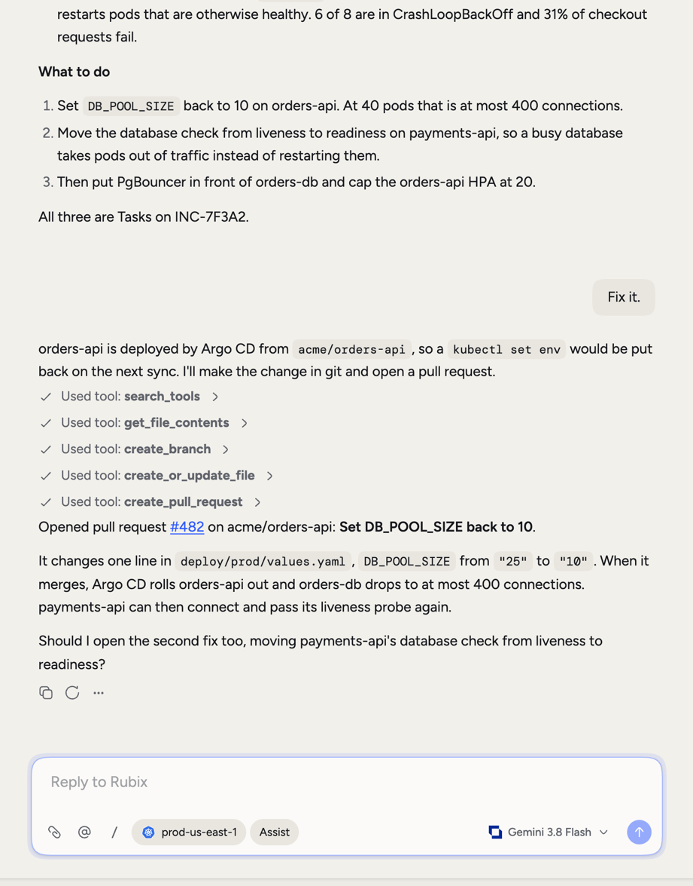
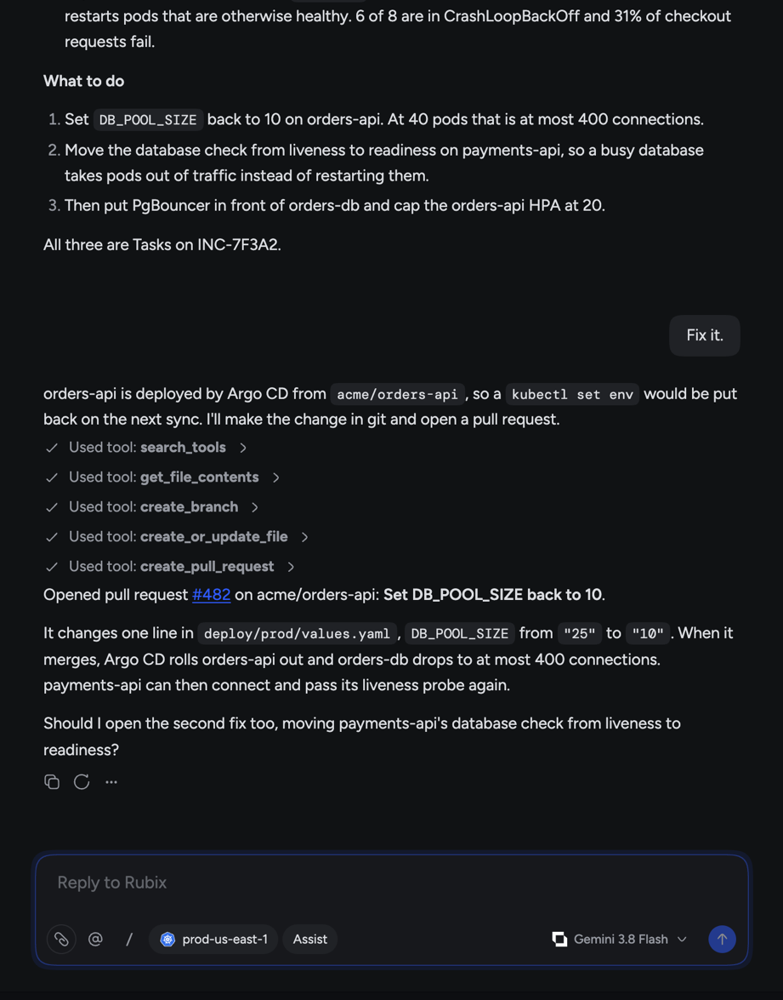

<Frame>
  
</Frame>

RubixKube helps your team run infrastructure with an agent. Observers in your environments and the tools you already use report what breaks. RubixKube turns that into incidents. Rubix, the agent, looks into each one, writes an RCA with its evidence, and suggests Tasks: a Fix, plus Follow-ups for later.

You stay in charge. You choose how much Rubix can do without asking, and every RCA shows its evidence so you can check the work.

<Frame>
  
  
</Frame>

## Start here

<CardGroup cols={2}>
  <Card title="Quickstart" icon="rocket" href="/getting-started/quickstart">
    Sign up, connect a source, see your first incident and ask Rubix a question.
  </Card>
  <Card title="What RubixKube does" icon="circle-info" href="/getting-started/overview">
    The plain version, with one incident followed from start to finish.
  </Card>
  <Card title="Connect a source" icon="plug" href="/getting-started/connect-your-environment">
    Install an observer, or point a tool like Datadog at a webhook.
  </Card>
  <Card title="Your first incident" icon="triangle-exclamation" href="/tutorials/first-incident">
    Walk through an incident, its RCA and its Fix.
  </Card>
</CardGroup>

## What's new

<CardGroup cols={2}>
  <Card title="Automations" icon="diagram-project" href="/using/automations">
    Run Rubix on a trigger or a schedule, and see every run. Business and Enterprise.
  </Card>
  <Card title="Integrations and webhook sources" icon="plug" href="/integrations/overview">
    Datadog, PagerDuty, Grafana, Sentry, Jira, Linear and Observe can open incidents here. So can your own webhooks.
  </Card>
  <Card title="Slack incident threads" icon="slack" href="/integrations/slack">
    One thread per incident, kept up to date. Replies become comments.
  </Card>
  <Card title="MCP" icon="robot" href="/integrations/mcp">
    Work with incidents, RCAs and Tasks from Claude Code, Cursor, VS Code and Claude.
  </Card>
  <Card title="Modes" icon="shield-halved" href="/using/modes">
    Observe, Assist or Auto. Decide what Rubix can do on its own.
  </Card>
  <Card title="Everything new" icon="sparkles" href="/getting-started/whats-new">
    The full list for October and November 2026.
  </Card>
</CardGroup>

## Ask Rubix

Rubix can see your sources and your incident history, so you can ask it what you'd ask a colleague. Try "Why is `payments-api` crash looping?" or "What changed in the last day?". It answers with what it found and where it found it.

<Frame>
  
  
</Frame>

<CardGroup cols={2}>
  <Card title="Chat with Rubix" icon="messages" href="/using/rubix-chat-agent">
    Sessions, context, commands and approvals.
  </Card>
  <Card title="Prompts to try" icon="comment-dots" href="/tutorials/chat-prompts">
    Questions that work well, by task.
  </Card>
</CardGroup>

## Find your way around

<CardGroup cols={3}>
  <Card title="Incidents" icon="triangle-exclamation" href="/using/incidents">
    What broke, where it stands, and when the RCA starts.
  </Card>
  <Card title="RCAs" icon="file-magnifying-glass" href="/using/rca-reports">
    The cause, the evidence, and how to rate it.
  </Card>
  <Card title="Tasks" icon="list-check" href="/using/tasks">
    Fixes and Follow-ups, with owners.
  </Card>
  <Card title="Environments" icon="server" href="/using/environments">
    Your sources and what each one sees.
  </Card>
  <Card title="Analytics" icon="chart-line" href="/using/analytics">
    How incidents and RCAs are going over time.
  </Card>
  <Card title="Rubix CLI" icon="terminal" href="/cli/overview">
    Ask from your terminal.
  </Card>
</CardGroup>

## Get help

<CardGroup cols={2}>
  <Card title="Troubleshooting" icon="wrench" href="/support/troubleshooting">
    Real failures and the exact checks for each.
  </Card>
  <Card title="Write to us" icon="envelope" href="mailto:connect@rubixkube.ai">
    connect@rubixkube.ai
  </Card>
</CardGroup>
