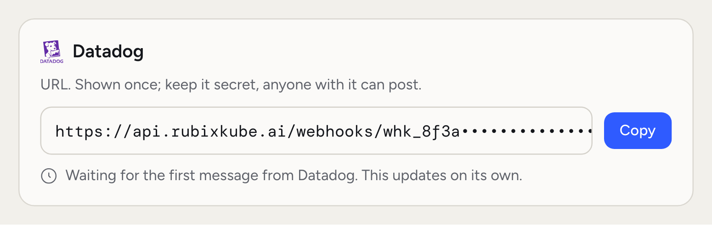
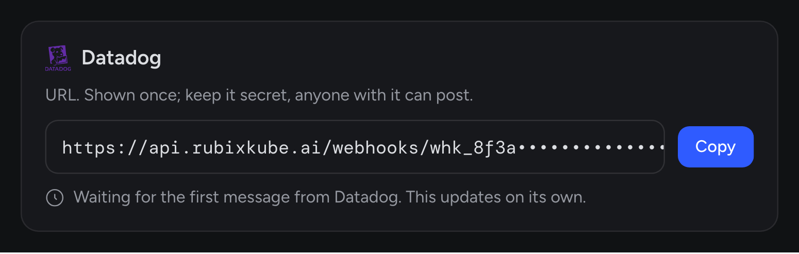
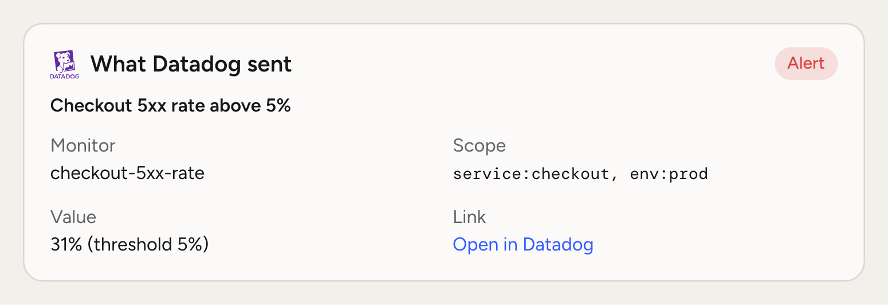
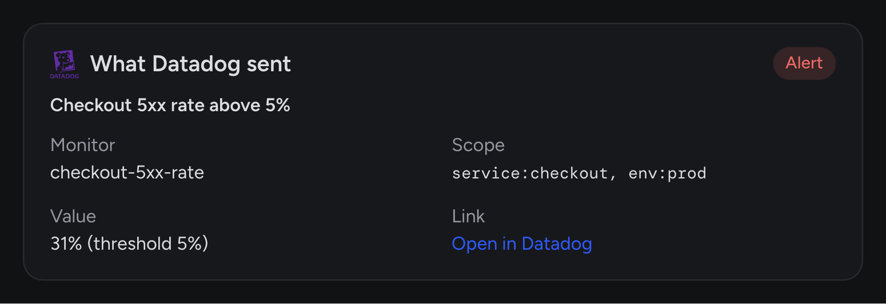

Connect Datadog so a monitor that fires opens an incident in RubixKube, and its recovery resolves it. Your team then gets an investigation for each alert, without opening Datadog to start digging. You can also connect Datadog as a tool Rubix reads while it investigates, so its RCAs can use your logs and metrics.

## When you'd use this

- **Your monitors live in Datadog.** Keep them there, and get an investigation for each one that fires.
- **You see the same problem twice.** Link Datadog to your cluster, and its alerts join the observer's group, with one RCA.
- **You want RCAs to use your logs and metrics.** Add the connection as well, under [What Rubix can read too](#what-rubix-can-read-too).

## Connect it

<Frame>
  
  
</Frame>

<Steps titleSize="h3">
  <Step title="Make its webhook in RubixKube">
    Go to **Environments > Connect** and pick **Datadog**. Give it a name, then choose **Make its webhook**. Copy the URL. It's shown once, and anyone who has it can post to it.
  </Step>
  <Step title="Add the webhook in Datadog">
    In Datadog, go to **Integrations > Webhooks** and add a new webhook. Name it `rubixkube` and paste the URL.
  </Step>
  <Step title="Paste the payload">
    Paste this into the webhook's **Payload** field. The Connect dialog shows the same text, with a copy button. RubixKube needs these fields to read the alert.

```json
{
  "event_id": "$ID",
  "transition": "$ALERT_TRANSITION",
  "monitor_id": "$ALERT_ID",
  "monitor": "$ALERT_TITLE",
  "cycle_key": "$ALERT_CYCLE_KEY",
  "priority": "$ALERT_PRIORITY",
  "alert_type": "$ALERT_TYPE",
  "title": "$EVENT_TITLE",
  "message": "$EVENT_MSG",
  "host": "$HOSTNAME",
  "scope": "$ALERT_SCOPE",
  "tags": "$TAGS",
  "link": "$LINK",
  "date": "$DATE"
}
```
  </Step>
  <Step title="Add it to your monitors">
    Put `@webhook-rubixkube` in the message of each monitor you want. Monitors without it send nothing.
  </Step>
</Steps>

## What opens an incident and what resolves it

| Monitor state | What happens |
|---|---|
| Triggered, Re-Triggered, No Data, Re-No Data, Renotify | Opens or updates the incident |
| Warn, Re-Warn | Opens the incident one severity lower, with the RCA held |
| Recovered | Resolves the incident |

**Severity** comes from the monitor's priority: P1 is critical, P2 high, P3 medium, P4 and P5 low. With no priority set, an `error` alert is high, a `warning` alert is medium, and anything else is low.

**Warnings.** A warning opens the incident one severity lower than the monitor's priority, so a P2 monitor warns at medium. Its RCA waits 15 minutes. If the monitor goes to Alert in that time, the RCA starts at once. You can turn this off or change the wait in the automation's settings.

**Which alerts count as the same incident.** One monitor plus one scope is one incident. If `Payments errors` alerts for `service:payments-api` and fires again while that incident is open, it updates the same incident. If it alerts for `service:orders-api`, that's a second incident.

**Several scopes at once.** Alerts one monitor sends for several hosts or pods become one group with one RCA. You can turn this off in the automation's settings.

A monitor tagged `impact:degradation` opens as a degradation, so RubixKube treats it as something that got slower. Any other monitor opens as a breakage.

## What you'll see

The source appears on **Environments** as soon as you make its webhook, then shows as connected when the first message arrives. Its page has an **Events** tab with the last 20 messages, so you can check what Datadog really sent.

The automation **Datadog alerts become incidents** is on under **Automations**. If events arrive and no incident opens, the source page says so and offers **Turn on**.

<Frame>
  
  
</Frame>

Each incident carries the alert's details and a link back to Datadog. Triage, the RCA and Tasks then work as they do for any other incident.

## What Rubix can read too

The webhook only carries alerts. To let Rubix look at Datadog while it investigates, open **Customize > Integrations**, pick **Datadog**, choose your Datadog site and connect in one of three ways.

- **Sign in with Datadog.** A Datadog admin first adds `https://console.rubixkube.ai/oauth/callback` under **Organization Settings > MCP Server > MCP OAuth Redirect URLs**.
- **Service account token.**
- **API key and application key.**

The connection's **Reads** section then shows what Rubix can reach: events, logs, monitors, metrics and traces. See [the Reads check](/integrations/overview#see-what-a-connection-can-read).

## Related pages

<CardGroup cols={2}>
  <Card title="Integrations overview" icon="plug" href="/integrations/overview">
    The two ways to connect a tool.
  </Card>
  <Card title="Incidents" icon="triangle-exclamation" href="/using/incidents">
    What happens after an incident opens.
  </Card>
  <Card title="PagerDuty" icon="pager" href="/integrations/pagerduty">
    Bring in the incidents your on-call team already has.
  </Card>
  <Card title="Sign-in and tokens" icon="lock" href="/integrations/oauth-and-auth-types">
    How connections sign in.
  </Card>
</CardGroup>
