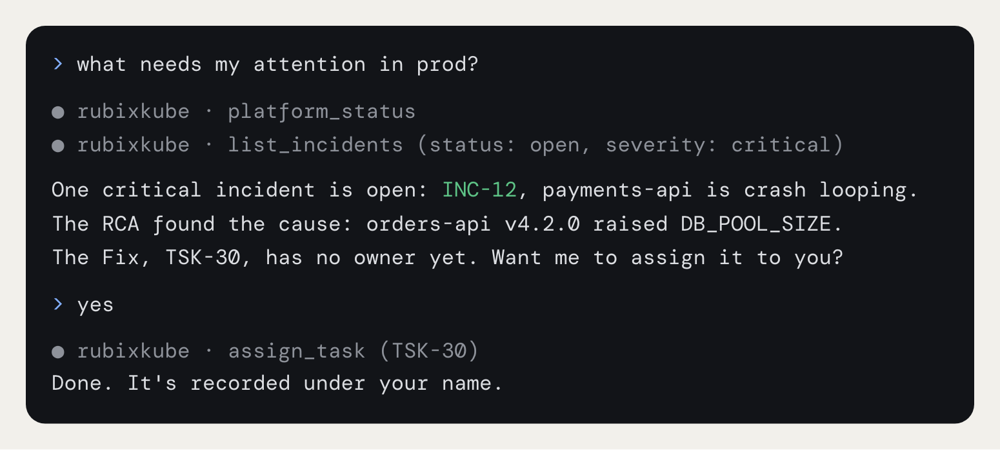
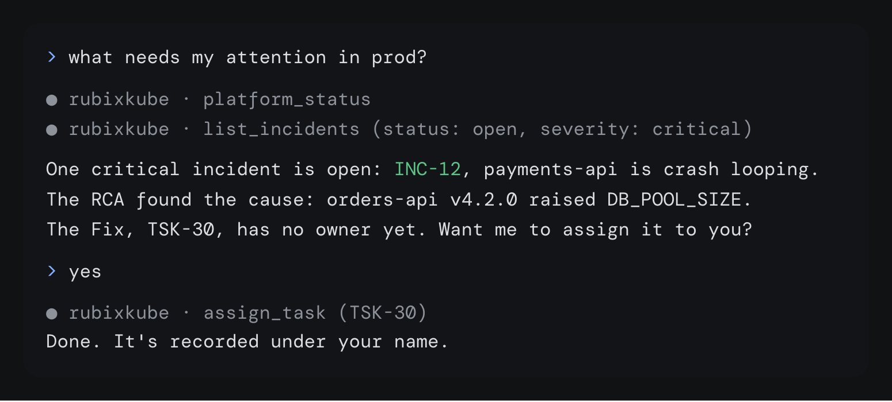

If you spend your day in an AI coding tool, you shouldn't have to switch to the console to check an incident. The RubixKube MCP server lets you use RubixKube from the tools you already have. Ask what needs attention, read an RCA, report an incident or turn a Fix into a Task, all from your editor. Any tool that speaks MCP can use it.

The server is at `https://mcp.rubixkube.ai/mcp`, over HTTP. It works with any RubixKube account, on every plan.

<Frame>
  
  
</Frame>

## Install

The console's **Apps** page has a one-click install for Cursor, VS Code and Claude.

<Tabs>
  <Tab title="Claude Code">
    Install the plugin, which adds the server, the skills and a read-only investigator agent:

```bash
/plugin marketplace add rubixkube-io/rubixkube-for-ai
/plugin install rubixkube@rubixkube
```

    Or add only the server:

```bash
claude mcp add --transport http rubixkube https://mcp.rubixkube.ai/mcp
```
  </Tab>
  <Tab title="Cursor">
    Choose **Add to Cursor** on the **Apps** page, or add this to `.cursor/mcp.json`:

```json
{
  "mcpServers": {
    "rubixkube": {
      "type": "http",
      "url": "https://mcp.rubixkube.ai/mcp"
    }
  }
}
```
  </Tab>
  <Tab title="VS Code">
    Choose **Add to VS Code** on the **Apps** page. It adds RubixKube for Copilot.
  </Tab>
  <Tab title="Other tools">
    Choose **Add to Claude** on the **Apps** page for Claude on the web and desktop. For anything else, point it at `https://mcp.rubixkube.ai/mcp` over HTTP.
  </Tab>
</Tabs>

## Sign in

The first time you use it, your tool opens a browser window. Sign in with the same account you use at [console.rubixkube.ai](https://console.rubixkube.ai). You stay signed in after that.

## Acting as you

Everything runs as the person who signed in, and every change is recorded under your name, the same as if you'd made it in the console. If you close an incident from Cursor, the incident's history says you closed it.

[Modes](/using/modes) apply to Rubix, not to your AI tool. RubixKube asks for no approval here, so your AI tool's own confirmation is the check before a change.

## Tools

There are 25 tools. Fifteen read and ten make changes.

### Reads

| Tool | What it answers |
|---|---|
| `platform_status` | One overview: sources and health, open incidents by severity, Tasks waiting, RCAs from the last day |
| `list_environments` | Your sources and their environment labels |
| `environment_snapshot` | The latest infrastructure snapshot of one source |
| `list_incidents`, `get_incident` | Incidents, open by default, with the RCA id when it's done |
| `get_incident_resolution` | What fixed an incident, or the candidates while it waits for an answer |
| `list_rcas`, `get_rca` | RCAs, one line each or in full with evidence |
| `list_tasks`, `get_task` | Tasks with status, priority, owner and links |
| `list_comments` | The comments on an incident, Task or RCA |
| `similar_incidents` | Earlier incidents on the same fingerprint or resource |
| `what_changed` | Deploys, config and scaling changes in the minutes before an incident |
| `search_knowledge` | Find a service, host, person or resource, with its incidents, RCAs and changes |
| `ask_knowledge` | A plain question answered from your organization's recorded history |

### Changes

| Tool | What it does |
|---|---|
| `report_incident` | Report an incident. The RCA runs in the background, so fetch it a few minutes later |
| `edit_incident`, `close_incident` | Correct or close an incident |
| `answer_incident_resolution` | Say what fixed a resolved incident |
| `retry_rca` | Run the RCA again |
| `create_task`, `update_task`, `move_task`, `assign_task` | Create, rename, move and assign Tasks |
| `post_comment` | Comment on an incident, Task or RCA |

## Prompts

These show up as slash commands in tools that support them.

| Prompt | What it does |
|---|---|
| `what_needs_attention` | Open incidents and Tasks, ranked by what to do first |
| `investigate_incident` | Walks one incident: what happened, the RCA, the evidence, what to do |
| `turn_rca_into_tasks` | Creates the Fix and Follow-ups an RCA proposes, after you confirm |
| `morning_summary` | New incidents, finished RCAs and Tasks that moved since yesterday |

## Resources

You can attach these to a chat as context: `rubixkube://environments`, `rubixkube://incidents/open`, `rubixkube://incidents/{id}`, `rubixkube://rcas/{id}` and `rubixkube://tasks/open`.

## Skills

The plugin adds eight skills that tell your assistant when and how to use the tools: `status`, `incidents`, `investigate`, `environments`, `tasks`, `rca`, `changes` and `knowledge`.

Claude Code also gets `rubixkube-investigator`, an agent that walks one incident and reports back without changing anything.

The plugin is open source at [rubixkube-io/rubixkube-for-ai](https://github.com/rubixkube-io/rubixkube-for-ai).

## Related pages

<CardGroup cols={2}>
  <Card title="Slack" icon="slack" href="/integrations/slack">
    Talk to Rubix in your Slack threads.
  </Card>
  <Card title="Rubix chat" icon="comments" href="/using/rubix-chat-agent">
    Talk to Rubix in the console.
  </Card>
  <Card title="Modes" icon="shield-halved" href="/using/modes">
    What Rubix can do without asking.
  </Card>
  <Card title="Integrations overview" icon="plug" href="/integrations/overview">
    The two ways to connect a tool.
  </Card>
</CardGroup>
