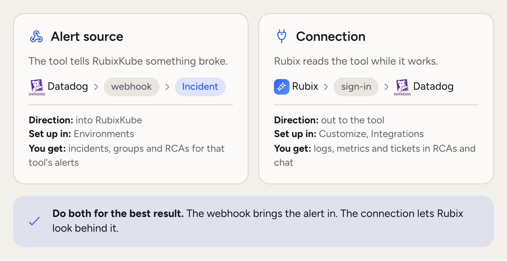
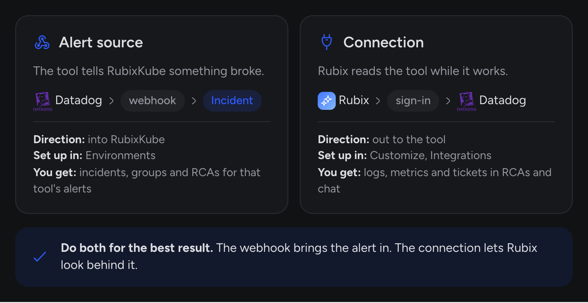
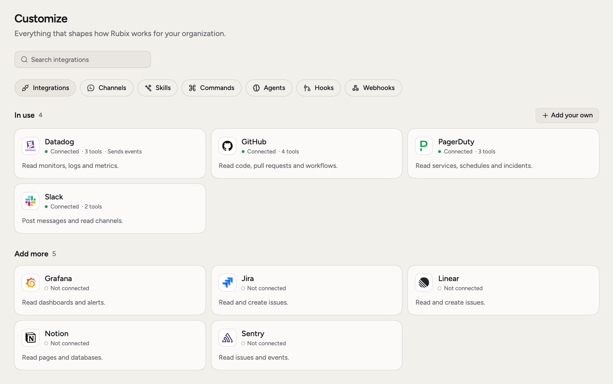
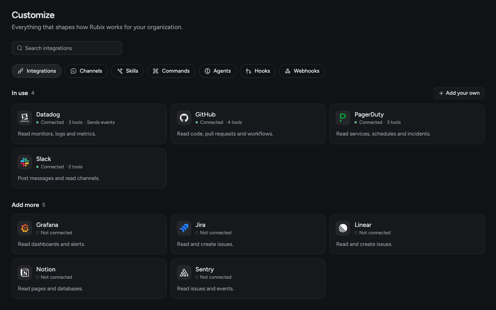

You already have tools that watch your systems and hold your team's knowledge. Connecting them means RubixKube hears about problems sooner, and Rubix has more to read when it works out why.

There are two ways to connect a tool. An alert source sends RubixKube a webhook, and its events become incidents. A connection lets Rubix read a tool while it investigates and chats with you. Many tools can do both, and you set each one up separately.

<Frame>
  
  
</Frame>

## Which one do you need?

- **You want Datadog alerts to become incidents.** Set up an alert source.
- **You want Rubix to read Datadog logs in an RCA.** Add a connection.
- **You want both.** An RCA is only as good as what Rubix can read, so a webhook alone gives it less to work with.
- **You want Rubix to read your code or docs.** GitHub, GitLab and Notion are connections.
- **Your tool isn't listed, or it's your own system.** Use [your own webhook](/integrations/webhooks) to send alerts, or a [custom integration](#your-own-tools) so Rubix can read it.

## Alert sources

An alert source is a tool that tells RubixKube when something breaks. It connects like any other source, under **Environments > Connect**.

You pick the tool and RubixKube makes it a webhook of its own. You paste that URL into the tool. The source registers itself and shows up on **Environments**, and a built-in automation turns its events into incidents. Each tool's page lists exactly which events open an incident and which resolve it.

## Connections

A connection lets Rubix read a tool. It adds evidence to an RCA and answers to your questions in chat. For example, Rubix can look through Datadog logs for `payments-api` while it works out why the service is crash-looping.

<Frame>
  
  
</Frame>

An admin connects a tool under **Customize > Integrations**. Open a tool under **Add more** and sign in, or paste a token, depending on what the tool offers. Some tools ask for a site, region or customer id first. A few need an admin at the other tool to allow RubixKube before anyone can sign in, and the page tells you when that's the case. See [Sign-in and tokens](/integrations/oauth-and-auth-types).

A connection's **Tools** list shows everything the tool offers, with a switch for each one. During an RCA, Rubix only calls tools that read. In chat, any tool that changes something follows your [modes](/using/modes).

## What's available in each

| Tool | Alert source | Connection |
|---|---|---|
| [Datadog](/integrations/datadog) | Yes | Yes |
| [PagerDuty](/integrations/pagerduty) | Yes | Yes |
| [Grafana](/integrations/grafana) | Yes | Grafana Cloud |
| [Sentry](/integrations/sentry) | Yes | Yes |
| [Jira](/integrations/jira) | Yes | Through [Atlassian Rovo](/integrations/atlassian-rovo) |
| [Linear](/integrations/linear) | Yes | Yes |
| [Observe](/integrations/observe) | Yes | Yes |
| [Your own webhook](/integrations/webhooks) | Yes | No |
| [GitHub](/integrations/github), [GitLab](/integrations/gitlab), [Notion](/integrations/notion), [New Relic](/integrations/new-relic) | No | Yes |

The [catalog](/integrations/catalog) has the full list.

## See what a connection can read

A connection that signs in doesn't always reach anything useful. A token can have the wrong scope, or the logs can live somewhere else. So RubixKube checks.

After you connect, sign in or press **Test**, RubixKube makes real reads against the tool over the last hour. The tool's **Reads** section shows one row for each kind of evidence, such as Logs, Metrics, Alerts or Tickets, and each row says what happened.

| Status | What it means |
|---|---|
| Reads | Rubix read data from this place |
| Nothing in the last hour | The read worked and came back empty |
| Refused | The tool said no. The row shows its words and the fix |
| Failed | The read didn't work. The row shows the error |

The same rows appear on an alert source's page under **Environments**. Datadog, PagerDuty, Observe and Atlassian Rovo get a read for each kind of evidence. Other tools get one read that shows the connection answers.

## Your own tools

To connect something that isn't in the catalog, choose **Add your own** under **Customize > Integrations**. You can add an [MCP server](/integrations/custom-mcp-servers) or a [REST API](/integrations/custom-rest). Custom integrations are **Business and Enterprise**.

## Related pages

<CardGroup cols={2}>
  <Card title="Catalog" icon="grid-2" href="/integrations/catalog">
    Everything you can connect.
  </Card>
  <Card title="Your own webhook" icon="webhook" href="/integrations/webhooks">
    Send incidents from anything that can post JSON.
  </Card>
  <Card title="Slack" icon="slack" href="/integrations/slack">
    Talk to Rubix and follow incidents in Slack.
  </Card>
  <Card title="Rubix MCP" icon="server" href="/integrations/mcp">
    Use RubixKube from your AI tools.
  </Card>
</CardGroup>
