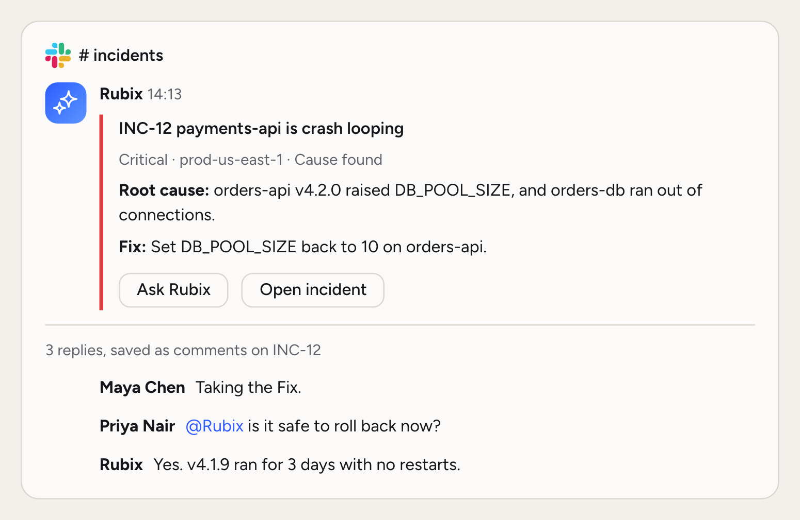
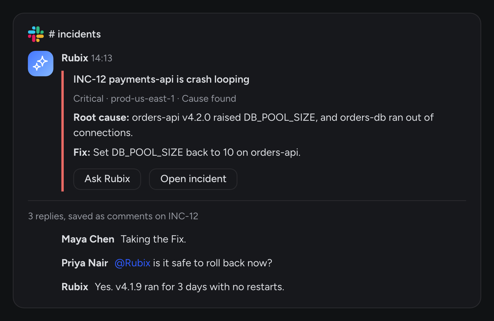

If your team talks in Slack, incidents should be there too. Nobody should have to keep a console tab open to know what's going on.

Rubix in Slack does two things. It answers in the thread when you ask, with what it sees in your environments. And it gives every incident a thread of its own, so your team can follow it and add to it from Slack.

<Frame>
  
  
</Frame>


Slack is **Business and Enterprise**. Rubix uses a large language model and its answers can be wrong, so check before you act, and use the Approve step as the check for any change.

## Install

<Steps titleSize="h3">
  <Step title="Open Channels">
    In the console, an admin goes to **Customize > Channels** and chooses **Add to Slack**.
  </Step>
  <Step title="Allow Rubix in your Slack workspace">
    Slack shows what Rubix asks for. If your Slack workspace requires it, a Slack admin approves the install. RubixKube then creates a private channel, `rubix-incidents`, and invites the person who installed it.
  </Step>
  <Step title="Choose your channels">
    Back in **Customize > Channels**, pick where each kind of message goes. See [Channels](#channels).
  </Step>
  <Step title="Invite Rubix where you want it">
    In each channel where you want to mention it, run `/invite @Rubix`. Rubix only sees channels it's in. Direct messages need no invite.
  </Step>
</Steps>

The agent experience (the Messages tab, sessions and the Stop button) needs a paid Slack plan. Mentions, incident threads and cards work on every Slack plan.

If the console says Slack needs new permissions, an admin chooses **Reconnect**. That's needed once for a workspace connected before incident threads arrived.

## Incident threads

Every new incident or group gets one thread in your Incidents channel. The first message is the incident's card, and the card follows its status. It shows what Rubix is doing while it investigates, the root cause and the Fix once there is one, and the outcome once it's closed.

The thread collects what happens, one line at a time:

- Triage's decision and any change of severity
- Why an RCA is waiting, and when Rubix starts it
- Rubix's progress notes, or a line saying the RCA run failed
- The root cause, with the RCA's card
- Comments people add in the console
- Who closed the incident and why, or that it reopened

An incident that joins a group says so with a link, and later updates go to the group's thread.

### Replies become comments

A reply in an incident thread is saved as a comment on the incident, under your name. It shows in the console, and Rubix reads comments during an RCA. The first time you reply in a thread, Rubix tells you, in a note only you can see.

To ask Rubix something, mention `@Rubix` in the thread. The mention is saved as a comment too, and Rubix answers there.

## Channels

An admin picks a channel for each kind of message under **Customize > Channels**. A category with no channel of its own follows Incidents.

| Category | What goes there |
|---|---|
| Incidents | New incidents and groups, each in its own thread |
| Reports | Weekly digests |
| Account | Members, sources and tools |
| Uptime | Uptime alerts |

If Rubix isn't in a channel you picked, the console says so. Run `/invite @Rubix` there.

## Cards

Paste a link to an incident, RCA, Task or artifact from the console and Slack shows it as a card. It works in any channel Rubix can see. The card has the facts, buttons such as **Ask Rubix**, and a side pane with the details. **Ask Rubix** starts a conversation about it in that thread.

## Talk to Rubix

### In a channel

Mention Rubix with a question. It answers in the thread, and the thread is one conversation: later mentions continue it, and Rubix reads what the thread said in between.

```
@Rubix what needs attention right now?
@Rubix why is payments-api crash-looping?
```

### In the Messages tab

Open Rubix from the apps list and ask there. Suggested prompts sit at the top, Rubix shows a working state with a Stop button while it thinks, and the channel you're looking at is passed along as context, so "what is going on in this channel?" works.

### Approvals

When Rubix proposes a change (closing an incident, moving a Task, running a command), the thread gets a card with the exact command and three buttons: **Approve**, **Approve for this chat** and **Deny**. Nothing runs until someone approves. The card then shows who decided, and the decision is recorded in your organization's activity log with that person's name.

### Questions

When Rubix needs a choice, the thread gets the options as buttons, with **Let Rubix decide** as a way out. In a direct message, a plain reply answers. In a channel, mention Rubix with the answer.

### Words in a thread

| Say | Rubix |
|---|---|
| `stop` | stops what it's doing in this thread |
| `status` | says what it's waiting on (an approval, a question) |
| `settings` | lets you pick the model and the source for this thread |
| `help` | explains what it can do |

`/rubixkube help`, `/rubixkube stop` and `/rubixkube settings` work from anywhere.

## Modes

A new conversation takes your organization's default mode, set by an admin under **Settings > Modes**: **Observe** (reads and explains, makes no changes), **Assist** (asks before each change) or **Auto** (makes changes without asking, and asks before anything destructive). The first reply in a thread says which mode the conversation is in.

## Permissions and data

Rubix asks Slack for these permissions:

| Permission | What it's for |
|---|---|
| `app_mentions:read` | Hear mentions |
| `im:history` | Hear direct messages |
| `channels:history`, `groups:history` | See replies in incident threads, and read a thread when mentioned (at most fifteen messages) |
| `channels:read`, `groups:read` | List channels so you can pick them under **Customize > Channels** |
| `groups:write` | Create the private `rubix-incidents` channel |
| `chat:write` | Post and stream replies, and incident threads |
| `assistant:write` | Run the Messages tab |
| `commands` | The `/rubixkube` command |
| `links:read`, `links:write` | Show cards for RubixKube links |
| `reactions:write` | Add a reaction to acknowledge a mention |
| `users:read`, `users:read.email` | Show who asked, and match a Slack reply to its author |
| `incoming-webhook` | Post to a channel for a Slack workspace still being set up |

Rubix receives messages from channels it's in and keeps only what's listed below. It doesn't join channels on its own, apart from the `rubix-incidents` channel it creates, and it can't see channels it isn't in.

Replies in incident threads are saved as comments on the incident. What you say to Rubix, and the thread messages sent along as context, become part of that conversation in RubixKube, kept as long as your organization keeps the conversation. Nothing else from Slack is stored. Rubix writes one thing into Slack apart from its messages: a conversation identifier in the metadata of its own replies. No Slack data is used to train models. See the [privacy policy](https://rubixkube.ai/privacy).

## Troubleshooting

<AccordionGroup>
  <Accordion title="Rubix doesn't answer a mention">
    Check that the Slack workspace is connected under **Customize > Channels**, and that Rubix was invited to the channel with `/invite @Rubix`.
  </Accordion>
  <Accordion title="This Slack workspace is not connected to RubixKube">
    An admin connects it under **Customize > Channels**.
  </Accordion>
  <Accordion title="Incidents aren't reaching Slack">
    Open **Customize > Channels** and check the Incidents row. If it says to invite Rubix, run `/invite @Rubix` in that channel. If the page asks you to reconnect, choose **Reconnect**.
  </Accordion>
  <Accordion title="Rubix is still answering in this thread">
    Say `stop` in the thread, or press Stop.
  </Accordion>
  <Accordion title="Remove Rubix">
    Choose **Disconnect** under **Customize > Channels**, or remove the app in Slack. Either stops it at once.
  </Accordion>
</AccordionGroup>

## Related pages

<CardGroup cols={2}>
  <Card title="PagerDuty" icon="pager" href="/integrations/pagerduty">
    Bring your on-call incidents into RubixKube.
  </Card>
  <Card title="Notifications" icon="bell" href="/using/notifications">
    What reaches you, and where.
  </Card>
  <Card title="Modes" icon="shield-halved" href="/using/modes">
    What Rubix can do without asking.
  </Card>
  <Card title="Rubix MCP" icon="server" href="/integrations/mcp">
    Use RubixKube from your AI tools.
  </Card>
</CardGroup>
