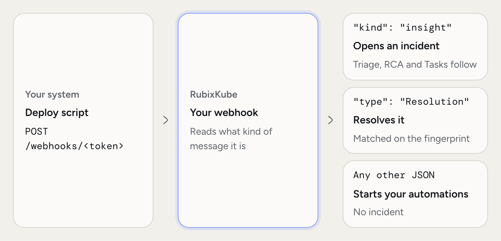
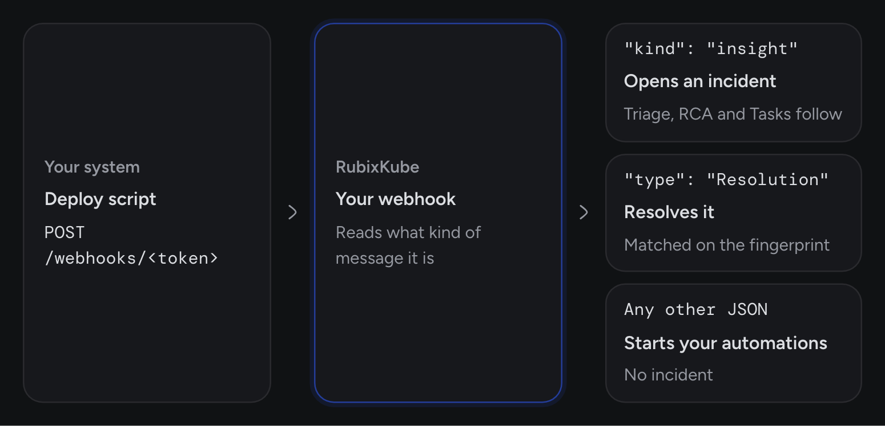
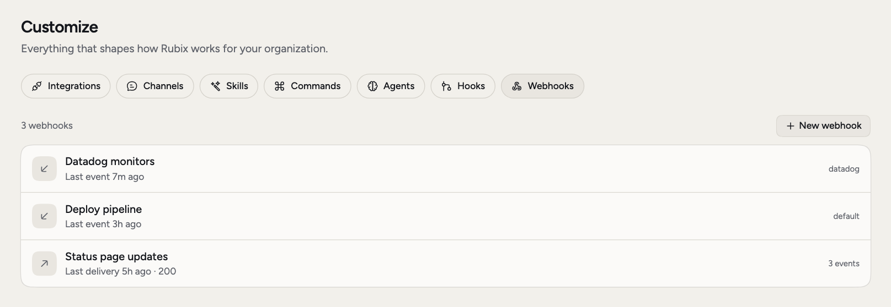
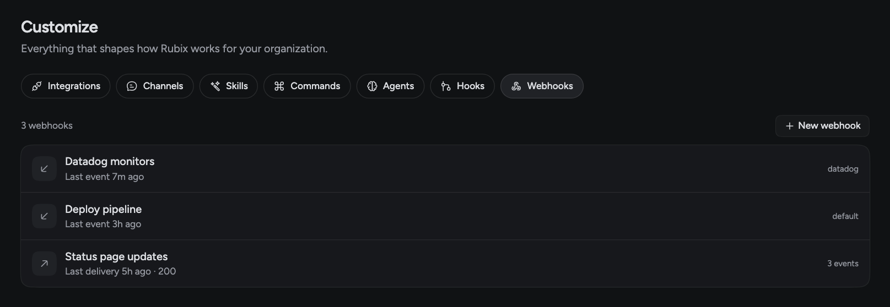

Not everything you run has a connector. A webhook connects RubixKube to anything that can make an HTTP request: a deploy script, a home-grown monitor, a tool we don't list. An incoming webhook is a secret URL your tools post to. An outgoing webhook is an address RubixKube posts to when something happens.

Webhooks are **Business and Enterprise**, and only admins can see and change them. You'll find them under **Customize > Webhooks**.

## When you'd use this

- **Your own monitor found a problem.** Send it in, and it gets triage, an RCA and Tasks like any other incident.
- **A deploy finished.** Send an event, and an [automation](/using/automations) checks that nothing broke.
- **You want RubixKube's events in your own system.** An outgoing webhook posts to an address of yours.

<Frame>
  
  
</Frame>


<Frame>
  
  
</Frame>

## Connect it

<Steps titleSize="h3">
  <Step title="Make the webhook">
    Go to **Customize > Webhooks** and choose **New webhook**. Pick **Incoming** and give it a name, such as `Deploy pipeline`.
  </Step>
  <Step title="Choose who uses it">
    Under **Used by**, pick a source or environment, or type a new source id. With one source, everything the webhook receives belongs to it. With several, each message says which one. With none, messages belong to `default`, which is every environment.
  </Step>
  <Step title="Save and copy the URL">
    Choose **Save**. The URL is shown once, and anyone who has it can post. If you lose it, **New URL** replaces it and the old one stops working at once.
  </Step>
  <Step title="Send something">
    Post JSON to the URL. The drawer has a **Try it** command you can paste into a terminal.
  </Step>
</Steps>

## What opens an incident and what resolves it

A message opens an incident when it has `"kind": "insight"`. That value is the older name for an incident, so keep it exactly as written.

```bash
curl -X POST https://api.rubixkube.ai/webhooks/<your-token> \
  -H "Content-Type: application/json" \
  -d '{
    "kind": "insight",
    "type": "DeployFailed",
    "message": "orders-api rollout failed on 3 of 12 pods",
    "severity": "high",
    "fingerprint": "orders-api-2.14.0"
  }'
```

| Field | What it's for |
|---|---|
| `kind` | `insight` makes it an incident |
| `source` | Which source it's for, when the webhook is used by several. You can send an `X-Source` header instead |
| `type` | What kind of problem, in a word or two: `DeployFailed`, `DiskFull` |
| `message` | What happened, as you'd tell a colleague |
| `severity` | `low`, `medium`, `high` or `critical` |
| `fingerprint` | Your own id for the problem. A repeat with the same one updates the incident instead of opening another |

To close it, send a `Resolution` with the same fingerprint:

```json
{
  "kind": "insight",
  "type": "Resolution",
  "fingerprint": "orders-api-2.14.0"
}
```

### Events

A message without `"kind": "insight"` is an event. It can be any JSON, and it starts your [automations](/using/automations). If no automation is listening, it's dropped.

```json
{
  "event": "deploy finished",
  "service": "orders-api",
  "version": "2.14.0"
}
```

### Turn your own events into incidents

If your tool can't send the fields above, add the built-in automation **Your webhook events become incidents** under **Automations**. It reads the JSON your tool already sends.

```json
{
  "title": "orders-api rollout failed",
  "severity": "high",
  "key": "orders-api-2.14.0",
  "service": "orders-api",
  "environment": "production",
  "url": "https://ci.example.com/runs/4821"
}
```

| Field | What it's for |
|---|---|
| `title`, `summary`, `message` or `event` | The incident's title. A message with none of these is ignored |
| `key`, `fingerprint`, `id` or `event_id` | Which incident it belongs to. Without one, the title is used |
| `severity` or `priority` | `critical`, `p1`, `sev1`, `fatal` are critical. `high`, `p2`, `sev2`, `error`, `major` are high. `low`, `p4`, `p5`, `info`, `minor` are low. Anything else is medium |
| `status` or `resolved` | `resolved`, `ok`, `recovered`, `closed` or `"resolved": true` resolves the incident |
| `service`, `host`, `environment`, `url` | Details kept on the incident |

<Warning>
With this automation on, every event with a title opens an incident, across all your own webhooks. A plain `{"event": "deploy finished"}` counts. Leave it off if your webhooks also carry events that aren't problems.
</Warning>

### Limits

A body can be up to 256 KB, and each webhook takes 60 events a minute. RubixKube answers `202` when it accepts a message. A retry with the same `id`, `event_id` or `X-Event-Id` header counts as one delivery.

If your tool can set headers, you can keep the token out of the URL. Post to `https://api.rubixkube.ai/observers/events` with `Authorization: Bearer <your-token>`.

## What you'll see

The webhook's row shows when the last event arrived. A source it registers appears on **Environments**, and its **Events** tab keeps the last 20 messages. Deleting a webhook stops its URL at once. Incidents it opened stay.

## Outgoing webhooks

An outgoing webhook posts to your own address when something happens in RubixKube. Choose **New webhook**, pick **Outgoing**, enter an `https` address and pick the events. **Save** shows the signing secret once.

| Event | Sent when |
|---|---|
| `incident.opened` | An incident opens |
| `incident.resolved` | An incident closes |
| `rca.ready` | An RCA is finished |
| `task.created` | A new Task is created |

The console also lists **Automation finished**, but nothing sends that event today.

```json
{
  "id": "evt_01JA3...",
  "type": "incident.opened",
  "created_at": "2026-10-08T10:12:00Z",
  "data": {
    "incident_id": "6ac6a2...",
    "title": "orders-api rollout failed",
    "severity": "high"
  }
}
```

Each request has an `X-RubixKube-Event` header with the event name, and an `X-RubixKube-Signature` header of the form `sha256=...`. That's an HMAC-SHA256 of the raw body with your secret, so check it to be sure the request came from RubixKube.

Answer with a 2xx within 10 seconds. Any other answer, or none, is tried again up to six attempts, over about 43 minutes, and then recorded as failed. The drawer's **Deliveries** list shows recent results, and **Send a test** posts one now.

## Related pages

<CardGroup cols={2}>
  <Card title="Integrations overview" icon="plug" href="/integrations/overview">
    The two ways to connect a tool.
  </Card>
  <Card title="Automations" icon="bolt" href="/using/automations">
    Do something with the events you send.
  </Card>
  <Card title="Incidents" icon="triangle-exclamation" href="/using/incidents">
    What happens after an incident opens.
  </Card>
  <Card title="Datadog" icon="dog" href="/integrations/datadog">
    A ready-made alert source.
  </Card>
</CardGroup>
