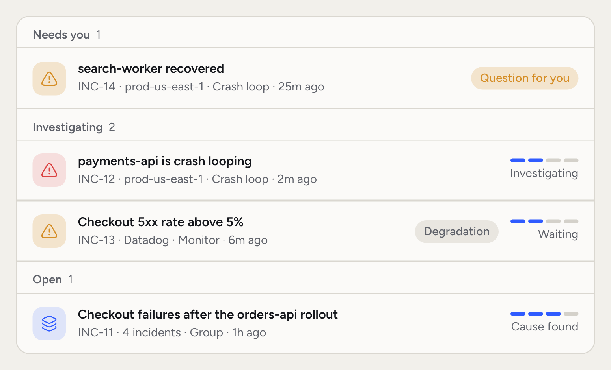
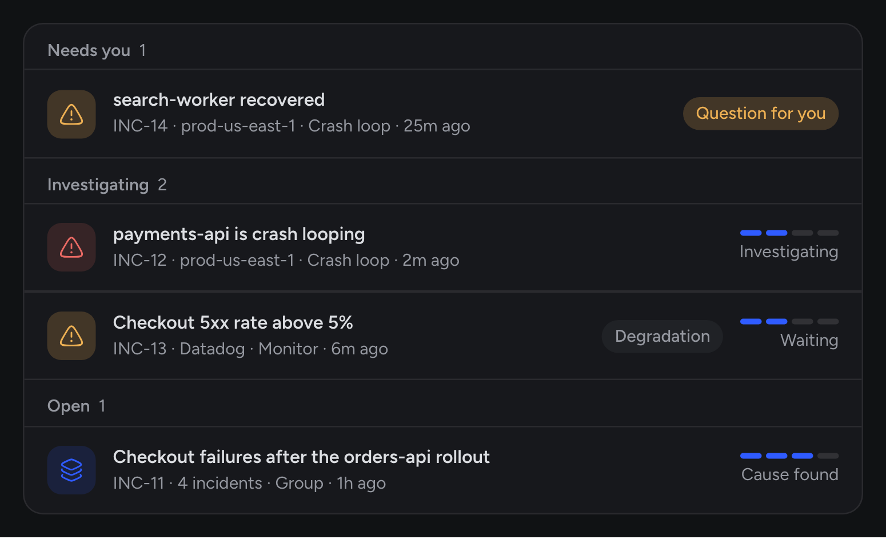
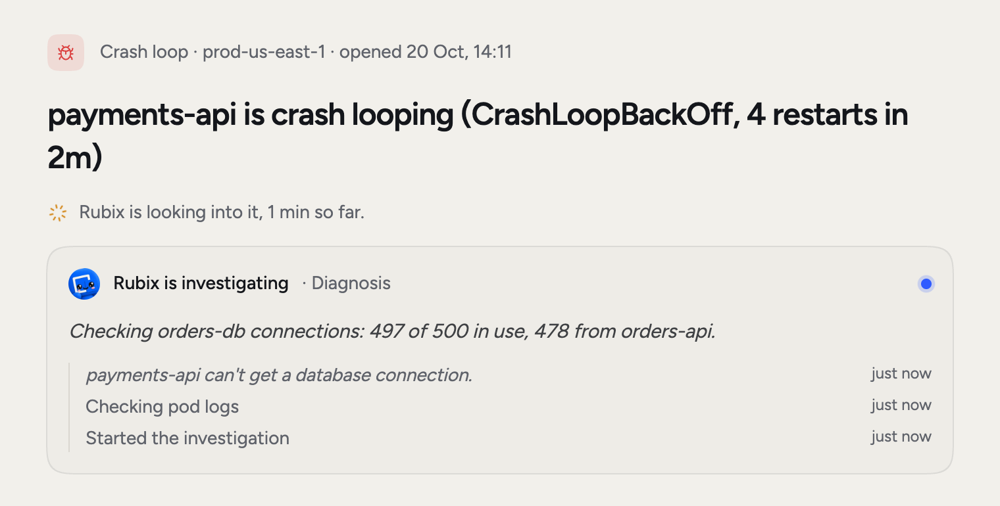
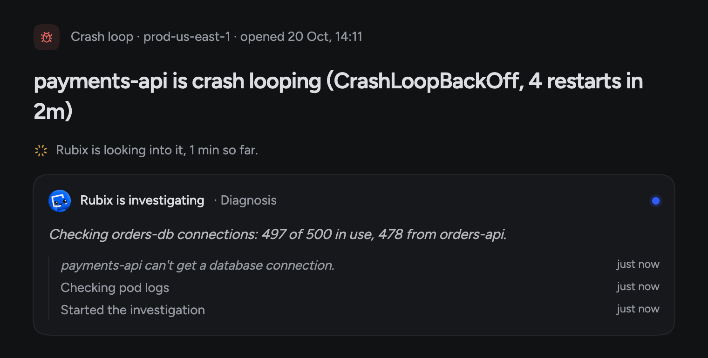
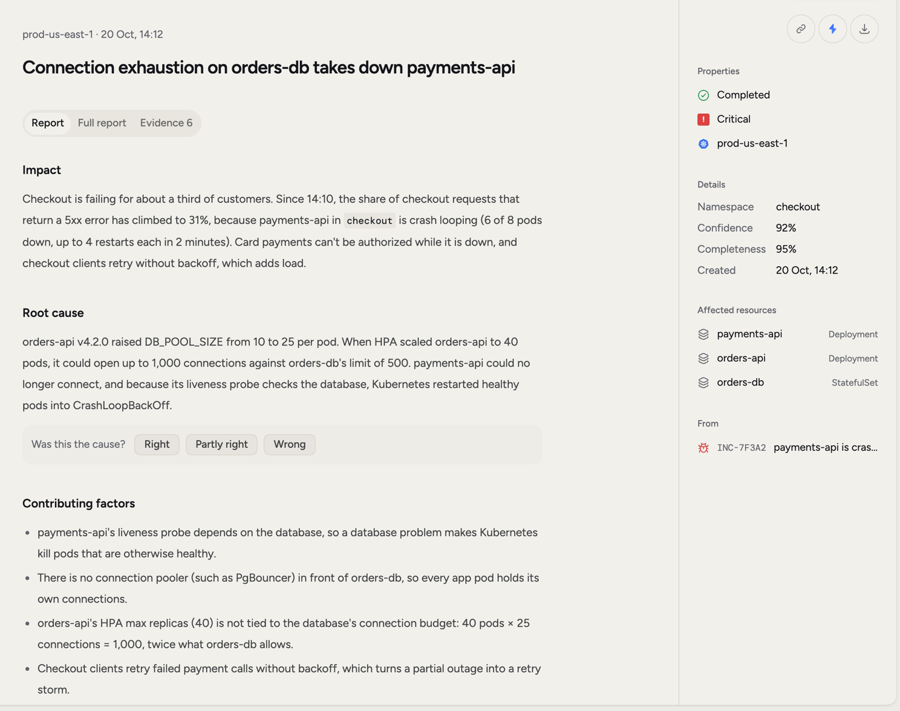
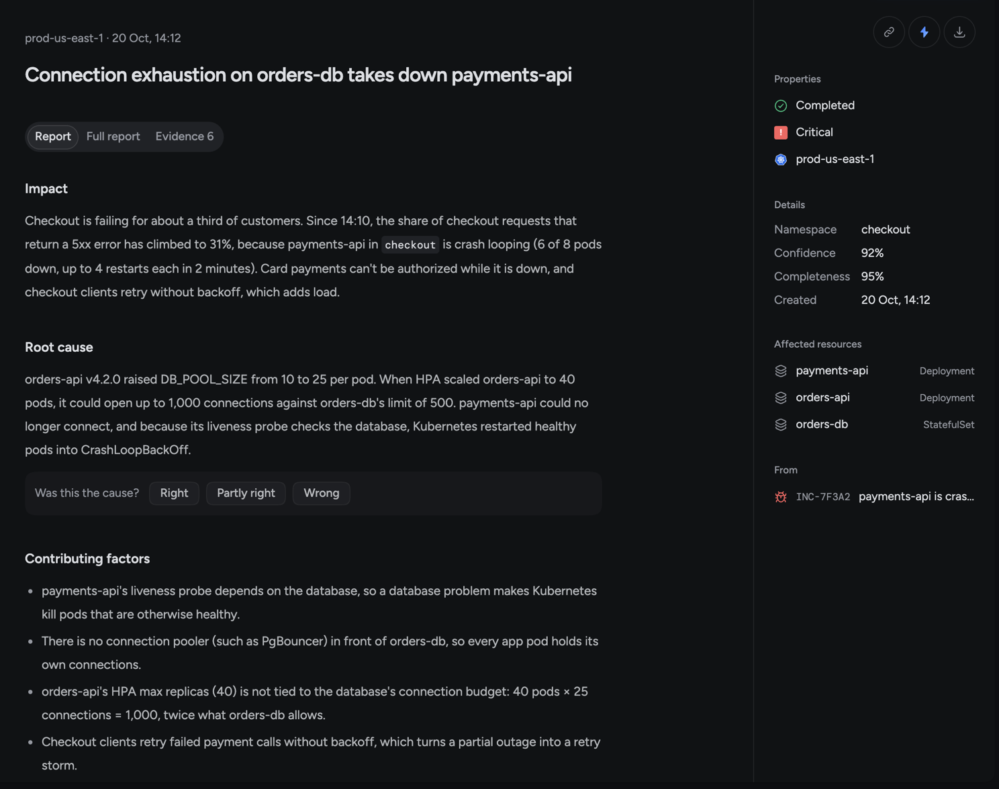
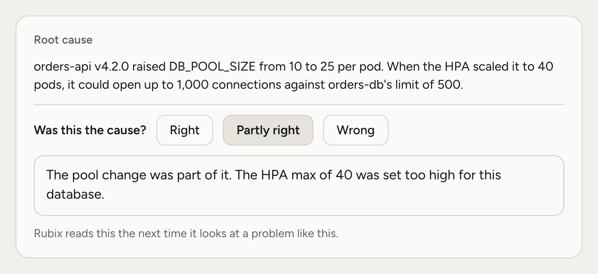
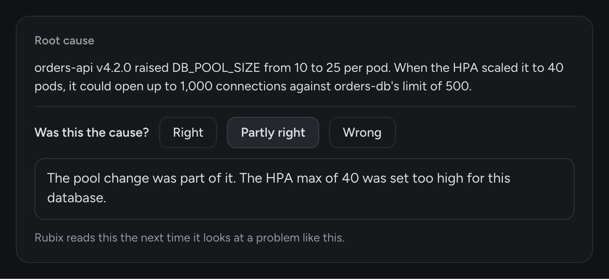
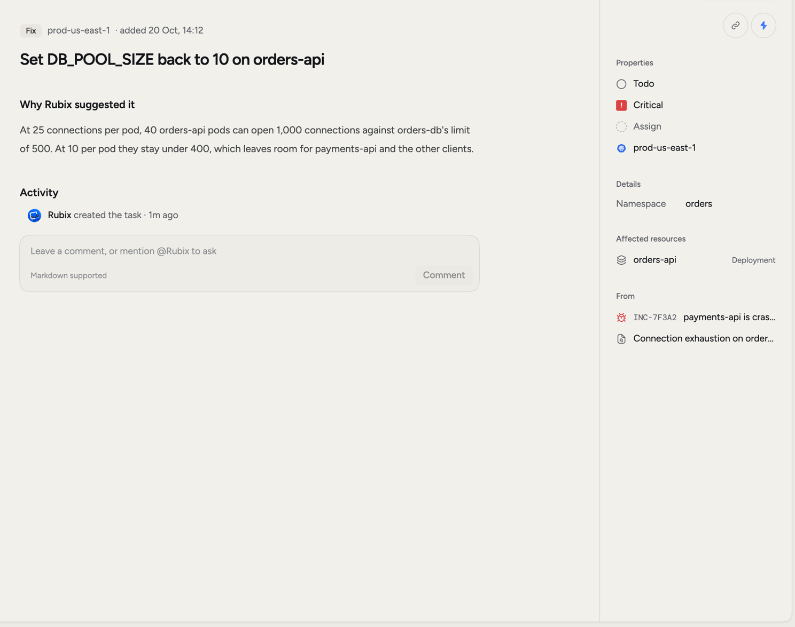
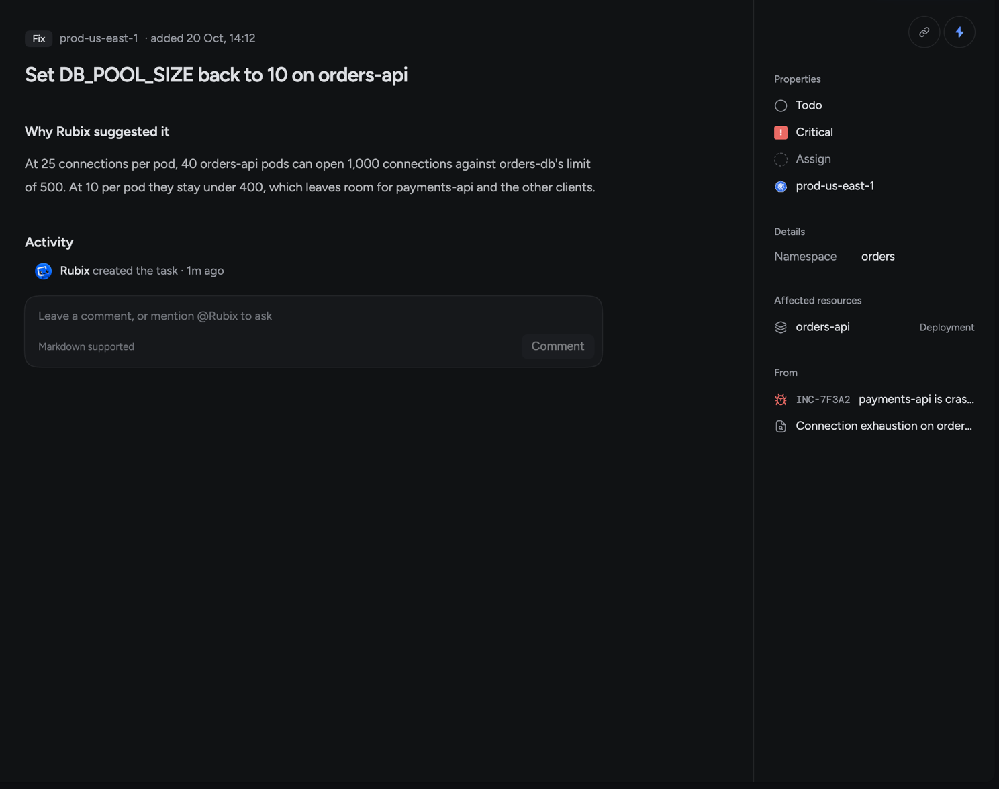

Follow one incident from start to finish. You'll connect a source, watch Rubix investigate, read the RCA, tell Rubix if it got the cause right, assign the Fix and close the incident.

The examples come from a demo organization, Acme Payments. A new `orders-api` version raises its database pool, connections to `orders-db` run out, and `payments-api` starts crash-looping in `prod-us-east-1`. Your names will differ. The steps won't.

You need a [RubixKube account](https://console.rubixkube.ai). The Individual plan is enough.

<Steps>
  <Step title="Connect a source">
    A source is a Kubernetes cluster, cloud account, machine or tool that RubixKube can see. Click **Connect a source** in the sidebar, pick what you're connecting and follow what the dialog shows. [Connect your environment](/getting-started/connect-your-environment) has the details.

    Already connected? Go to the next step.
  </Step>

  <Step title="Let an incident open">
    The observer in your source reports what breaks, and RubixKube turns that into an incident. If you have one open already, use it. If not, you can break something small on purpose:

    ```bash
    kubectl run brokenpod --image=nginx:doesnotexist -n default
    ```

    That image doesn't exist, so the pod can't start.

    <Warning>
      Run this on a test cluster, never on one that serves customers. You'll delete the pod in step 6.
    </Warning>

    Open **Incidents** in the sidebar and wait for it to appear.

    <Frame>
      
      
    </Frame>
  </Step>

  <Step title="Watch Rubix investigate">
    Open the incident. The journey card shows where it is: detected, triaged, waiting, then each part of the investigation with how long it took.

    <Frame>
      
      
    </Frame>

    The RCA doesn't always start right away. Critical incidents go first and less serious ones wait longer. While it waits, the card says what it's waiting for.

    Curious before it finishes? Click **Ask Rubix what it sees so far**.
  </Step>

  <Step title="Read the RCA">
    When Rubix finishes, the incident page shows the cause and links to the RCA. You'll also find it under **RCAs** in the sidebar.

    <Frame>
      
      
    </Frame>

    Start with **Root cause** and **Fix** on the **Report** tab. In our example, the root cause says the new `orders-api` version used up the `orders-db` connections, which left `payments-api` crash-looping. The Fix says to set `DB_POOL_SIZE` back to 10.

    Below that you'll find the Tasks, the impact, the rollback steps and a timeline. The **Evidence** tab shows what Rubix based its answer on, and **Confidence** in the side panel shows how sure it is.
  </Step>

  <Step title="Say if Rubix got it right">
    Rubix can be wrong, so every RCA asks. Under the root cause, **Was this the cause?** has three answers: **Right**, **Partly right** and **Wrong**.

    <Frame>
      
      
    </Frame>

    Right is one click. Partly right and Wrong ask what it really was. Rubix reads your note the next time it looks at a problem like this, so a sentence here pays off later.

    If the RCA missed, you can also pick **Run the RCA again** from the menu.
  </Step>

  <Step title="Assign the Fix">
    The **Tasks** section lists what Rubix proposes. A Fix solves this problem. A Follow-up stops it from coming back. Open the Fix.

    <Frame>
      
      
    </Frame>

    Click **Assign to me**, or use **Assign to…** to give it to someone else. **Why Rubix suggested it** explains the reasoning. Click **Start** when you begin and **Complete** when it's done. If someone should check the work, use **Send for review**, and they can **Approve** it.

    Want help doing it? **Ask Rubix about this** opens a chat about the Task. What Rubix can do for you there depends on your [mode](#what-changes-under-observe-assist-and-auto).

    If you made the test pod, the Fix is to remove it:

    ```bash
    kubectl delete pod brokenpod -n default
    ```
  </Step>

  <Step title="Say what fixed it">
    When the problem clears, the observer reports the recovery. If Rubix can't explain why it recovered, the incident moves to **Needs you** and asks **What fixed it?**, or **Which of these fixed it?** when it saw changes right before the recovery.

    Pick a change, **It recovered on its own** or **Something else**, then click **Save answer**. Not sure? **Ask Rubix to check** looks at the evidence for you.

    A short answer is enough:

    ```
    Set DB_POOL_SIZE back to 10 on orders-api.
    ```

    If this question doesn't appear, Rubix doesn't need the answer. Go to the next step.
  </Step>

  <Step title="Close the incident">
    Open the status menu on the incident and pick **Close incident**, or press `X`. It moves to Resolved as closed by you. Open Tasks stay open, so your Follow-ups aren't lost.

    If you'd like incidents to close by themselves, turn on **Close incidents when they recover** in **Settings > Incidents**.
  </Step>
</Steps>

## What changes under Observe, Assist and Auto

Modes set how much Rubix can do in a session. The investigation only reads, so it runs the same in every mode. The difference is who makes the change in step 6.

| Mode | What Rubix can do | How the Fix gets done |
| --- | --- | --- |
| Observe | Reads and investigates. Nothing that changes anything runs. | You make the change. Rubix can walk you through it. |
| Assist | Can change things, and asks before each change. | Ask Rubix to do it. An **Approval needed** card shows what it wants to run. Pick **Approve**, **Allow in this chat** or **Deny**. |
| Auto | Changes things without asking. Destructive actions always ask. | Ask Rubix to do it. You only see the approval card for destructive actions. |

Rubix can only change things through the tools you've connected. Admins set **Mode for new sessions** and **Highest mode anyone can use** in **Settings > Modes**. Those two apply to the whole organization, and anyone can switch a session's mode up to that limit with `/mode`.

## Common questions

<AccordionGroup>
  <Accordion title="Does every incident get an RCA?">
    No. An alert marked as known doesn't get one, and neither does a problem that recovers before the RCA starts. Incidents in a group share one RCA.
  </Accordion>
  <Accordion title="What's the difference between an incident and an RCA?">
    An incident is something that broke. An RCA is the report Rubix writes about why, with its evidence and the Tasks it proposes.
  </Accordion>
  <Accordion title="What if the RCA doesn't finish?">
    The incident page says so and tells you why. Pick **Run the RCA again** from the menu, or ask Rubix what it can see.
  </Accordion>
  <Accordion title="Can Rubix change something without asking me?">
    Only in Auto, and only if an admin allows Auto for your organization. Destructive actions still ask.
  </Accordion>
</AccordionGroup>

<CardGroup cols={2}>
  <Card title="Incidents" icon="triangle-exclamation" href="/using/incidents">
    Filters, groups and everything else on the Incidents page.
  </Card>
  <Card title="RCAs" icon="file-magnifying-glass" href="/using/rca-reports">
    What each part of an RCA tells you.
  </Card>
  <Card title="Modes" icon="shield-halved" href="/using/modes">
    Choose how much Rubix can do.
  </Card>
  <Card title="Chat prompts" icon="comments" href="/tutorials/chat-prompts">
    Good questions to ask Rubix.
  </Card>
</CardGroup>
