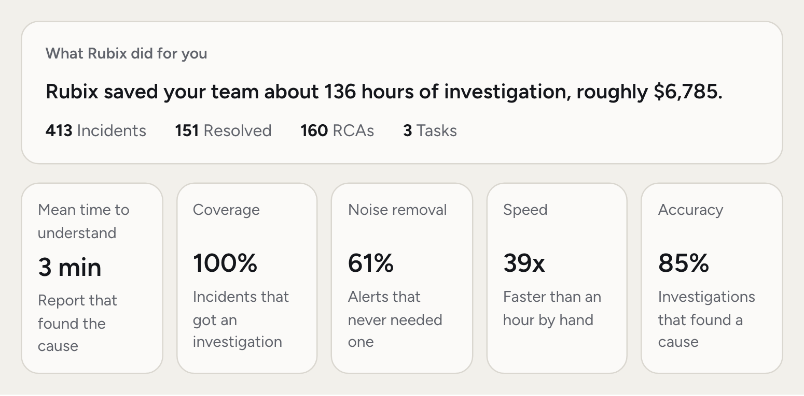
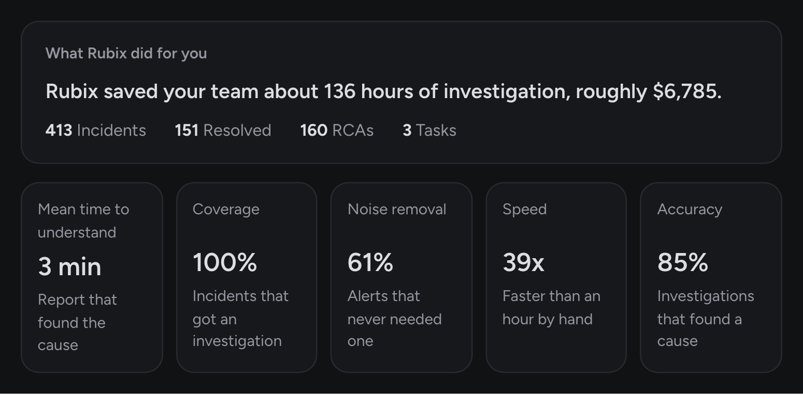
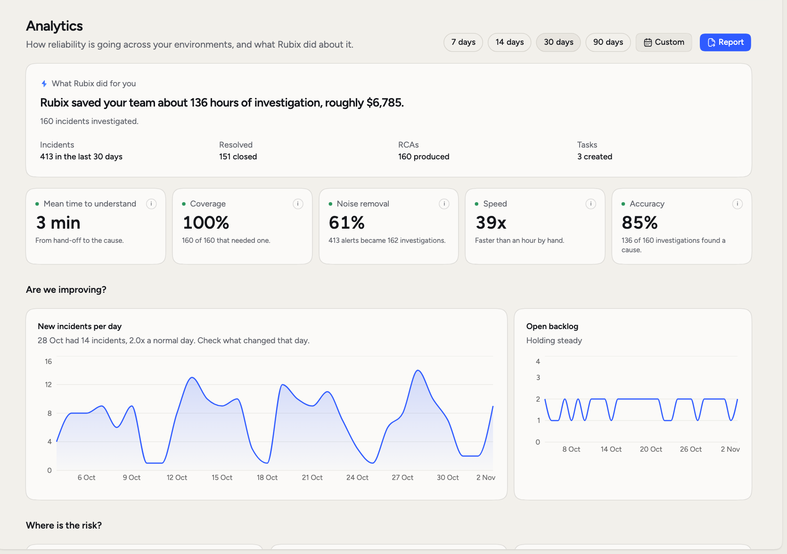
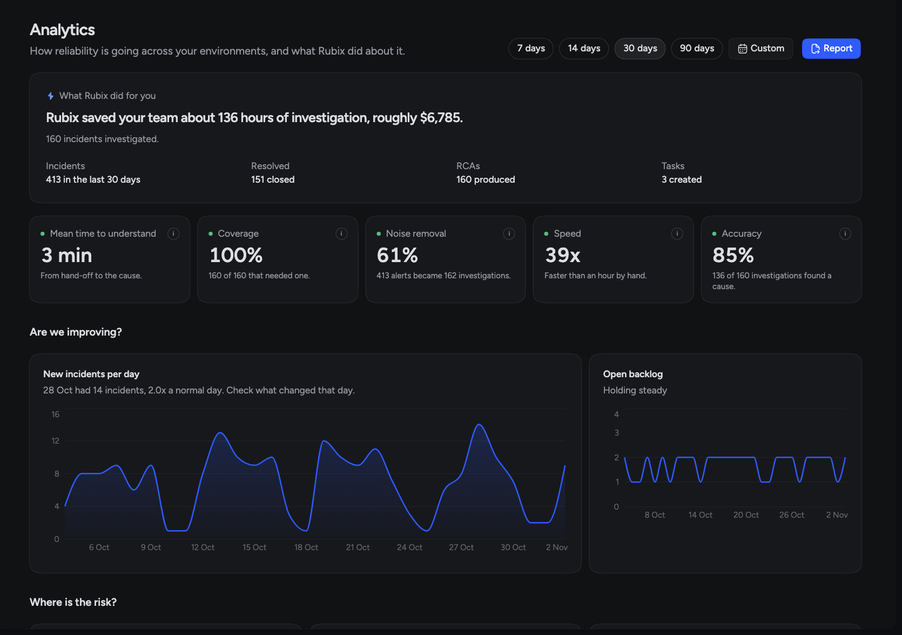

Analytics answers the questions you get asked about reliability: are we getting better, where's the risk, and is this tool worth it? It turns your incidents and RCAs into numbers you can show someone.

## When you'd use this

- **Your weekly review.** See whether new incidents and the open backlog are going down.
- **Deciding what to fix.** **What keeps going wrong** shows where a Follow-up would pay off most.
- **Reporting up.** **Report** gives you a four-page PDF for a leadership review.
- **Checking Rubix.** Coverage and Accuracy show how much it's taking on.

<Frame>
  
  
</Frame>

<Frame>
  
  
</Frame>

## Pick what to look at

Choose **7 days**, **14 days**, **30 days** or **90 days** at the top of the page, or **Custom** for your own dates. The page opens on 30 days.

The environment filter in the page header narrows everything to one environment. With no filter, you see all of them.

A new connection takes a day or two to fill in. Until then the page says "Your first numbers are on their way".

## The header box

The box called **What Rubix did for you** opens with one sentence, "Rubix saved your team about N hours of investigation, roughly $X."

That figure counts one hour of an engineer's time for each incident Rubix investigated, at $50 an hour. Both numbers are fixed, so it's an estimate you can compare between periods, not a measurement of your team. If there's no saving to show, the sentence says what Rubix got through instead.

Under the sentence are four counts for the period: **Incidents**, **Resolved**, **RCAs** and **Tasks**.

## The five numbers

| Number | What it tells you |
|---|---|
| **Mean time to understand** | The median time from RubixKube confirming an incident and starting its investigation to the report that found the cause. |
| **Coverage** | Of the incidents that needed an investigation, how many got one, their own or their group's. Incidents that were ignored or recovered before an investigation started don't need one. |
| **Noise removal** | How many alerts never needed an investigation, because grouping, holds or recoveries took care of them. It's one minus investigations over alerts. |
| **Speed** | How many times faster Rubix's median investigation is than an hour of work by hand. |
| **Accuracy** | The share of investigated incidents where Rubix found a cause. A cause counts at confidence 0.7 and above, or with a determined or likely verdict. |

Click the small **i** on a card to read its definition. Accuracy counts whether a cause was found, not whether it was right. Read the RCA and rate it to check that yourself, see [RCAs](/using/rca-reports).

## How an investigation counts

An investigation counts once per incident or group, however many times the RCA ran. Failed runs never count. Inconclusive ones do, because Rubix did the work and said what it couldn't determine.

## The charts

The rest of the page answers three questions.

**Are we improving?** **New incidents per day** shows the volume. **Open backlog** shows how many stayed open.

**Where is the risk?** **How serious** splits incidents by severity. **What keeps going wrong** ranks the most common kinds of incident, and reads **Which monitors fire** when your incidents come from monitors. **Where, by environment** shows which environment had the most. With one environment selected, it breaks that environment down further, by namespace or service.

**Are we closing the loop?** **New or coming back** shows first-time problems against ones that return. **Where incidents stand** follows incidents from detection to resolution.

Click a bar under **Where is the risk?** to open those incidents in the [Incidents](/using/incidents) list, with the same dates.

## Share a report

Click **Report** to open a **Reliability report**: four A4 pages with the header box, the five numbers and the three questions, for the period and environment you picked. Click **Download PDF** to save it.

<CardGroup cols={2}>
  <Card title="Incidents" icon="triangle-exclamation" href="/using/incidents">
    The incidents behind these numbers.
  </Card>
  <Card title="RCAs" icon="file-lines" href="/using/rca-reports">
    Read each investigation and rate it.
  </Card>
  <Card title="Tasks" icon="list-check" href="/using/tasks">
    The Fixes and Follow-ups that came out of them.
  </Card>
  <Card title="Environments" icon="server" href="/using/environments">
    Your sources and the labels you filter by.
  </Card>
</CardGroup>
