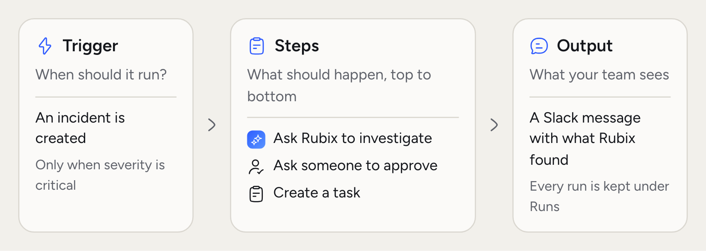
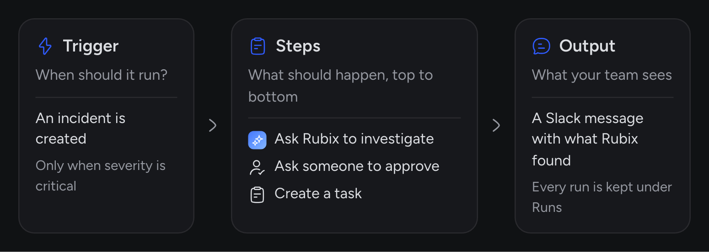
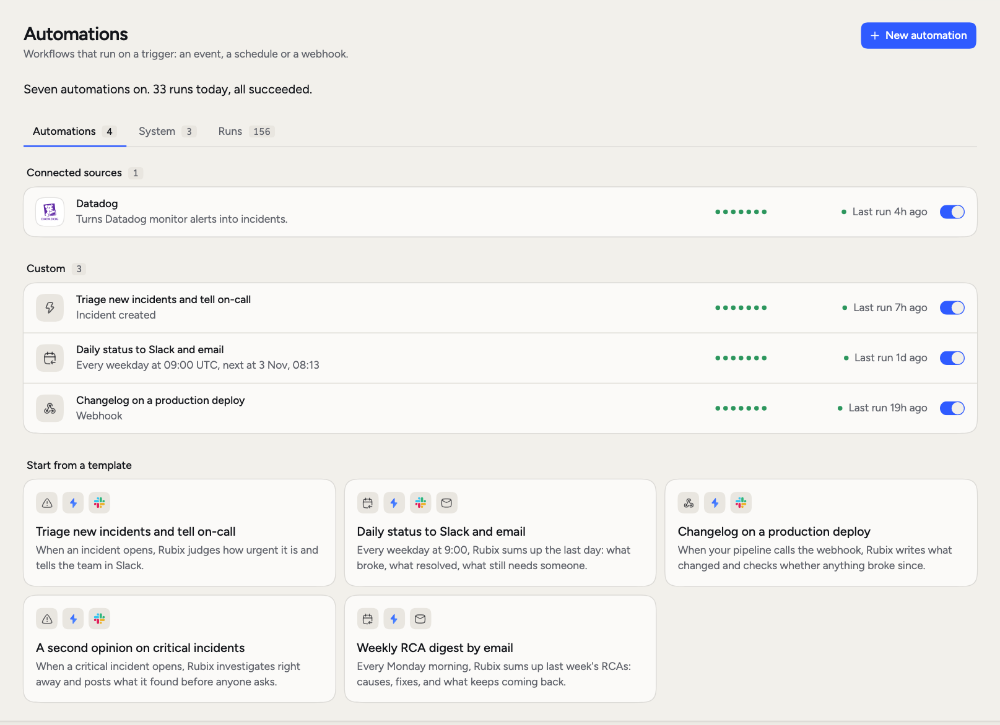
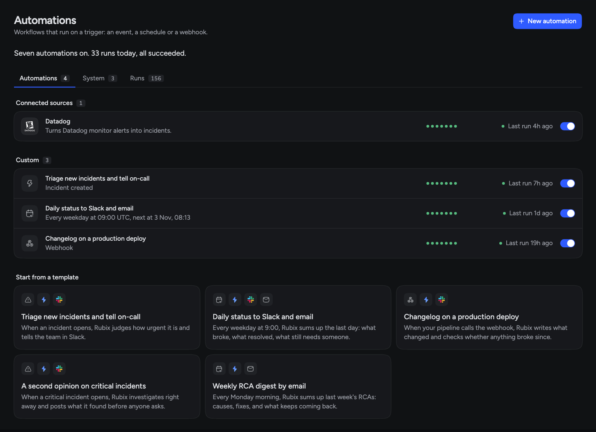
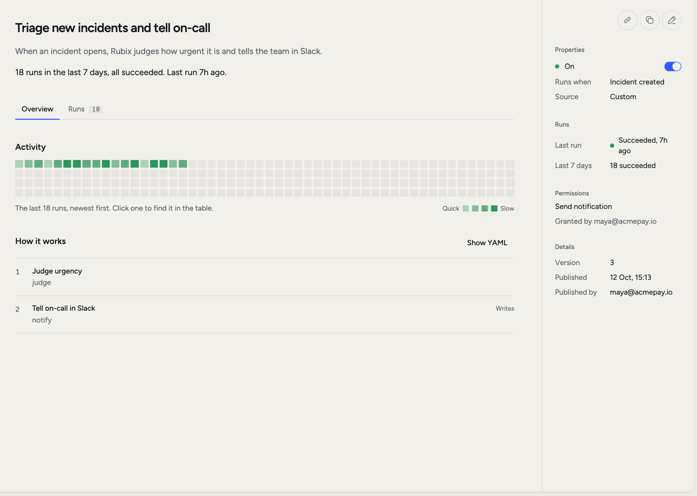
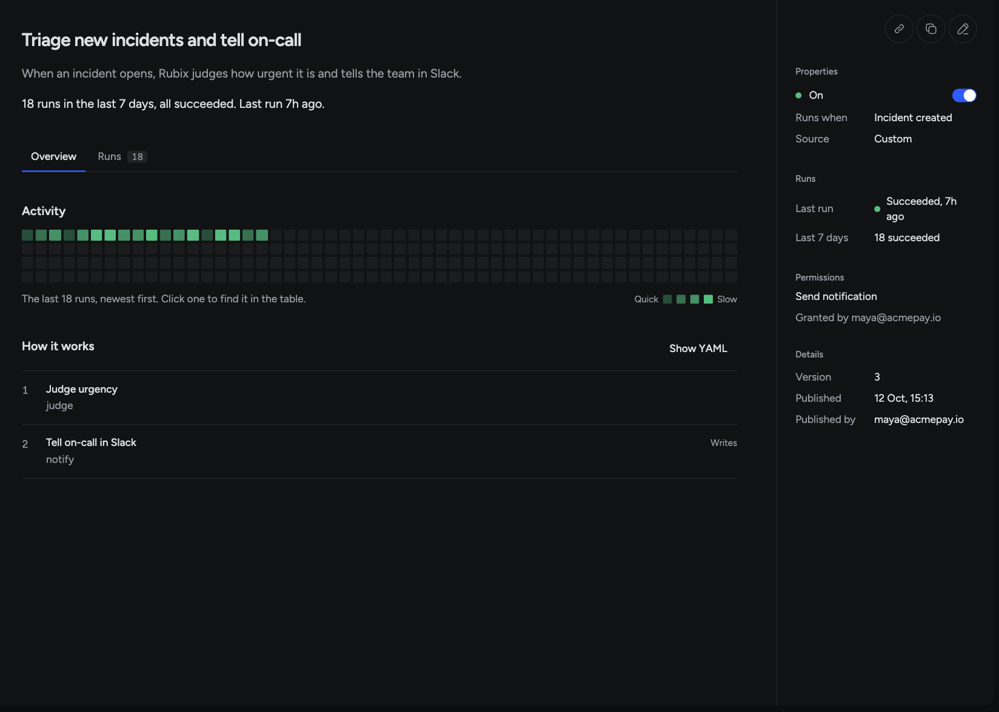
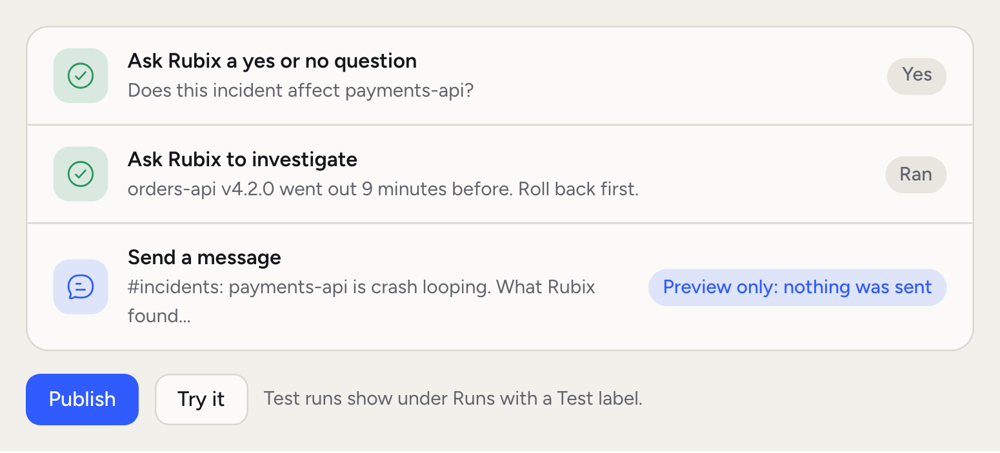
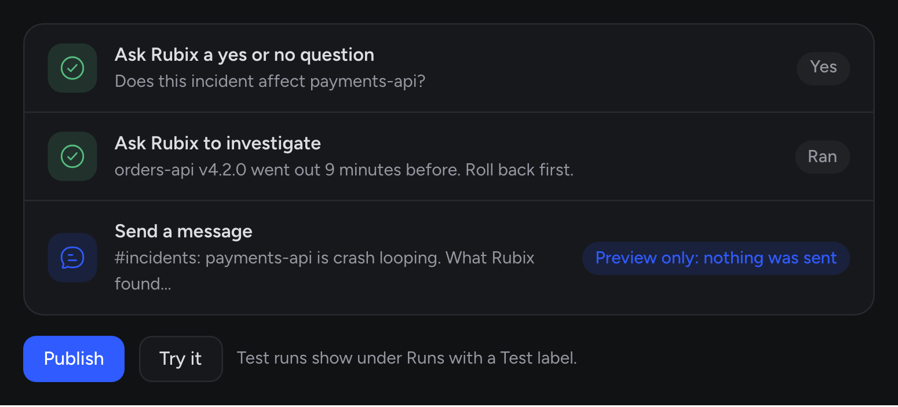

Some work happens the same way every time: tell the team when something critical opens, check every deploy, send a summary each week. Automations do that work for you, so nobody has to remember.

An automation is a rule. When something happens, RubixKube runs a list of steps.

<Frame>
  
  
</Frame>

## When you'd use this

- **Get ahead of the RCA.** When a critical incident opens, have Rubix post a first look to Slack.
- **Check every deploy.** Your pipeline calls a URL, and Rubix writes what changed and whether anything broke.
- **Report on a schedule.** A daily status for the team, or last week's RCAs by email on Monday.
- **Connect your own process.** Open an incident from your own system, or ask someone to approve before a step runs.

Use chat for a one-off question. Use an automation when you'd ask the same thing again next week.

You create your own automations on **Business and Enterprise**. On Individual you can't create or add one, but the ones RubixKube runs for you keep running.

<Frame>
  
  
</Frame>

## What you see

Open **Automations** in the sidebar. One sentence at the top says where things stand: how many are on, how today's runs went, and whether a run needs approval. Below it are three tabs.

**Automations** lists everything in four groups:

- **Connected sources**: automations that came with a source. Connect Datadog, and its alerts become incidents.
- **Built-in**: ready-made automations an admin can add with **Add**.
- **Custom**: the ones your organization made.
- **Start from a template**: ways to begin a new one.

**System** is for admins. It holds what RubixKube runs for you, covered in [Built-in automations](#built-in-automations).

**Runs** shows the last 20 runs of each automation. Filter it by **All**, **Failed** or **Needs approval**.

Each row shows its recent runs as dots, its status, and for admins a switch to turn it on or off.

## Inside an automation

Click a row to open it.

<Frame>
  
  
</Frame>

**Overview** has **Activity**, a grid with one square per run. The color says how the run ended and the depth of color says how long it took. **How it works** lists the steps. **Settings** appears when the automation has values you can change without editing its steps.

**Runs** lists every run, with a search box and the same filters. Click a run to see each step and what it gave back.

## Start from a template

| Template | What it does |
|---|---|
| **Triage new incidents and tell on-call** | When an incident opens, Rubix judges how urgent it is and tells the team in Slack. |
| **Daily status to Slack and email** | Every weekday at 09:00 UTC, Rubix sums up the last day. |
| **Changelog on a production deploy** | When your pipeline calls the webhook, Rubix writes what changed and checks whether anything broke since. |
| **A second opinion on critical incidents** | When a critical incident opens, Rubix investigates right away and posts what it found. |
| **Weekly RCA digest by email** | Every Monday at 08:00 UTC, Rubix sums up last week's RCAs. |

<Steps>
  <Step title="Pick a template">
    Under **Start from a template**, click a card. A panel shows its **Trigger**, **Steps**, **Output**, **Permissions** and **Requirements**.
  </Step>
  <Step title="Create the draft">
    Click **Create**. This saves a draft. Nothing runs yet.
  </Step>
  <Step title="Change what you need">
    Click **Edit** to adjust the trigger or steps.
  </Step>
  <Step title="Publish">
    Click **Publish** to start running it.
  </Step>
</Steps>

Only admins can create and edit automations. The templates that post to Slack need Slack connected, see [Slack](/integrations/slack).

## Build your own

Click **New automation**, or **Edit** on an existing one. Give it a name, then work down the page. A sentence at the top reads your automation back in plain words as you build it.

Under **When should it run?**, choose a trigger. You can add more than one.

| Group | Trigger |
|---|---|
| RubixKube | **An incident is created**, **An incident is resolved**, **An RCA is ready** |
| Your sources | **`<source>` sends an event**, for anything a connected source reports |
| Other | **On a schedule**, **When I run it**, **Another system calls a URL** |

An event trigger runs on every event. To narrow it, use **Add a condition**: severity is critical, for example.

Then click **+** to add steps. They run from top to bottom.

| Group | Step | What it does |
|---|---|---|
| Rubix | **Ask Rubix to investigate** | Rubix looks into it with its tools and writes what it found. |
| Rubix | **Ask Rubix a yes or no question** | One quick check with no tools. Later steps can depend on the answer. |
| People | **Send a message** | Sends to Slack, email or the in-app inbox. |
| People | **Ask someone to approve** | The run waits for a person, for up to 1 hour, 4 hours or 1 day. |
| Incidents | **Open an incident** | Creates an incident, and Rubix starts its RCA. |
| Incidents | **Resolve the incident** | Closes the incident this run is about. |
| Incidents | **Create a task** | Adds a Follow-up on the incident for someone to pick up. |
| More | **Use a tool** | Calls one tool of a connected integration. |
| More | **Wait** | Pauses before the next step. |

In a message, you can insert what came in and what earlier steps gave back, such as the incident title or Rubix's answer.

Open a step's **Advanced** section to set **Only when**, **Time limit**, **Retries** and **If it fails** (**Stop the run**, **Carry on** or **Jump to a step**).

**Advanced settings** at the bottom of the page set limits for the whole automation: **Token budget**, **Time limit** and **Debounce**, which waits after a trigger before running. A switch there keeps it to one run at a time. A token budget is required when a step uses Rubix.

### Repeat and fan-out

The step list also has an **Advanced** group for two steps that change how a run moves.

**Repeat** goes back to an earlier step and runs the steps from there again. Set **Go back to**, **Stop when** and **Rounds at most**, up to 20. Use it when Rubix should keep checking until something is done. The run shows which round each step reached.

**For each item, at the same time** is the fan-out step. It takes a list and runs one job per item in parallel, then collects the answers. Use it to have Rubix check several services at once. An item that fails doesn't fail the step. The next step reads the answers and decides what to do.

## Try a draft

<Frame>
  
  
</Frame>

**Try it** runs your draft without publishing it. Use the button at the bottom of the page for the whole automation, or the one inside a step to run that step alone. If the trigger is an event, the run uses a sample of that event.

In a try:

- Reads run for real.
- Writes are previewed. The step shows what it would send and says **Preview only: nothing was sent**.
- Approvals are approved at once and waits are skipped.
- Rubix steps run for real and use tokens.

Each step then shows what it gave back. Test runs appear in **Runs** with a **Test** label and don't count toward how the automation is doing.

<Warning>
A Rubix step is not previewed. If **Rubix may make changes, not only read** is on for a step, a try runs that step as it would run for real. Leave the switch off until the rest of the automation works.
</Warning>

## Publish

**Save draft** keeps your work and changes nothing that's running. **Publish** puts it live. You can turn it off at any time.

If a step acts outside RubixKube, **Permissions needed** lists it. Click **Allow and publish** to allow those steps on every run without asking. A tool that deletes things can't run in an automation.

If the trigger is **Another system calls a URL**, you get the URL when you publish. It's shown once, so copy it then.

**Delete**, on the automation's page, removes it and its run history. This can't be undone.

## Runs and approvals

A run ends as **Succeeded**, **Failed**, **Cancelled** or **Timed out**. While it's going, it reads **Running** or **Needs approval**.

When a step asks someone to approve, the run stops there until someone answers or the time runs out. Open the run, add a note if you want, and click **Approve** or **Deny**. **Cancel run** stops a run that's in progress.

An automation with a schedule or **When I run it** also has **Run now**.

## Built-in automations

RubixKube ships its own automations. Admins find these on the **System** tab, and each one's page says **RubixKube runs this for you**:

- **Triage incident**
- **Classify incidents**
- **Root cause analysis**
- **Rubix answers in comments**
- **Correlate sources**

You can turn one off to stop it in your organization, but you can't delete it.

Some built-ins have **Settings**. Change a value and click **Save**. A changed value is marked **Changed**, and **Put back** returns it to the default.

RubixKube keeps built-ins up to date, and **Updates** reads **Automatic**. If you edit a built-in's steps, your version stays and **Updates** reads **Paused**. When RubixKube changes it later, you see **Update available**. **Reset** replaces your steps with RubixKube's current version and turns updates back on. Your settings, and whether it's on, stay as they are.

## Two examples

Both use the same problem: a new `orders-api` version raises its database pool, connections run out, and `payments-api` starts crash-looping.

### Check every deploy

Create a draft from **Changelog on a production deploy**, publish it, and add the URL to your deploy pipeline.

When `orders-api` ships, the pipeline calls the URL. Rubix reads what was deployed, writes the changelog in plain words, and looks for incidents opened since. Once `payments-api` starts failing, the Slack message says what changed and gives a verdict on the deploy, so your team sees the link without searching for it.

### Investigate critical payments incidents

Click **New automation** and build this:

1. Trigger: **An incident is created**, with the condition that severity is critical.
2. **Ask Rubix a yes or no question**: "Does this incident affect `payments-api`?"
3. **Ask Rubix to investigate**: "Find what changed before this and what to try first." Under **Advanced**, set **Only when** so the step runs only on a yes.
4. **Send a message** to Slack, with Rubix's headline and what it found.

Click **Try it**. You see Rubix's answer to the question, its investigation, and the Slack message marked as a preview. When it reads well, click **Publish**.

The RCA still runs as usual. This only gets the team a first look sooner.

<CardGroup cols={2}>
  <Card title="Incidents" icon="triangle-exclamation" href="/using/incidents">
    What most automations start from.
  </Card>
  <Card title="Modes" icon="shield" href="/using/modes">
    What Rubix may do without asking.
  </Card>
  <Card title="Your own webhook" icon="webhook" href="/integrations/webhooks">
    Send events from your own systems.
  </Card>
  <Card title="Usage and plan" icon="chart-column" href="/using/usage-and-plan">
    See how many tokens automations use.
  </Card>
</CardGroup>
