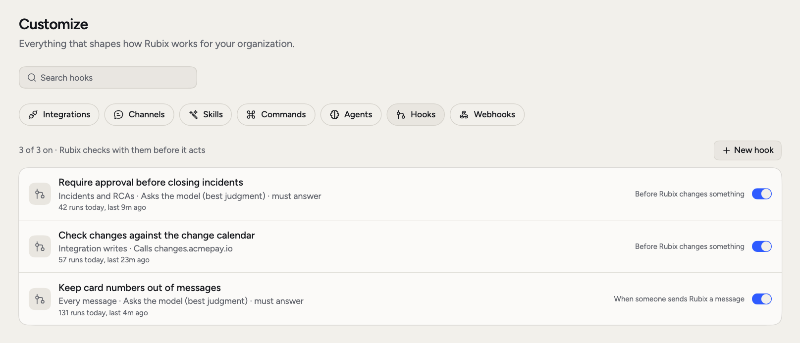
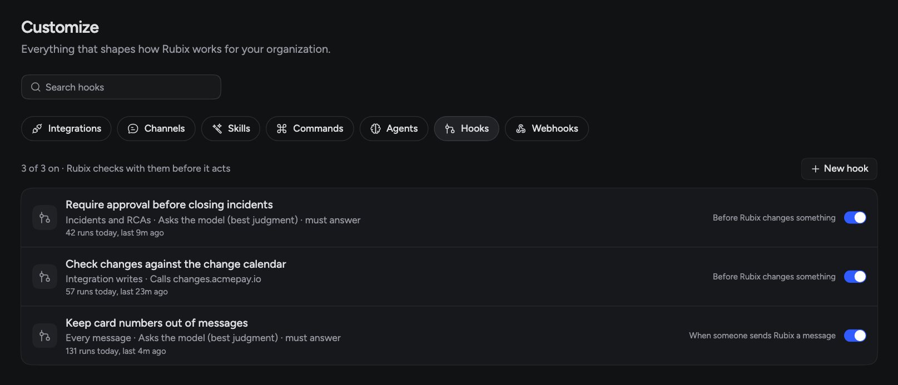
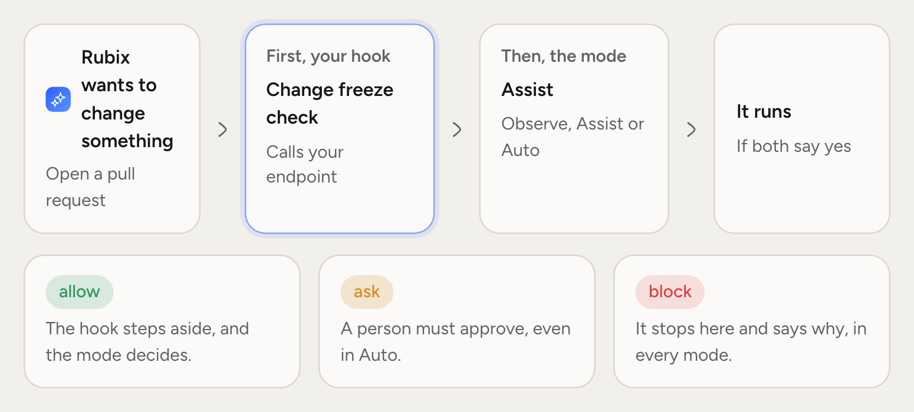
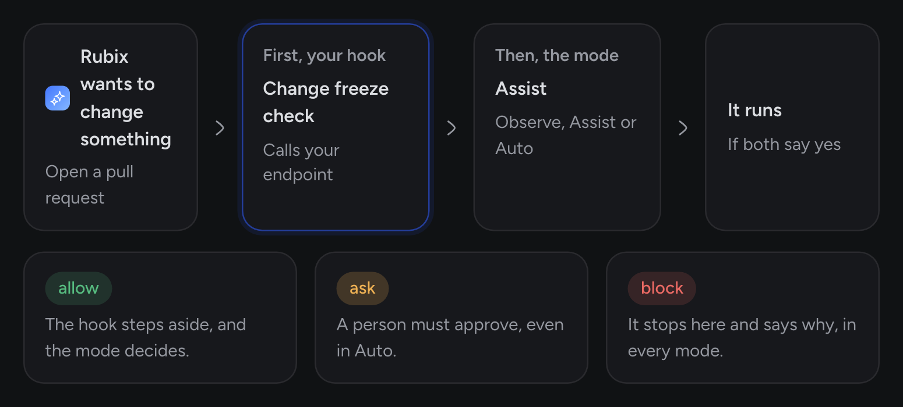

Out of the box, Rubix works the way it works for everyone. **Customize** is how you make it work the way your team does.

- **Commands** save the prompts your team types again and again.
- **Agents** give Rubix specialists to hand work to.
- **Hooks** run your own checks before Rubix acts.

[Skills](/using/skills) sit alongside these, and teach Rubix how you do things.

<Frame>
  
  
</Frame>

## Commands

If your team keeps typing the same long question, save it. A command is a saved prompt. Type `/` in the chat box, pick the command, and its prompt fills the box, ready for you to edit and send. Everyone in the organization can use commands. Admins add and change them.

To add one, open **Customize > Commands** and click **New command**. You can also pick **/triage**, **/postmortem** or **/status** under **Start from an example** and edit it.

Put `$ARGUMENTS` where the person's own text goes. The cursor lands there. Here's a small example:

| Field | Value |
|---|---|
| **Name** | `pool-check` |
| **What it's for** | Check a service's database connections |
| **What to type after it** | service |
| **Prompt** | Check database connections for $ARGUMENTS in prod-us-east-1. Compare the pool size with the last version and tell me if it changed. |

Someone types `/pool-check`, picks it, types `orders-api` and sends.

## Agents

Some questions go better with a narrow focus, like reading database locks without the noise of everything else. Rubix can hand part of a task to a specialist. The specialist works in its own context, only reads, and reports back to Rubix. It can't change anything, and it doesn't talk to you directly.

**Customize > Agents** lists Rubix, its built-in specialists such as the Investigator, and your organization's own, marked **Yours**. Open one to see what it can reach. Below that, admins see the observers in each environment, their tool servers, and whether each one is checking in.

To add a specialist, click **New agent**. Only admins can do this.

| Field | What to enter |
|---|---|
| **Name** | Lowercase letters, digits and dashes, like `database-expert` |
| **When Rubix should use it** | Rubix reads this to decide which agent fits a task |
| **Instructions** | How it should work and what to look at |
| **What it can reach** | **Records**, **Observer tools**, **Knowledge base** and **Integrations**. All read-only. With none, it only reasons over what Rubix hands it |

For example, a `database-expert` agent for `orders-db` could have "Postgres slow queries, locks and connection limits" as its **When Rubix should use it**, and instructions that say to check the database pods first.

## Hooks

Modes set how much Rubix does in general. Hooks are for the rules with no exceptions, like "no changes during a freeze" or "nothing posted to customer channels". A hook is a check Rubix runs at a set moment. It calls your endpoint or asks a model, and never runs a command.

<Frame>
  
  
</Frame>

Hooks come with Business and Enterprise. Only admins can see and change them.

Open **Customize > Hooks** and click **New hook**, or pick an example under **Start from an example**. Then choose:

**When** it runs:

- **Before Rubix changes something**: your check can block the change, or require a person's approval whatever the chat's mode. You can narrow it to **Integration writes**, **Incidents and RCAs**, **Fixes and follow-ups**, **Comments** or **Knowledge base**.
- **When someone sends Rubix a message**: your check can refuse the message or add context Rubix reads with it.

**What it does**:

- **Call your endpoint**: Rubix sends a POST with the event as JSON to a public https address. Use this for a rule that must always hold.
- **Ask the model**: write a condition, such as "Block the change if it posts to a public or customer-facing channel." The model answers yes or no. This is best judgment, not a guarantee.

Your endpoint answers with a 200 and one of these:

| Answer | What Rubix does |
|---|---|
| Empty, or `{"decision": "allow"}` | Carries on. The mode still decides |
| `{"decision": "block", "reason": "Change freeze until Monday"}` | Stops and tells the person why |
| `{"decision": "ask", "reason": "..."}` | Asks a person first, whatever the chat's mode. Only before a change |
| `{"context": "..."}` | Reads your text with the message, like runbook links. Only when someone sends a message |

**Must answer** decides what happens if the hook fails or takes too long, up to the **Wait up to** time. On, Rubix stops. Off, Rubix carries on and the mode decides. It starts on for hooks that run before a change.

Click **Send a test** to try a sample event. When you save a hook that's switched on, Rubix tests it. If the test fails, the hook is saved but switched off, and you see why. Each hook's row shows how many times it ran today and if it's failing.

<Warning>
  With **Must answer** off, a broken hook lets the change go ahead without your check. Leave it on for rules like a change freeze.
</Warning>

## Related pages

<CardGroup cols={2}>
  <Card title="Skills" icon="wand-magic-sparkles" href="/using/skills">
    Instructions Rubix loads when a task needs them.
  </Card>
  <Card title="Modes" icon="shield-halved" href="/using/modes">
    How hooks fit with Observe, Assist and Auto.
  </Card>
  <Card title="Chat with Rubix" icon="comments" href="/using/rubix-chat-agent">
    Use commands in a session.
  </Card>
</CardGroup>
