Rubix can only help with what it can see. **Environments** is where you control that: what's connected, whether it's healthy, and what counts as a problem.

## When you'd use this

- **You're adding something new.** Connect a cluster, a cloud account, a machine or a tool like Datadog.
- **An RCA says it couldn't read something.** Check the source's health and its **Reads**.
- **You want one view of production.** Label sources so Incidents, RCAs and chat can narrow to them.
- **You're getting too many incidents, or not enough.** Change the rules, timing and ignore lists.
- **Something just rolled out.** See what changed and which apps it touches.

<Frame>
  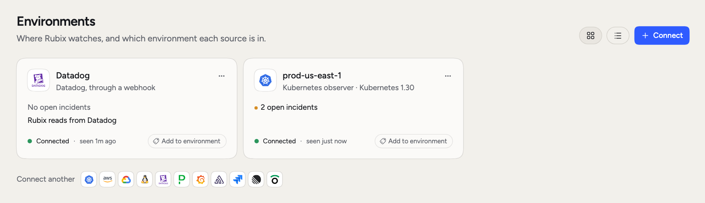
  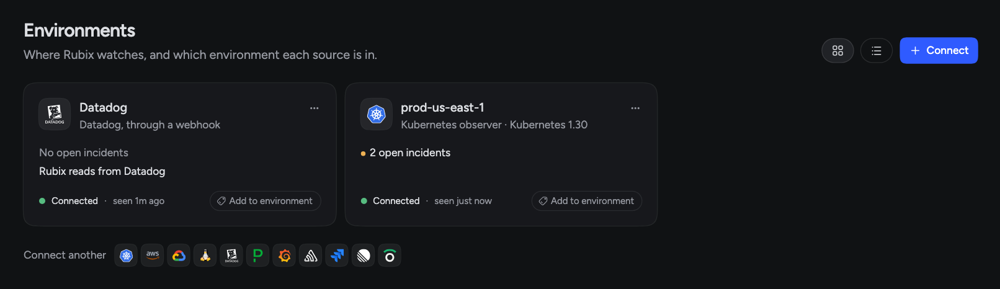
</Frame>

## Sources and environments

A **source** is one thing that reports to RubixKube: a Kubernetes cluster, a cloud account, a machine, or a tool such as Datadog.

An **environment** is a label you put on sources, such as `prod` or `staging`. One environment can hold several sources. For example, `prod` can hold the `prod-us-east-1` cluster, an AWS account and a Datadog source. One source can carry more than one label.

The page groups sources by label. Sources with no label sit under **Not in an environment**. Switch between grid and list with the buttons at the top.

<Frame>
  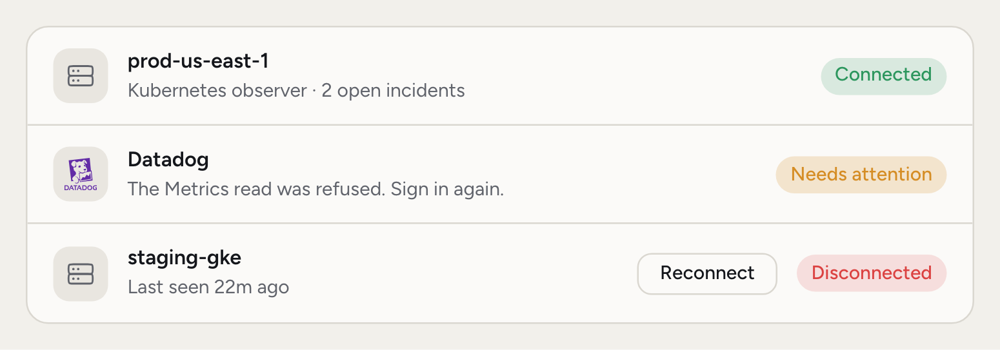
  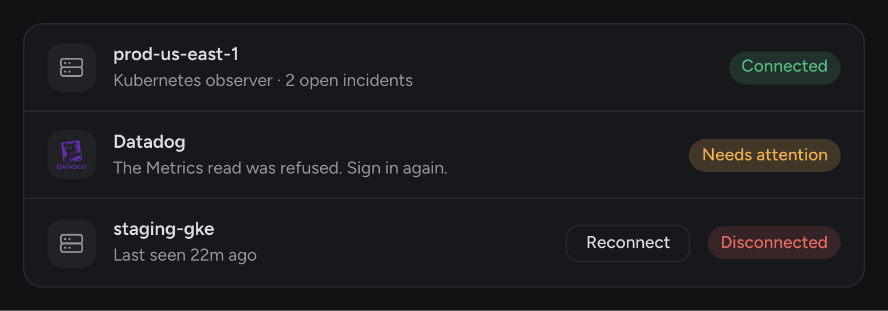
</Frame>

Each source shows its open incidents, its health and when it was last seen. Health is one of three words:

- **Connected:** it's reporting.
- **Needs attention:** it's reporting, but something is wrong. The reason shows under the name.
- **Disconnected:** it stopped reporting. Rubix can't see it until it's back, and its page offers **Reconnect**.

A source that stays quiet moves to **Archived** at the bottom of the page. Its incidents stay hidden unless you turn on archived sources in the environment filter.

### Label a source

Admins can do all of this from the page:

- Click the labels on a source to add or remove one. Type a new name and pick **Create** to make a new environment.
- Click **Add source** in an environment's header to pull sources in.
- Click an environment's name to rename it.
- Pick **Remove environment** from its menu. Only the label goes. Its sources stay connected.

## Connect a source

Only admins can connect sources. Click **Connect** and pick what you're adding.

<Frame>
  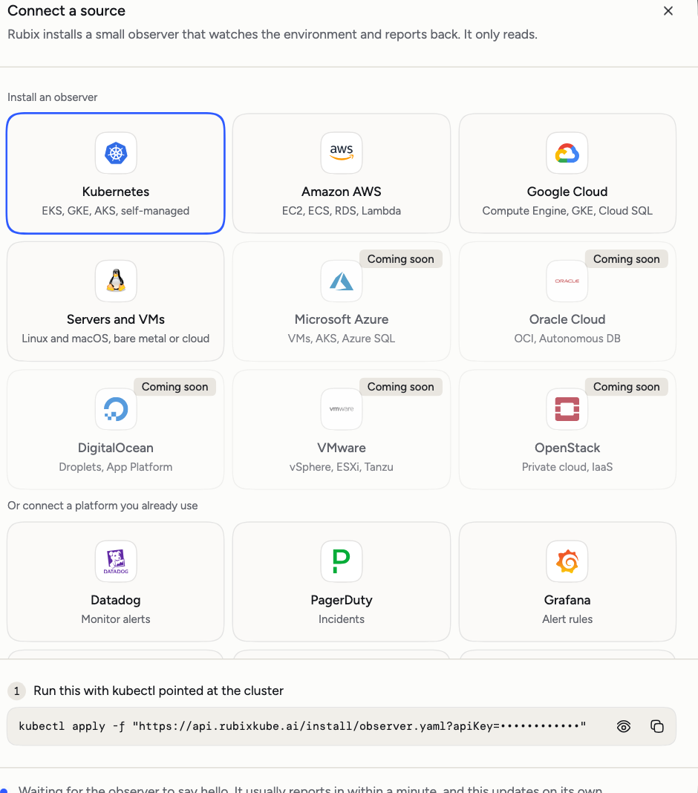
  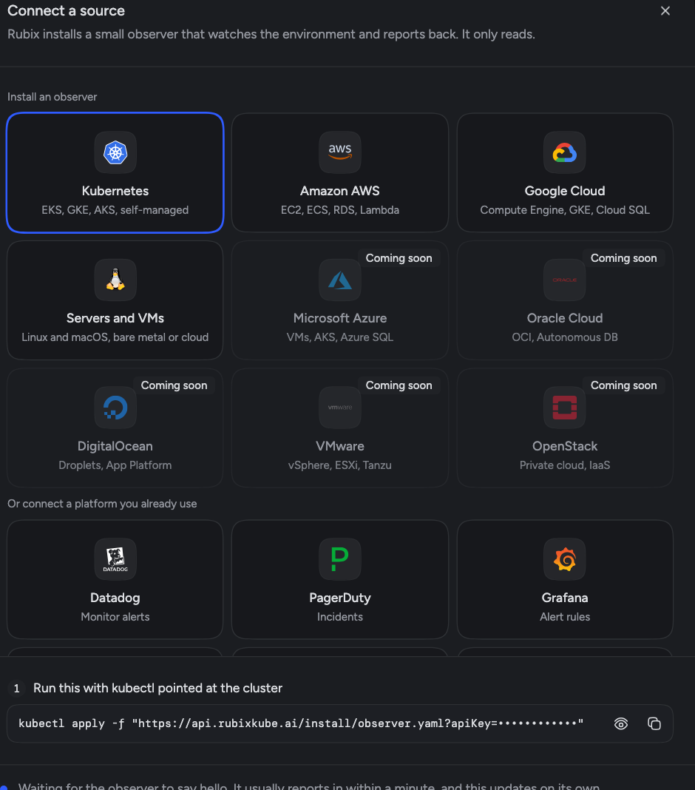
</Frame>

There are two kinds:

- **Where things run.** You install an observer. The dialog gives you the command for [Kubernetes](/environments/kubernetes), [AWS](/environments/aws), [Google Cloud](/environments/gcp), or [servers and VMs](/environments/vm).
- **Tools you already use.** You point the tool at a webhook of its own. Datadog, PagerDuty, Grafana, Sentry, Jira, Linear and Observe work this way. Give the source a name and click **Make its webhook**. The URL shows once, so copy it then. See the [Integrations overview](/integrations/overview).

The dialog waits for the first report and updates on its own. When it arrives you can label the source and open it.

## The source page

Open a source to see how it's doing. The header says who reports it and its health. **Ask Rubix about this** starts a chat about it.

<Frame>
  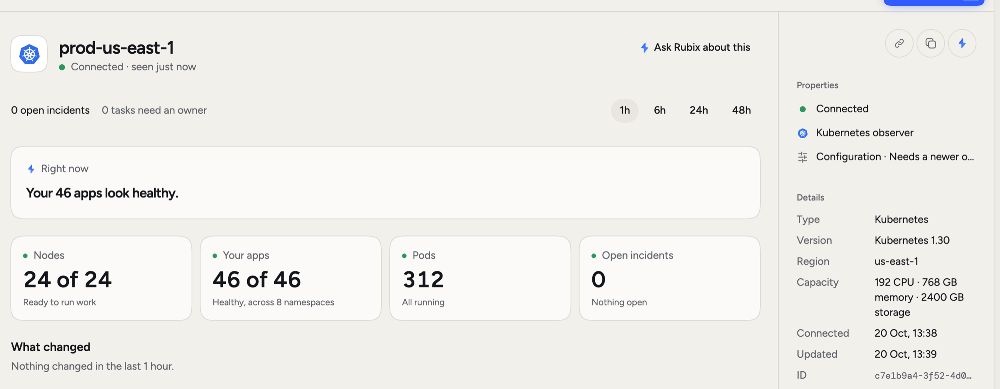
  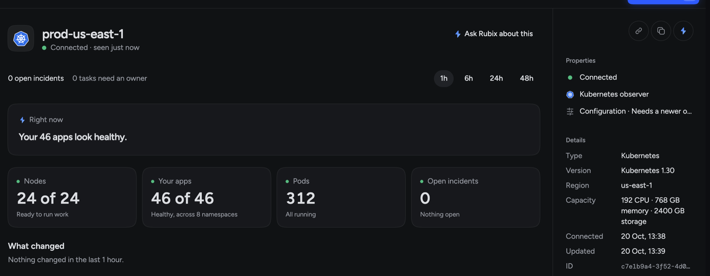
</Frame>

Clusters, cloud accounts and machines share the same layout:

- **Right now** is one sentence from Rubix about the source. Questions about links show here too.
- **What changed** lists changes in the time you pick: 1h, 6h, 24h or 48h.
- **Resources** is the inventory. Search it, or filter by kind and health.

The side panel holds the labels, linked sources, the observer's **Configuration**, details such as region and version, and the state of each tool the observer runs.

What's in the inventory depends on the source:

| Source | You see |
|---|---|
| Kubernetes | Tiles for **Nodes**, **Your apps**, **Pods** and **Open incidents**. **Resources** sorts apps into Services, Datastores, Queues, Workers, Agents, Monitoring and System, and lists Nodes. |
| AWS, Google Cloud | Tiles for **Resources**, **Machines**, **Worth a look** and **Open incidents**. **Resources** lists what's in the account, by type and region. |
| Server or VM | Disk, memory, swap and load, then **Services**, **Processes**, **Disks** and **Network**. |

On Kubernetes, switch **Resources** from list to map to see which apps call which. Select an app to see what calls it, what it calls, how traffic gets in, and what changed around it. This is a good first stop after a rollout: if `orders-api` changed and `payments-api` is failing, you see both in one place.

## Platform sources

A tool connected by webhook sends events. Nothing runs in it, so its page is different.

**Overview** shows what's open, the last event, **Reads**, the webhook it comes in through, and whether its automation is on. If the automation is off, events arrive but open no incidents.

**Events** lists the last 20 messages. Select one to see exactly what was sent. Use this when an alert didn't open an incident and you want to know what the tool really sent.

## Links between sources

The same thing often shows up twice. Datadog reports a host, and your cluster has it as a node. RubixKube links them, so incidents from both land on one and Rubix reads both when it investigates.

The **Correlate sources** automation looks for these links. When two sources share an id, RubixKube links them by itself and tells you once under **Right now**. Admins can pick **Unlink**, or **Got it** to clear the line.

When the only evidence is a name, Rubix asks.

<Frame>
  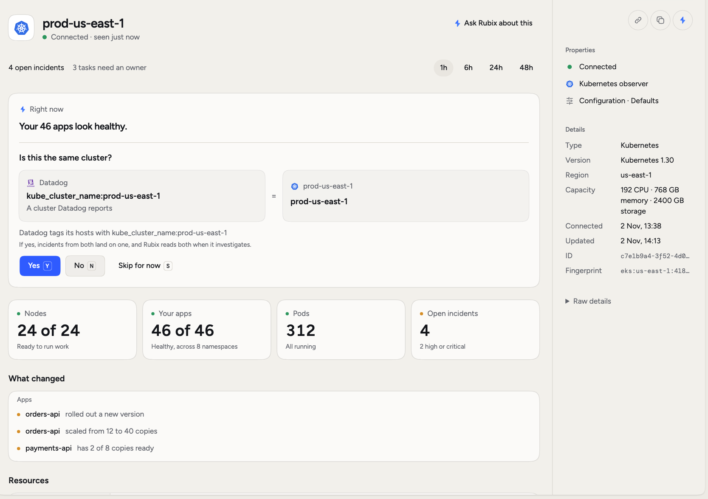
  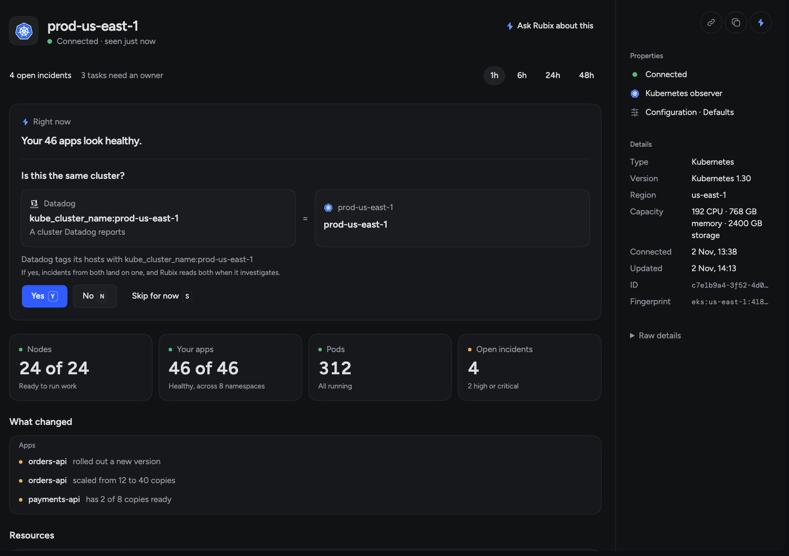
</Frame>

The question shows both sides and the reason. Admins answer it. Everyone else sees it.

- **Yes** (`Y`) links them.
- **No** (`N`) means Rubix doesn't ask about this one again.
- **Skip for now** (`S`) asks again the next time the page opens.

After Yes or No, a message appears with an **Undo** button. Click it to bring the question back. Your answer is final otherwise. Rubix only suggests links, and it won't overrule you.

Linked sources show in the side panel. A link on one thing inside a source shows on that thing, and in the **Linked** column of **Resources**.

## Reads

A webhook only brings alerts in. For Rubix to read from a tool during an RCA, connect the tool under **Customize > Integrations**. The source page says whether it's connected. If the tool has refused, **Sign in again** sits next to the reason.

Being connected doesn't prove a read works. A token can have the wrong scope, and you'd only find out when an RCA comes back thin. So the **Reads** section on a platform source's page shows what happened on a real read. There's one row for each kind of data and place, such as logs in one dataset:

<Frame>
  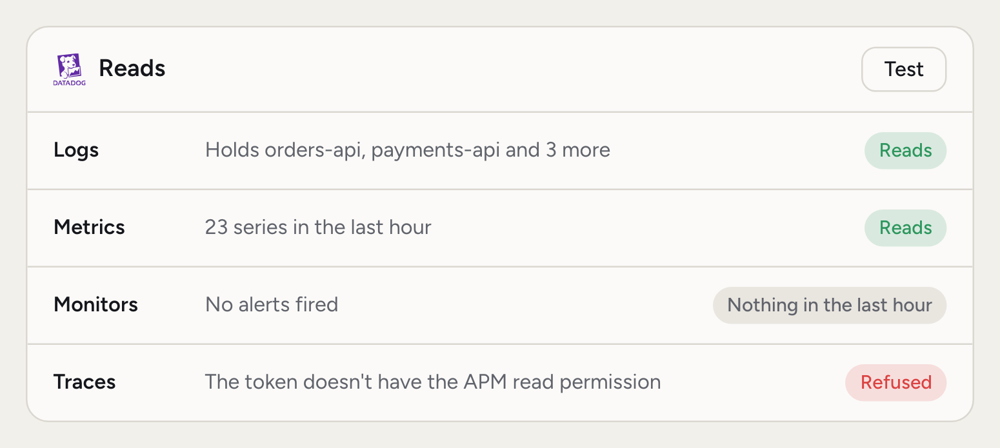
  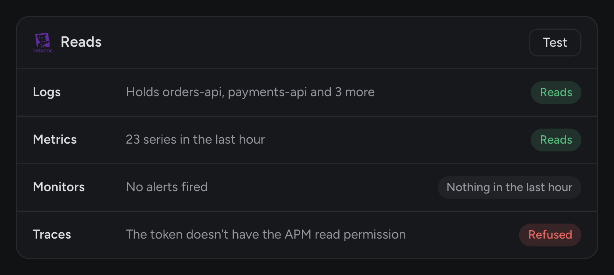
</Frame>

| State | Meaning |
|---|---|
| **Reads** | The last read worked. |
| **Nothing in the last hour** | The read worked, and there was nothing to return. |
| **Refused** | The tool said no. The row shows the tool's words and the permission or setting to fix. |
| **Failed** | The read failed. The row shows why. |

A row can also say what it holds, such as `Holds orders-api, payments-api and 3 more`. The same rows show when you open the connection under **Customize > Integrations**.

## Change what an observer looks for

Open a Kubernetes source and click **Configuration** in the side panel. Anyone can read it. Only admins can change it. Click **Save**, and the observer applies the change within a minute, with no restart.

Only the Kubernetes observer takes these settings. Cloud and VM sources show a message that they can't be configured from here.

| Tab | What you set |
|---|---|
| **Detection** | Turn each built-in rule on or off and change its values: crash loops, out of memory, pods stuck starting, pods that can't be scheduled, memory running out, high error rate, slow responses. |
| **Timing** | **Before an incident opens**: a new problem waits 30 seconds at least, and opens after 3 checks or 5 minutes. **Recovery**: a workload must stay healthy for 10 minutes to count as recovered. |
| **Ignore** | **Namespaces** and **Workloads** whose problems don't open incidents, or **Only these namespaces**. Rubix still sees what runs there. |
| **Privacy** | **Hide sensitive values** replaces keys, tokens, passwords, emails, cards and public IPs inside your cluster, before logs or tool results reach RubixKube. Add your own pattern with **Hide a value of your own**. |
| **YAML** | The raw values. **Copy as ConfigMap** gives you a ConfigMap to keep in Git. |

The numbers above are the defaults.

### Add a rule of your own

The built-in rules catch what breaks. Add your own for what matters to your business, like a payment error rate. On **Detection**, click **Add rule** and pick a type:

- **Metric:** a value from Prometheus, a `/metrics` page or metrics-server.
- **Golden signal:** errors, slow responses, traffic or saturation of one service.
- **HTTP check:** an address inside the cluster answers, and fast enough.

<Frame>
  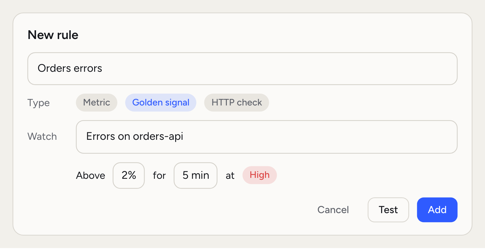
  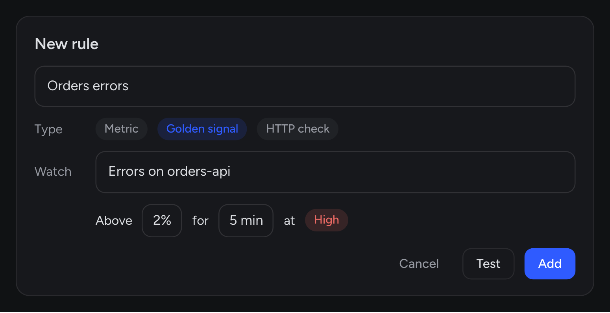
</Frame>

Set the value, how long it has to hold and the severity. Click **Test** to see what the rule finds right now, before you add it.

### Where a value comes from

Settings stack up in layers, so you can set something once for everyone and still make an exception for one source.

<Frame>
  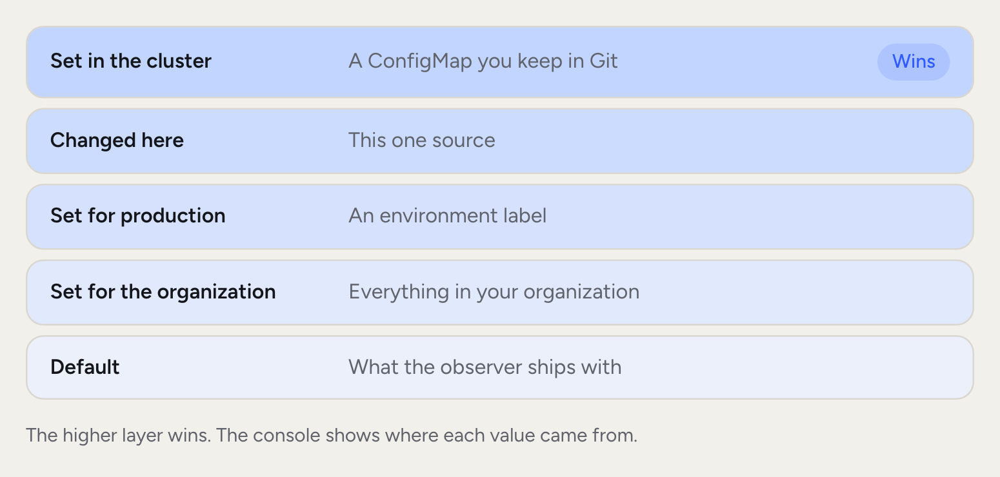
  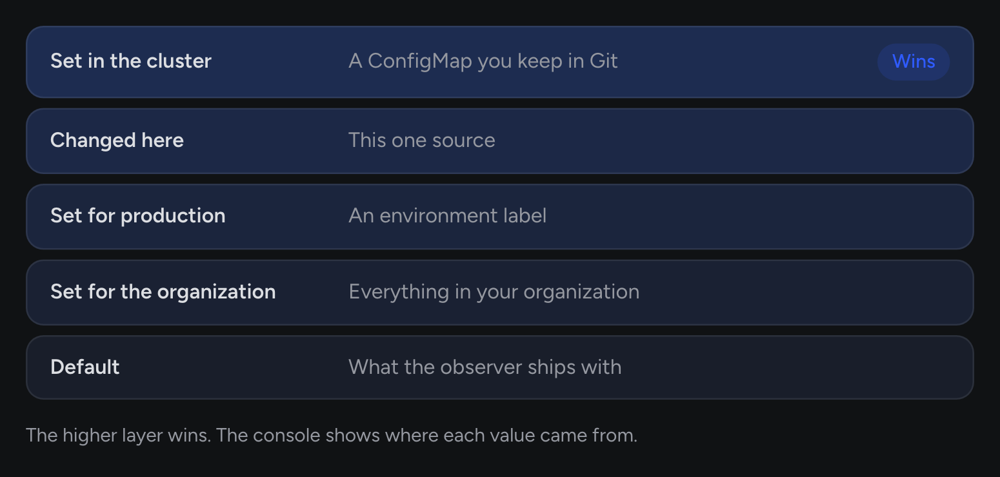
</Frame>

A value that isn't the default says where it was set: **Changed here**, **Set for the organization**, **Set for** a label's name, or **Set in the cluster**. **Locked by your organization** means nobody can change it from this source or the cluster.

The console saves values for one source at a time. To set a value for a whole organization or environment label, or to lock one, email [connect@rubixkube.ai](mailto:connect@rubixkube.ai).

## Rename or delete a source

Use the menu on a source's card or page.

<Warning>
  **Delete** can't be undone. For an observer source, its history and metrics are deleted, and the observer keeps running until you uninstall it. For a platform source, its incidents, history, webhook and automation are deleted, so its URL stops working. Remove the webhook from the tool too, or the tool keeps failing.
</Warning>

## Related pages

<CardGroup cols={2}>
  <Card title="Connect your environment" icon="plug" href="/getting-started/connect-your-environment">
    The first install, step by step.
  </Card>
  <Card title="Observers" icon="eye" href="/concepts/observer-agent">
    What an observer does and where it runs.
  </Card>
  <Card title="Integrations" icon="puzzle-piece" href="/integrations/overview">
    Alert sources and tools Rubix can read.
  </Card>
  <Card title="Settings: Incidents" icon="sliders" href="/using/settings">
    Auto-close, grouping and recurring incidents.
  </Card>
</CardGroup>
