Incidents are where your team goes to answer one question: what's wrong right now, and whose move is it?

Alerts on their own leave that work to you. Three tools fire about one problem, someone has to work out they're related, and someone has to go digging. An incident pulls that together. It's one record of something that broke, with the evidence, what Rubix found, and what's left to do.

## When you'd use this

- **Something feels off.** Open **Incidents** to see what's open and how far along each one is.
- **An alert just fired.** Follow it here instead of opening each tool. Rubix is already looking.
- **You're picking up work.** Filter to **Needs you** to see what's waiting on a person.
- **You noticed a problem first.** [Report an incident](#report-an-incident) and Rubix starts on it.
- **It was fixed and you want the story.** The incident keeps what happened, who did what, and what fixed it.

Incidents come from three places. Observers report what they see in your sources. Connected tools such as Datadog and PagerDuty send alerts by webhook. People report them by hand. All three work the same way from here.

<Frame>
  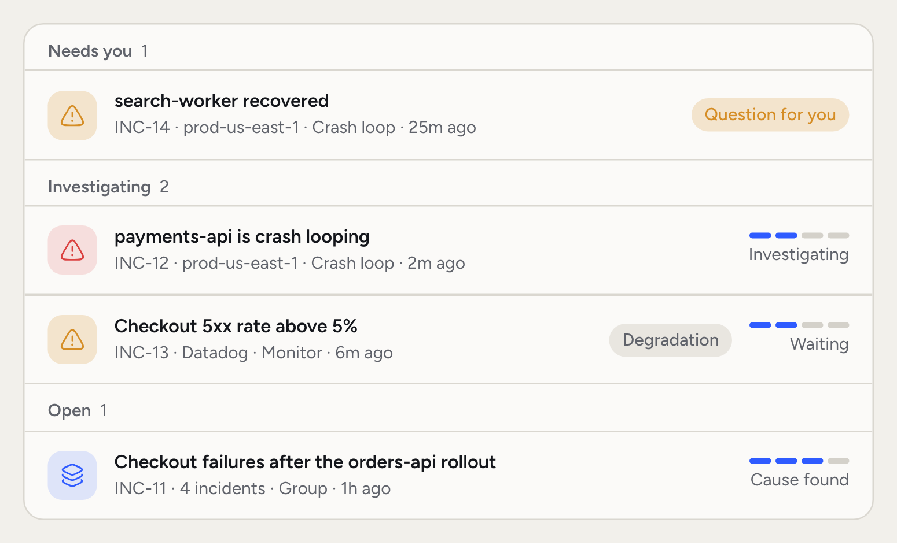
  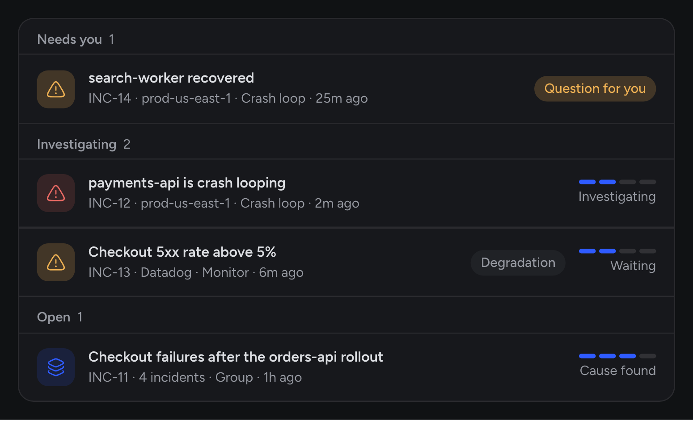
</Frame>

## The Incidents list

Read the list by stage. The stage tells you who has the next move, so you can skip what Rubix is still working on and go straight to what needs you.

The list has three tabs: **Open**, **Resolved** and **All**. Each tab shows its count.

A row shows the title, the code, the source, the type and the age. A track on the right shows how far the incident has come: Detected, Investigating, Cause found, Resolved. A row can also carry a **Degradation** badge, a **Question for you** badge, a comment count, and the faces of people working on its Tasks.

**Search** finds an incident by code, workload, service or namespace. **Filter** narrows the list:

| Filter | Choices |
|---|---|
| Stage | Needs you, Investigating, Open, Resolved, Ignored |
| Severity | Critical, High, Medium, Low |
| Impact | Breakage, Degradation |
| Environment | Your environments and sources |
| Type | The kinds in your list, such as Crash loop, Out of memory or Group |
| RCA | RCA ready, No RCA yet, RCA failed |
| Created | Last 24 hours, Last 7 days, Last 30 days, Last 90 days |

**Display** sets the order (Created, Severity, Last seen), the grouping (Stage, Severity, Environment, No grouping) and the row size (Comfortable, Compact).

Stages tell you who has the next move:

- **Needs you:** it recovered, and Rubix needs you to say what fixed it.
- **Investigating:** an RCA is running or on its way.
- **Open:** the RCA is done, or none is coming, and the incident isn't closed yet.
- **Resolved:** it's closed.
- **Ignored:** it's recorded, with no RCA.

Press `J` and `K` to move through the list, `C` to create an incident and `X` to close the one you've picked.

## The incident page

Open a row to see the whole story. In the demo organization, `payments-api` starts crash-looping in `prod-us-east-1` after a new `orders-api` version raises its database pool.

<Frame>
  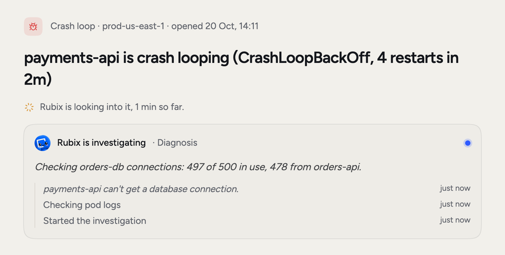
  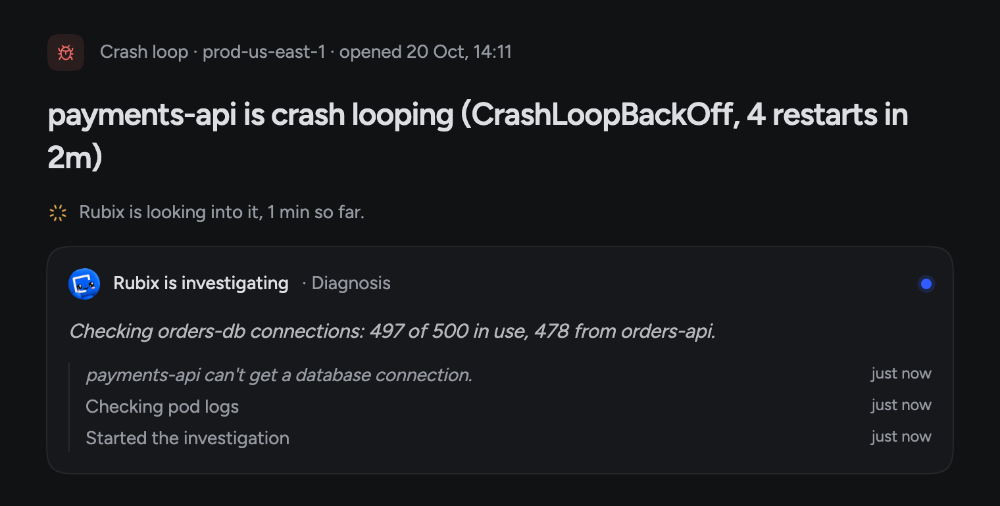
</Frame>

The page reads from top to bottom:

- **What the observer detected**, or **What Datadog sent** when a tool opened it: the alert, logs and changes that came with it.
- **Related incidents:** its group, the incident it came back after, and others with the same cause.
- **What Rubix found:** what happened, the cause and the Fix, once the RCA is done. On an incident the cause reads **Root cause**, **Likely cause** or **Not determined**.
- **What changed before this started:** recent changes in the source. A tool that sends only alerts has nothing to compare, and the page says so.
- **Tasks:** what Rubix suggests, plus any you add with **Add task**.
- **Activity:** comments and everything that happened to the incident.

The right side holds severity, source, environments, type, impact, first and last seen, and affected resources. You can change the severity there. If you see a wrong resource, edit **Affected resources**.

### The progress card

While Rubix works, a card headed **Rubix is working on this** shows each step and how long it took. A typical run reads Detected, Triaged, Waited to start, and then what the RCA is doing right now.

<Frame>
  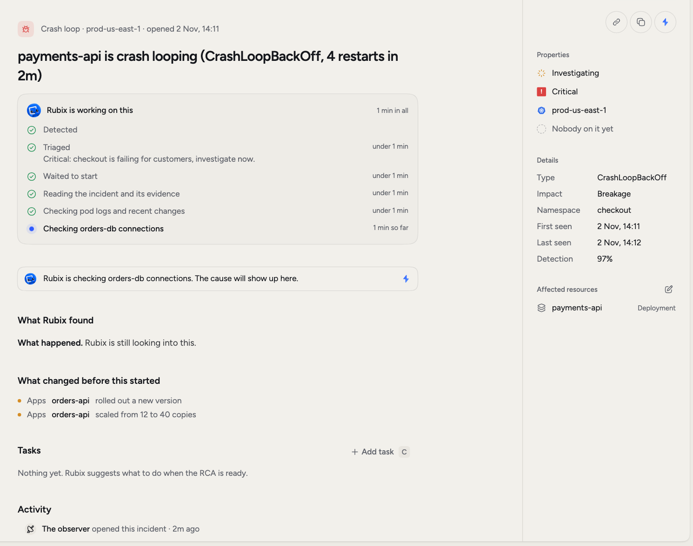
  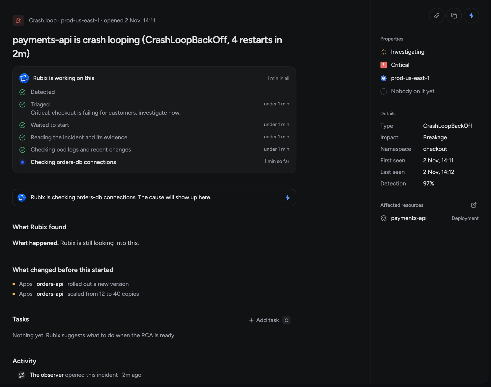
</Frame>

The card goes away once Rubix finds the cause. If the RCA can't finish, the card reads **Rubix could not finish** and gives the reason.

## Severity and impact

Severity says how bad it is: Critical, High, Medium or Low. It also decides how soon the RCA starts.

Impact says what kind of problem it is. **Breakage** means something broke, like `payments-api` crash-looping. **Degradation** means it still runs but works worse than it should, like a rising error rate or slow responses. Degradations carry a badge in the list, and the **Impact** filter shows them on their own.

Triage can change both. You can change the severity yourself on the incident page.

## Groups

One failure often sets off several alerts. Without groups you'd get five incidents, five investigations and five threads about the same thing. So incidents on the same resource, or with the same cause, share a group and one RCA. You get one investigation and one set of Tasks.

A group shows as one row with the type **Group**. The row lists every source behind it, so an observer's incident and a Datadog alert on the same problem sit together. Open the arrow at the end of the row to see each incident in the group and the source it came through.

<Frame>
  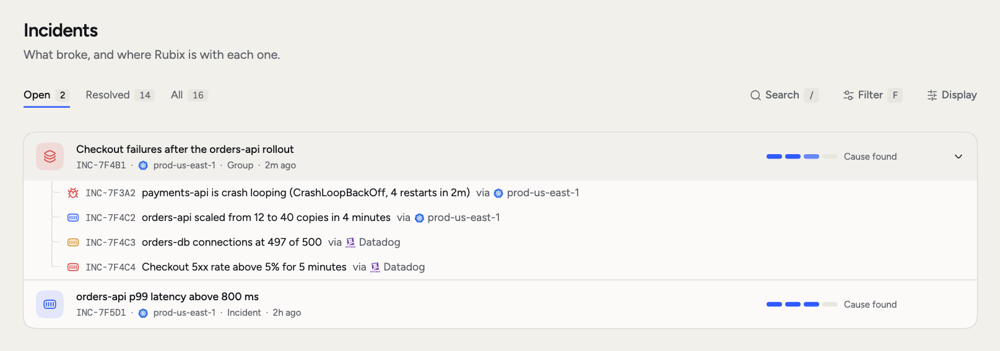
  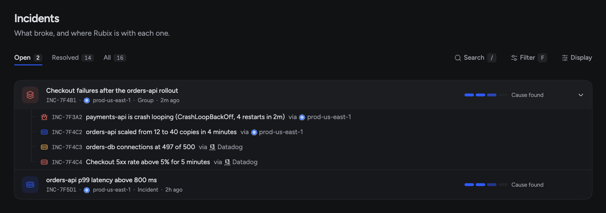
</Frame>

Incidents in a group don't get rows of their own in the list. Each one keeps its own page, title and history. Its page shows the group's RCA and says which group it belongs to.

Close a group and its open incidents close too. When every incident in a group closes, the group closes. If one breaks again after the group's Fix, it leaves the group.

## Triage and known alerts

Before the RCA, Rubix triages the incident. It reads what happened before and what changed, then decides what happens next. It can change the severity or impact, hold the RCA, release the wait early, or mark the alert as known. The reason shows under **Triaged** on the progress card.

This saves you from reading the same report twice. A known alert is one that earlier RCAs say is expected behaviour, like a worker that restarts when a weekly job finishes. No RCA runs, and the page says why.

<Frame>
  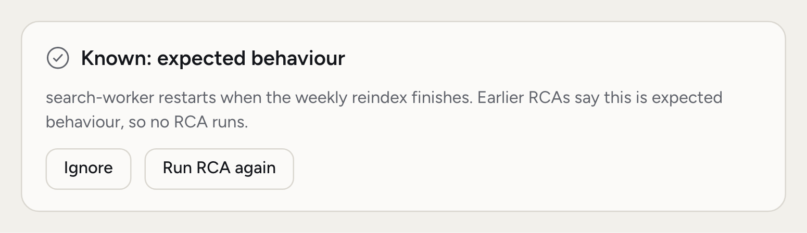
  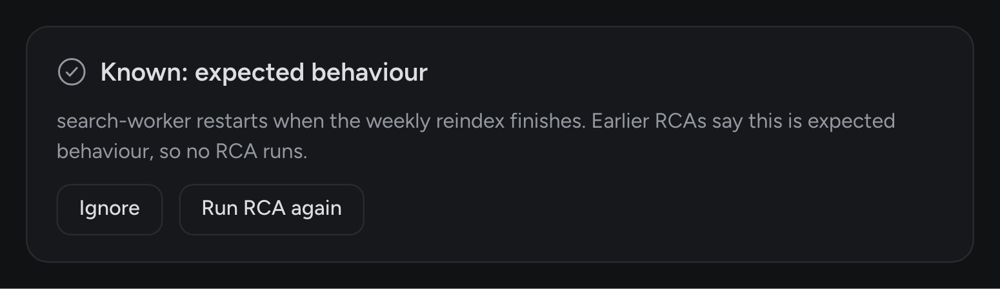
</Frame>

- **Ignore** keeps this problem recorded with no RCA.
- **Run RCA again** starts an RCA anyway, for when you think triage got it wrong.

## When the RCA starts

Most RCAs don't start the moment an alert arrives. A lot of problems clear up on their own, so Rubix waits a short while first. Serious incidents wait less. Admins set the wait for each severity in [Settings > Incidents](/using/settings), so it differs between organizations.

The row and the page always say what the RCA is waiting for:

| Word | What it means |
|---|---|
| Triage | Triage is still running. The RCA starts after it. |
| Waiting | The wait is running, or Rubix is waiting for a linked source so one RCA covers both. |
| Verifying | It looks healthy again, and Rubix is checking that it holds. |
| In a group | The RCA runs on the group. |
| Queued | Other RCAs are running first. |
| Retrying | The last attempt failed, and Rubix is trying again. |

Once an RCA has finished or failed, or when no RCA is coming, **Run the RCA again** shows in the status menu and the page's menu. It skips every wait and starts at once.

If an attempt fails, Rubix tries again on its own. When it runs out of tries, **What Rubix found** gives the reason, with a **Retry RCA** button and the error under **Error details**. See [RCAs](/using/rca-reports) for what a finished report holds.

## Recovery and closing

Observers report when something recovers. The row then shows **Recovered**, and the page says how long ago and that you can close it. If it recovers before the RCA starts, no RCA runs. If it breaks again, the RCA starts.

### What fixed it?

When something recovers and Rubix can't tell why, it asks you. The incident moves to **Needs you** and the row shows **Question for you**.

<Frame>
  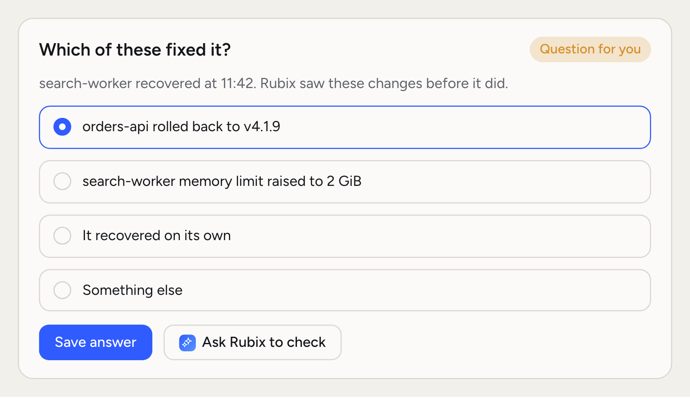
  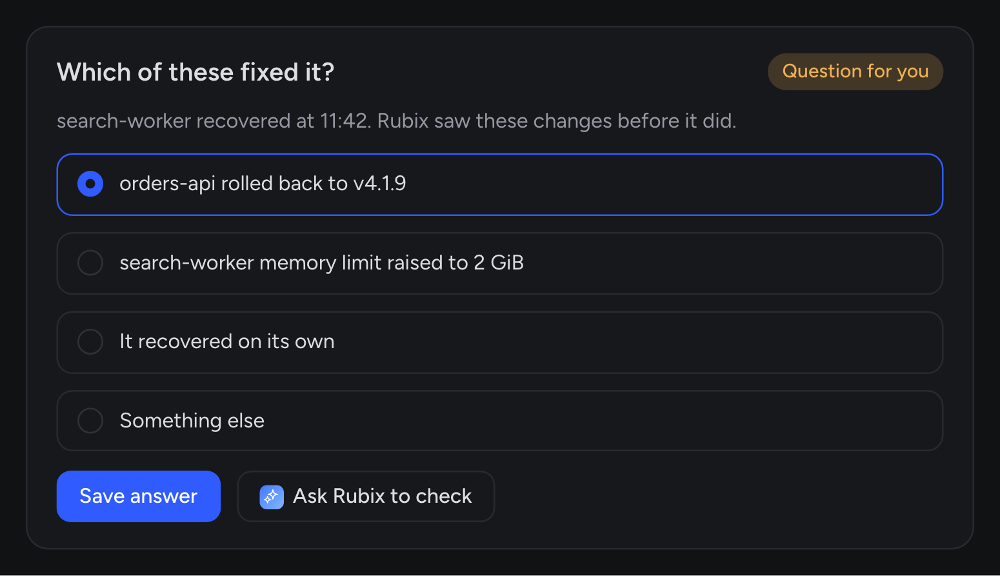
</Frame>

Your answer is how RubixKube learns which change really helped.

The page lists the changes seen before the recovery under **Which of these fixed it?**, or asks **What fixed it?** when it saw none. You can also pick **It recovered on its own** or **Something else**. Click **Save answer**, or click **Ask Rubix to check** to have Rubix look at the evidence. Your answer helps Rubix with the next incident like this one.

### Close an incident

Choose **Close incident** from the status menu, or press `X`. It moves to **Resolved** as closed by you. Its open Tasks stay open.

Admins can turn on **Close incidents when they recover** in [Settings > Incidents](/using/settings). It's off by default. With it on, Rubix closes an incident once the workload stays healthy.

## Incidents that come back

If a problem returns while its incident is open, that same incident is updated. The row says "came back", and **Came back** on the right counts the times. **Activity** keeps the earlier rounds folded away.

If a closed incident returns, you get a new incident linked to the old one. The old one shows under **Related incidents**.

When a problem keeps returning, another identical RCA won't help. Rubix stops investigating it on its own and leaves the call to you. Usually that means the fix hasn't been made yet, so snooze it while someone works on it.

<Frame>
  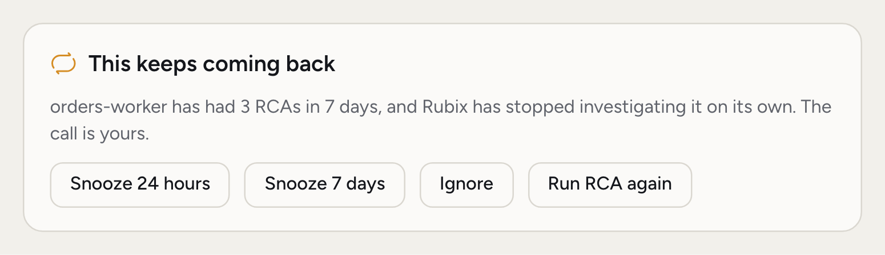
  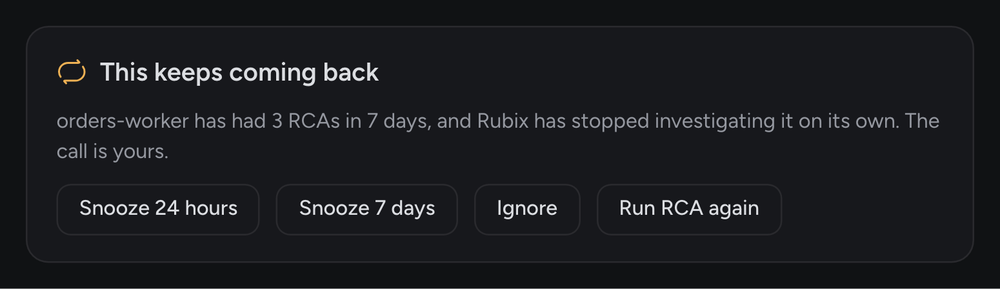
</Frame>

- **Snooze 24 hours** or **Snooze 7 days:** it's recorded with no RCA until the snooze ends.
- **Ignore:** it's recorded with no RCA.
- **Run RCA again:** Rubix investigates once more.

You set how often that happens under **Recurring incidents** in [Settings > Incidents](/using/settings).

## Comments and mentions

Comments keep the conversation next to the evidence, so the next person doesn't have to find a Slack thread. They matter for Rubix too: it reads them during an RCA. If you know something the tools don't, like "this went out with the load test", write it down.

<Frame>
  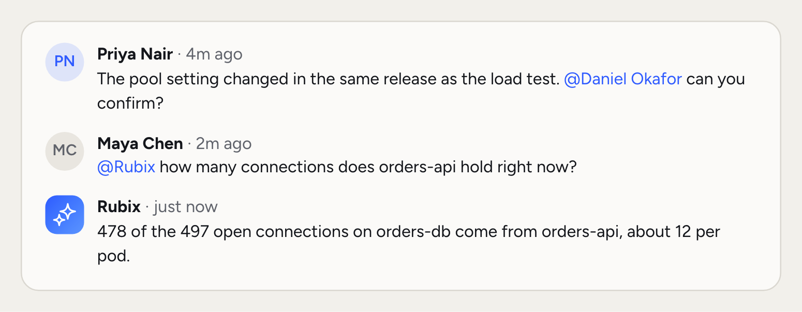
  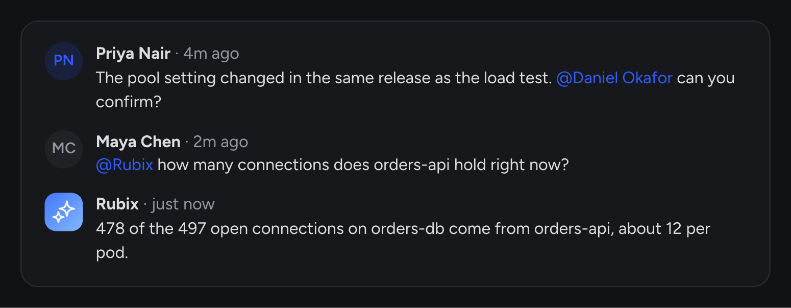
</Frame>

Write in the comment box under **Activity**. Type `@` to tag a teammate, and they get a notification in the console's bell and by email.

Mention `@Rubix` to ask a question. Rubix replies in the same thread, with the incident in front of it. It works in your organization's [mode](/using/modes). In Assist, a comment reply won't make changes, because Rubix can't stop to ask you first.

## Short codes

Every incident has a short code such as INC-12. RCAs and Tasks have their own, such as RCA-4 and TSK-30. Codes count up per organization.

Use a code anywhere: in the search box, in chat with Rubix, and in your AI tools over [MCP](/integrations/mcp). **Copy ID** in the page's menu copies it.

## Report an incident

Sometimes you notice a problem before anything else does.

<Steps>
  <Step title="Open the dialog">
    On **Incidents**, click **New incident** or press `C`.
  </Step>
  <Step title="Say what's wrong">
    Add a title and any details: since when, what you saw, what you already tried.
  </Step>
  <Step title="Set the details">
    Pick the severity and the environment. Add the workload if you know it, so Rubix starts looking there.
  </Step>
  <Step title="Create it">
    Click **Create incident**. Rubix starts on it, and you land on the incident's page.
  </Step>
</Steps>

## Related pages

<CardGroup cols={2}>
  <Card title="RCAs" icon="magnifying-glass" href="/using/rca-reports">
    Read what Rubix found and rate it.
  </Card>
  <Card title="Tasks" icon="list-check" href="/using/tasks">
    Take the Fix and see it through.
  </Card>
  <Card title="How incidents work" icon="triangle-exclamation" href="/concepts/incidents">
    The idea behind incidents, groups and recurrence.
  </Card>
  <Card title="Settings" icon="gear" href="/using/settings">
    Recovery, waits and recurring incidents.
  </Card>
</CardGroup>
