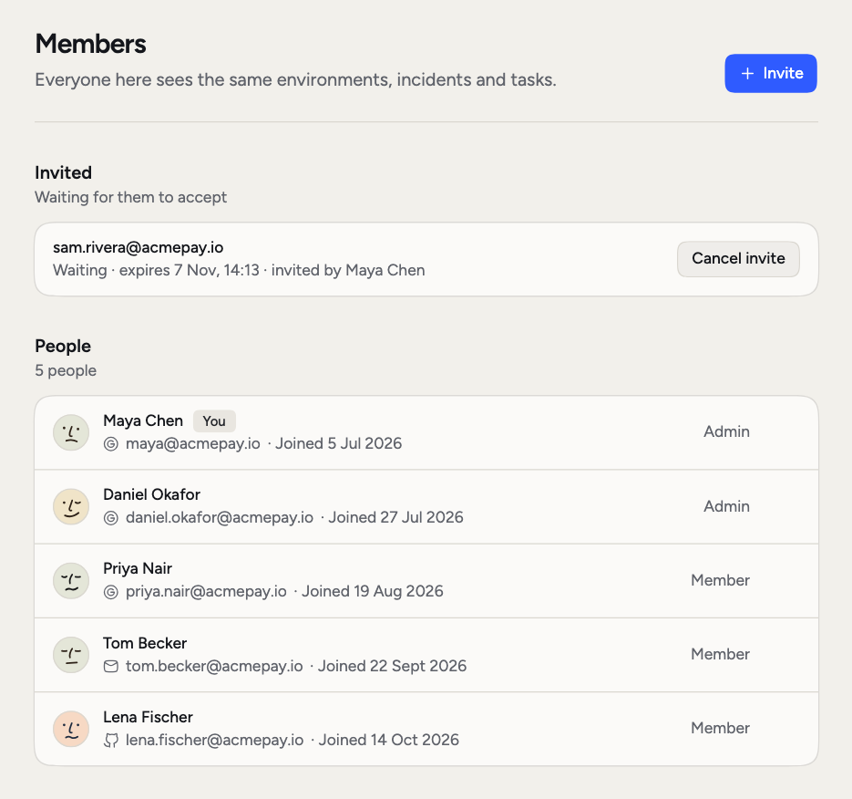
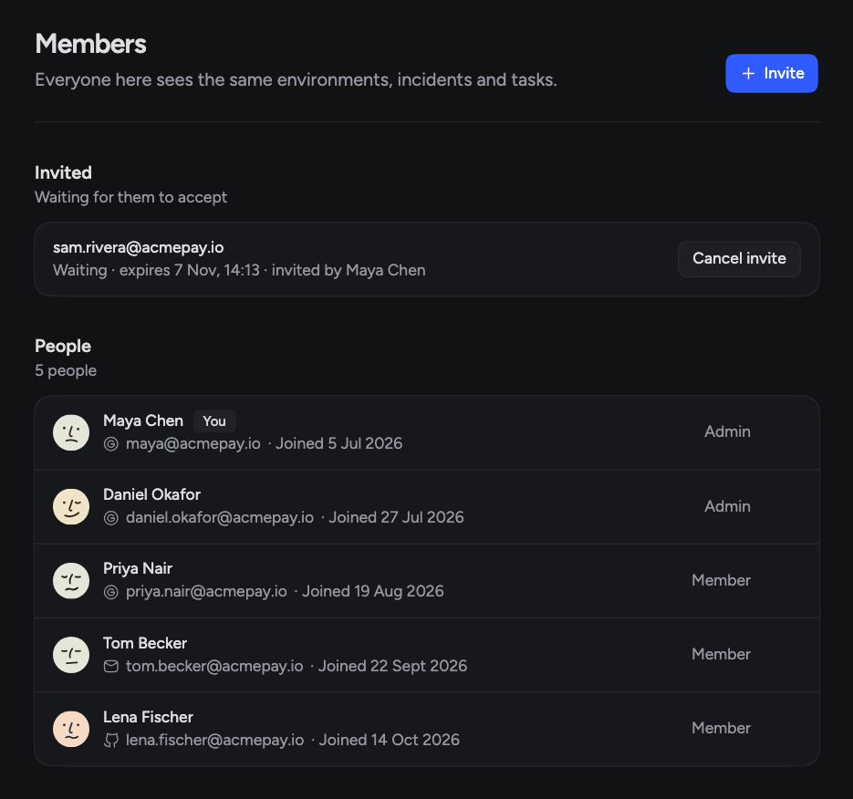

RubixKube works best when the people who handle incidents are all in it, so Tasks have owners and comments reach someone. **Settings > Members** lists everyone in your organization. Everyone here sees the same environments, incidents and Tasks.

Inviting people needs **Business and Enterprise**. On Individual, the page tells you teams come with Business.

<Frame>
  
  
</Frame>

## Roles

Each person shows one of three roles:

| Role | What it means |
|---|---|
| **Owner** | Can do everything an Admin can. An Owner can't be removed from this page. |
| **Admin** | Invites and removes people, and changes organization settings such as the name, Slack channels, incident settings and automations. Sees **Activity** and AI usage. |
| **Member** | Sees everything the organization sees and works with Rubix, incidents and Tasks. Settings that need an admin say so. |

## Invite someone

<Steps>
  <Step title="Open the dialog">
    On **Settings > Members**, click **Invite**.
  </Step>
  <Step title="Enter their email">
    In **Invite someone**, enter the address and click **Send invitation**.
  </Step>
  <Step title="They join">
    They get an email with a link. Once they join, they see everything your organization sees. They join as a Member.
  </Step>
</Steps>

## Manage invites

Admins see open invites under **Invited**, with when each one expires and who sent it.

- **Copy invite link** copies the link, if you'd rather send it yourself.
- **Cancel invite** stops the link from working.

Accepted and expired invites move to **Past invitations**. **Clear** removes one from the list.

## Remove someone

Click the menu on a person's row and choose **Remove from organization**. They lose access at once. Their account stays, and you can invite them again later. You can't remove yourself or an Owner.

## More than one organization

One person can belong to several organizations. If you do, click your organization's name at the top of the sidebar and pick another under **Switch organization**. The switch applies to that browser tab.

<CardGroup cols={2}>
  <Card title="Usage and plan" icon="chart-column" href="/using/usage-and-plan">
    See how many users your plan allows.
  </Card>
  <Card title="Settings" icon="gear" href="/using/settings">
    Change your organization's name and logo.
  </Card>
  <Card title="Notifications" icon="bell" href="/using/notifications">
    Choose how you hear about things.
  </Card>
</CardGroup>
