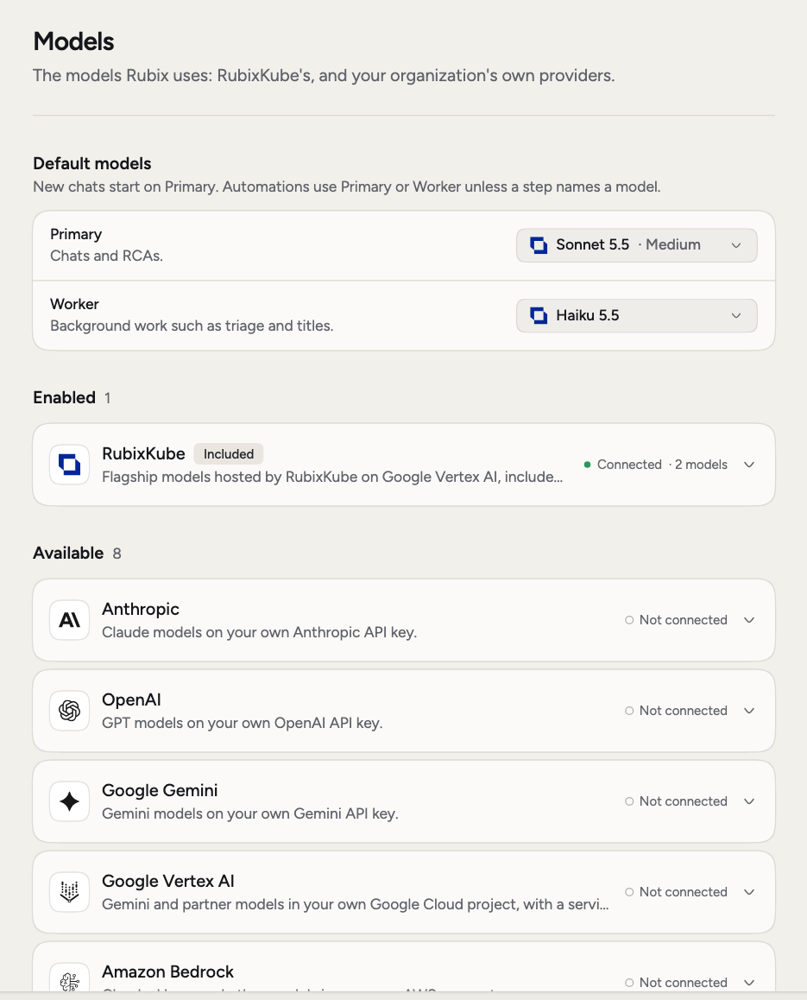
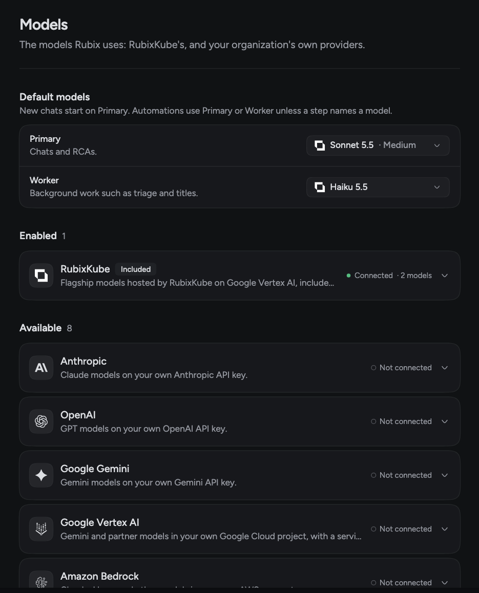

Rubix works straight away, with RubixKube's models included in your plan and no key to set up. Use **Settings > Models** when you have a reason to change that.

## When you'd use this

- **A better model for investigations.** Set a stronger Primary for chats and RCAs.
- **Lower cost on background work.** Set a smaller Worker for triage and titles.
- **Your data rules.** Connect your own provider so model traffic goes to your account. This needs Business or Enterprise.
- **One hard question.** Pick a different model for one chat without changing anything for anyone else.

<Frame>
  
  
</Frame>

## Set the default models

**Default models** has two roles. Each one has a model and a **Reasoning** level, for models that offer it.

| Role | Used for |
|---|---|
| **Primary** | Chats and RCAs. |
| **Worker** | Background work such as triage and titles. |

New chats start on Primary. Automations use Primary or Worker unless a step names a model.

If you leave Primary empty, it uses **RubixKube's default**. If you leave Worker empty, it's the **Same as Primary**.

Admins change these and click **Save**. Everyone else can see what's set.

## Pick a model for one chat

Click the model picker in the chat box, or type `/model`. Your pick stays with that chat and doesn't change anything for the organization. It follows the chat to any device.

If the model offers it, you can set **Reasoning** there too. **Auto** leaves it to the model.

## Connect your own provider

Bring your own model when you need a model we don't host, or want usage on your own account. This needs Business or Enterprise, and an admin.

These providers are available:

- Anthropic
- AWS Bedrock
- Google Gemini API
- Google Vertex AI
- OpenAI
- OpenRouter
- xAI
- **Your own endpoint**: any OpenAI-compatible server such as vLLM or LiteLLM, or your own Ollama

<Steps>
  <Step title="Open the provider">
    In **Settings > Models**, find it under **Available** and click to open it.
  </Step>
  <Step title="Add your credentials and a model">
    Fill in the key or the other fields the provider asks for, then pick a model.
  </Step>
  <Step title="Click Test and connect">
    Rubix tests the connection with that model. It's only saved if the test passes.
  </Step>
  <Step title="Add more models">
    Open the provider again and add any others. Each model has a switch that offers it in the chat.
  </Step>
</Steps>

Connected providers appear under **Enabled**, next to RubixKube. A provider that stops working shows **Needs attention** and the reason.

Removing a provider deletes its credentials and stops offering its models. Chats that used them switch to the default.

<Note>
  Want to keep your data off RubixKube's models? Turn on **Use only our own models** under **Own models only**. RubixKube's models stop being offered, and Primary and Worker run on your own models. Add a model of your own first.
</Note>

## Related pages

<CardGroup cols={2}>
  <Card title="Chat with Rubix" icon="comments" href="/using/rubix-chat-agent">
    Pick a model for one chat.
  </Card>
  <Card title="Modes" icon="shield-halved" href="/using/modes">
    What Rubix can do without asking.
  </Card>
  <Card title="Usage and plan" icon="chart-simple" href="/using/usage-and-plan">
    See what your plan includes.
  </Card>
</CardGroup>
