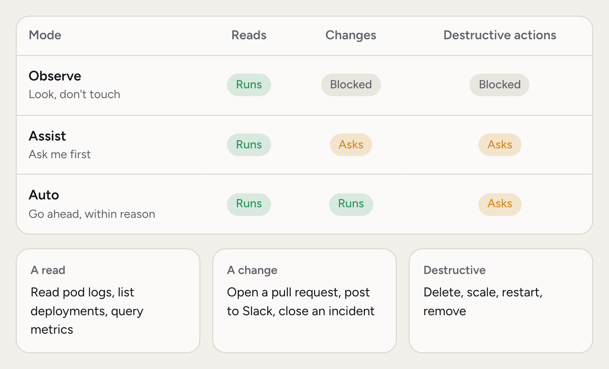
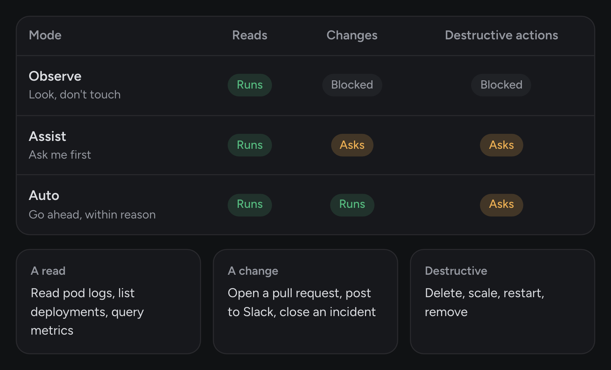
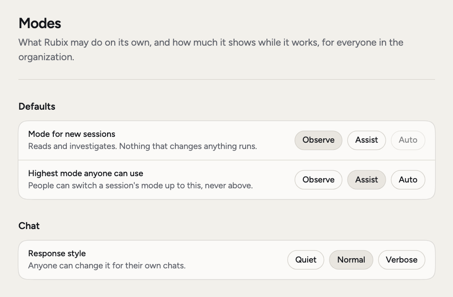
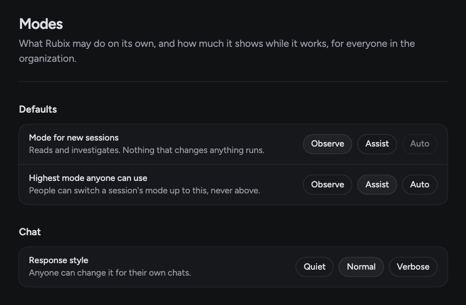
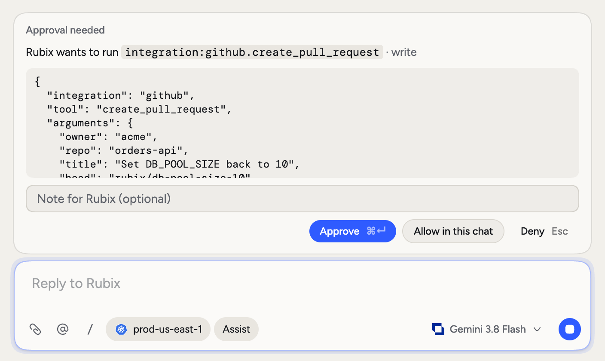
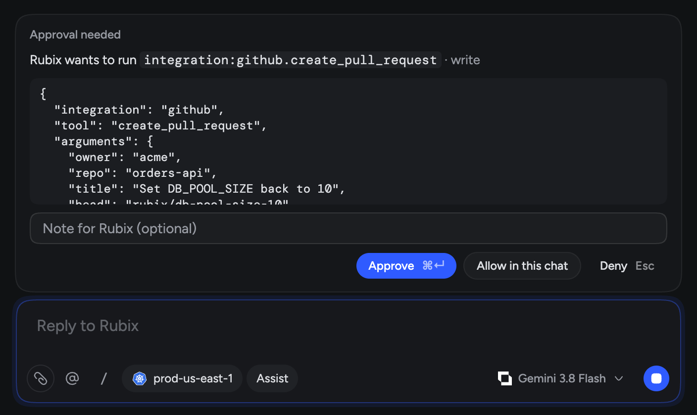

An agent that can only read is safe but limited. One that can change anything is useful until it isn't. Modes let you pick the point in between, and move it as your trust grows.

There are three. Observe only reads, Assist asks before every change, and Auto makes changes on its own but still asks before anything destructive.

<Frame>
  
  
</Frame>

## Which mode should you use?

- **Observe** is right when you're starting out, or when Rubix is near something sensitive. It investigates and answers, and nothing changes. Every new organization starts here.
- **Assist** is the next step up. Rubix does the work of preparing a change, and a person says yes each time. You stay in control without typing it all yourself.
- **Auto** fits work that's low risk and well understood, such as tidying Tasks or posting updates. Try it in a chat first, and add a [hook](/using/customize#hooks) for any rule that must always hold.

## What counts as a change

A change is anything that isn't a read, such as posting to Slack, opening a ticket, or closing an incident. Destructive means actions such as delete, scale, restart and remove. When a tool isn't known to be read-only, Rubix treats it as a change.

## Who sets the mode

Admins set two things in **Settings > Modes**:

<Frame>
  
  
</Frame>

- **Mode for new sessions**: the mode every new session starts in.
- **Highest mode anyone can use**: people can switch a session's mode up to this, never above.

Until an admin changes them, new sessions start in Observe and the highest mode is Assist. So Auto stays off until an admin picks it.

If you lower the highest mode, sessions already running in a higher mode drop to it. The mode for new sessions drops with it.

## Change the mode in a session

Anyone can change the mode of their own session, up to the highest mode. There are three ways, once the session has started:

- Click the mode chip in the chat box.
- Press Shift+Tab in the chat box.
- Type `/mode` and pick one.

A mode above the limit shows as **Your organization doesn't allow this**. The session keeps its mode until you change it. It doesn't affect anyone else's sessions.

## Approve a change

When Rubix needs approval, an **Approval needed** card appears above the chat box. It shows the tool, its risk and the details of the call. The person who owns the session or an admin can answer.

| Button | What it does |
|---|---|
| **Approve** | Runs this one call. Shortcut: ⌘↵ |
| **Allow in this chat** | Runs this call, and lets this tool run without asking for the rest of the chat |
| **Deny** | Doesn't run it, and Rubix is told. Shortcut: Esc |

You can add a **Note for Rubix** with your answer. If you deny a change, the note tells Rubix why.

If nobody answers in time, the change doesn't run.

<Warning>
  **Allow in this chat** covers every later call to that tool in the chat, not only the one on the card. It never covers destructive actions. Those ask every time.
</Warning>

<Frame>
  
  
</Frame>

In Slack, the card appears in the thread with **Approve**, **Approve for this chat** and **Deny**.

## Plans

When Rubix writes a plan, you see **Plan to review** above the chat box. **Execute plan** moves the chat to Assist, so each step that changes something still asks first. If your organization's highest mode is Observe, the chat stays in Observe. **Drop** discards the plan.

## When nobody can answer

Automations and @Rubix in comments run with nobody there to approve, so they never wait:

- If the highest mode is Auto, a step set to make changes can make them. Anything that needs approval, such as a destructive action, is refused.
- With any other highest mode, these runs only read.

To put a person in the loop, add an approve step to the automation. See [Automations](/using/automations).

## Good to know

Hooks run first, before the mode is checked, in every mode. A hook can block a change or require a person's approval, even in Auto and even after **Allow in this chat**. See [Hooks](/using/customize#hooks).

Modes apply to Rubix. Your own AI tools connected over [MCP](/integrations/mcp) act as you, and their actions are recorded under your name.

**Settings > Modes** also has **Response style** (Quiet, Normal, Verbose), which sets how much Rubix says while it works. Admins set the default, and anyone can change it for their own chats.

## Related pages

<CardGroup cols={2}>
  <Card title="Chat with Rubix" icon="comments" href="/using/rubix-chat-agent">
    Sessions, approvals and commands.
  </Card>
  <Card title="Customize" icon="sliders" href="/using/customize">
    Add your own checks with hooks.
  </Card>
  <Card title="Automations" icon="gears" href="/using/automations">
    Run Rubix on a trigger.
  </Card>
</CardGroup>
