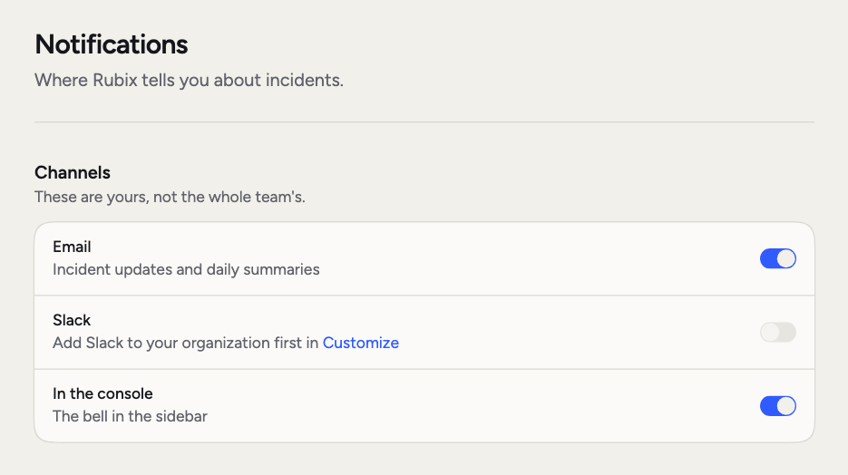
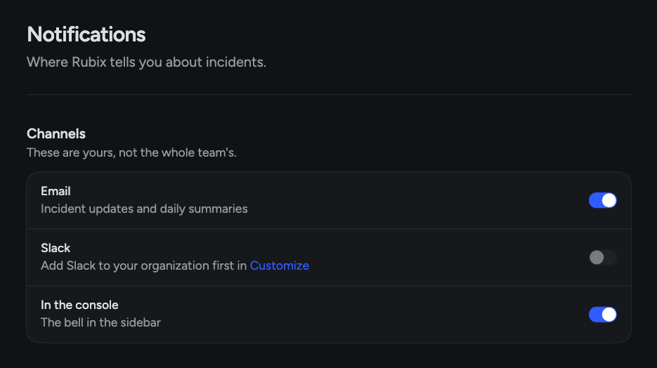

You should hear about what needs you, and not much else. Each person chooses how they hear from RubixKube. An admin chooses which Slack channels your team's messages go to.

## When you'd use this

- **Too much email.** Turn off the **Email** switch. Mentions still reach your Inbox.
- **Your team lives in Slack.** Send incidents to a channel, with a thread for each one.
- **Leaders want a summary.** The weekly digest and a Reports channel cover that.
- **You want a message for one specific case.** Build an [automation](/using/automations).

<Frame>
  
  
</Frame>

## Your switches

**Settings > Notifications** has three switches. They're yours, not the whole team's.

- **Email**: a weekly digest, and an email when someone mentions you.
- **Slack**: messages in your team's Slack channel. This switch stays off until Slack is added in **Customize > Channels**.
- **In the console**: the bell in the sidebar.

## The Inbox

The bell in the sidebar opens your **Inbox**, with a count of what's unread. You see things like new incidents, finished RCAs, new Tasks and Task updates, a question about what fixed an incident, and mentions.

Switch between **Unread** and **All**, or use **Mark all as read**.

## Slack channels

Slack is on **Business and Enterprise**. An admin connects it once for the organization, see [Slack](/integrations/slack). Then **Customize > Channels** sets a channel per category:

| Category | What goes there |
|---|---|
| **Incidents** | New incidents and groups, each in its own thread |
| **Reports** | Weekly digests |
| **Account** | Members, sources and tools |
| **Uptime** | Uptime alerts |

A category with no channel of its own reads **Same as Incidents**. If the console says "Invite @Rubix" next to a channel, add Rubix to that channel in Slack.

## The weekly digest

Each week, RubixKube sends a digest of what Rubix worked on, with a link to [Analytics](/using/analytics). It goes by email to everyone with the **Email** switch on, and to your Inbox. If nothing happened, you get a short note saying it was a silent week.

## Mentions

Type `@` in a comment on an incident, RCA or Task to tag someone. They hear about it through the bell and by email, following their own switches. Mention `@Rubix` to ask Rubix, and it replies in the thread.

## Send your own

To send a message when something specific happens, build an automation with a **Send a message** step. It can go to Slack, email or the in-app inbox. See [Automations](/using/automations).

<CardGroup cols={2}>
  <Card title="Slack" icon="slack" href="/integrations/slack">
    Connect Slack and work with Rubix in your channels.
  </Card>
  <Card title="Automations" icon="diagram-project" href="/using/automations">
    Run steps when something happens.
  </Card>
</CardGroup>
