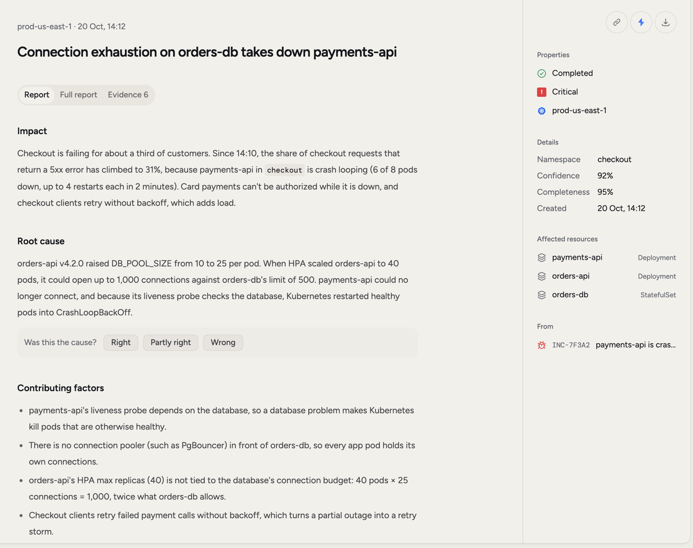
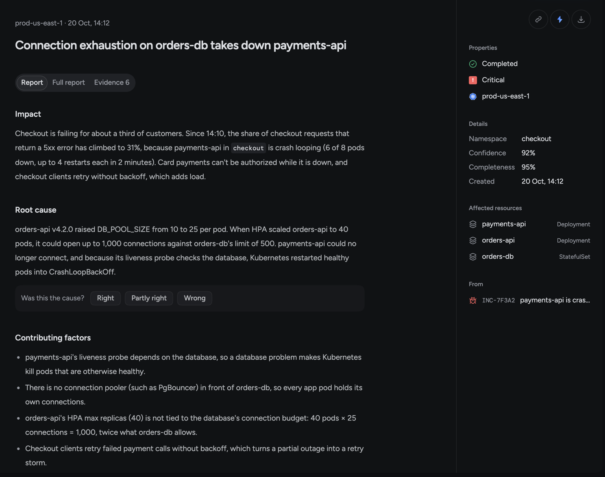
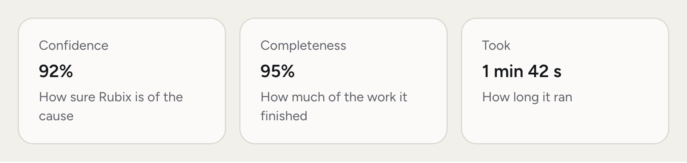
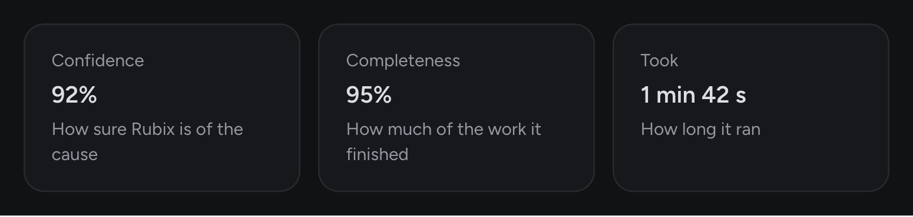
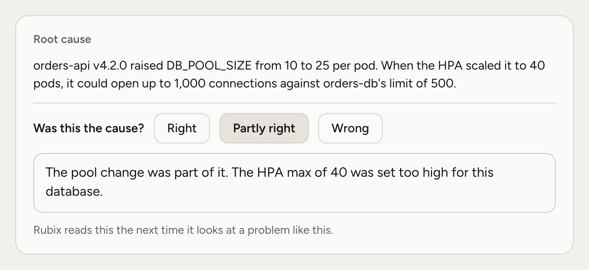
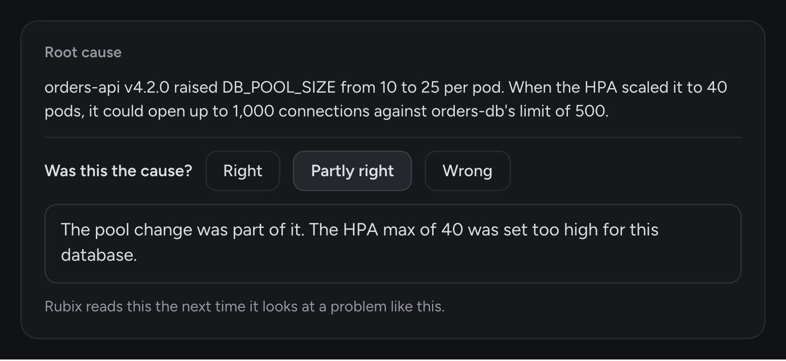
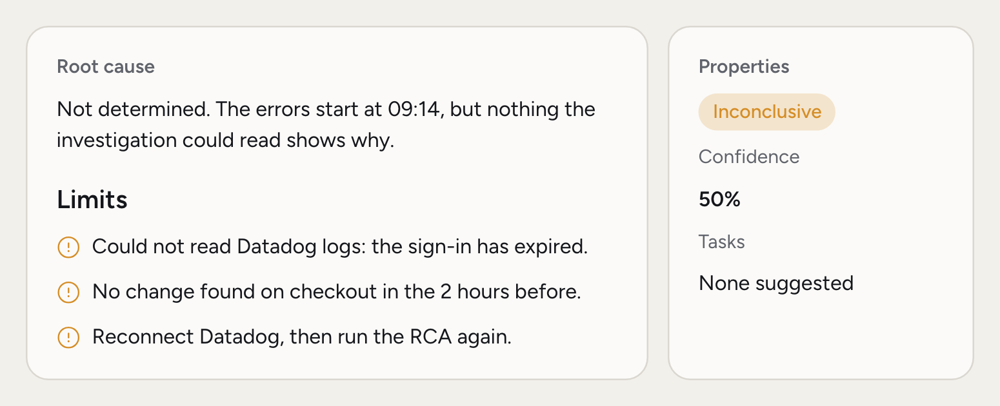
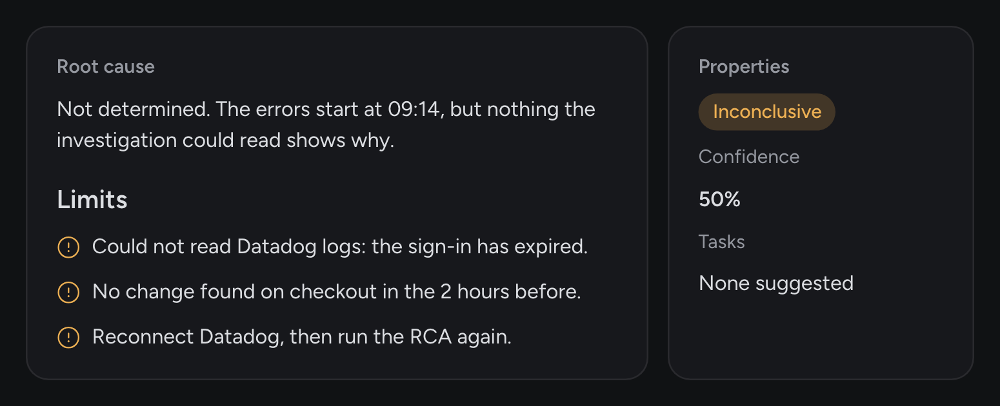

An RCA saves you the hour between "something's broken" and "I know why". Rubix reads the logs, metrics and recent changes for you, then writes down what happened, the evidence for it, and what to do.

Rubix can be wrong, so every RCA shows where each claim came from and lets you rate it. It's a colleague's first pass, not a verdict. An RCA reads your systems and writes nothing to them. Any change comes later, through a [Task](/using/tasks) or a chat with Rubix.

## When you'd use this

- **An incident is open.** Read the root cause and the Fix before you start digging yourself.
- **You're deciding what to do.** Check the evidence behind the claim that matters most.
- **Your team needs a write-up.** Export the report as a starting point for your review.
- **The same thing happened before.** Find the earlier RCA and see what was tried.

<Frame>
  
  
</Frame>

## Find an RCA

Open an incident and pick its RCA on the right, or open **RCAs** in the sidebar. The list has three tabs: **Open**, **Resolved** and **All**. An RCA counts as open while its incident is. When an incident has several reports, the list shows the newest.

Filter by Stage, Severity, Environment, Confidence or Created.

## What's in the report

The page has up to three tabs. **Full report** and **Evidence** show once there's something to put in them.

### Report

The short version, with the answer first:

- **Root cause:** what changed or broke, with the names and numbers from the evidence.
- **Fix:** the steps to put it right.
- **Tasks:** the Fix and Follow-ups Rubix suggests, with their owners.
- **Impact:** what was affected.
- **Current state:** how things stood when the report was written.
- **Contributing factors:** what else had to be true for this to happen.
- **Timeline:** what happened, in order.

In the demo story, the root cause is that a new `orders-api` version raised its database pool, connections ran out, and `payments-api` started crash-looping. The Fix is setting `DB_POOL_SIZE` back to 10.

### Full report

The whole report as Rubix wrote it. It adds how it happened, what was ruled out, open questions, and notes on the investigation.

Numbers in the text are citations. Click one to jump to the evidence behind that claim. Where a tool returned numbers that matter, the report draws them as a chart and says which result they came from.

### Evidence

Each item shows the source it came from and what that source returned. Rubix's quotes are matched against the results its tools really returned. A quote that doesn't match gets the label **Not verified word for word**.

## Confidence

<Frame>
  
  
</Frame>

**Confidence** on the right is how sure Rubix is of the cause. **Completeness** is how much of the investigation it finished. **Took** is how long it ran.

Confidence isn't a promise. Read it with the evidence. When someone rates the cause **Right**, confidence goes up. A **Wrong** stops that.

On the incident page, the cause reads **Root cause** when the results show it directly, and **Likely cause** when one link in the chain isn't shown.

## Was this the cause?

This is how you teach Rubix. A rating takes seconds, and it changes what happens next time.

<Frame>
  
  
</Frame>

Under the root cause, pick **Right**, **Partly right** or **Wrong**.

**Right** takes one click. The other two ask what it really was. Write it down. Rubix reads your answer the next time it looks at a problem like this one.

## When an RCA is inconclusive

Sometimes the evidence doesn't settle it. A source can't be reached, a sign-in has expired, or nothing shows the cause. Rubix says so instead of guessing.

<Frame>
  
  
</Frame>

An inconclusive RCA looks different:

- The status on the right reads **Inconclusive**.
- The root cause opens with "Not determined", and the incident page shows **Not determined**.
- **Limits** appears under the root cause. It lists the checks that didn't settle, the open questions, and what would make the next investigation better, such as reconnecting an integration.
- **Was this the cause?** doesn't appear, because there's no cause to rate.
- Rubix suggests no Tasks.

Fix what **Limits** points at, then run the RCA again.

<Note>
An RCA that stops before it finishes keeps what it found so far. It reads **RCA stopped** and has no verdict or confidence.
</Note>

## Run the RCA again

Choose **Run the RCA again** from the page's menu, or use the button on the row in the **RCAs** list. It skips every wait and starts at once. It's useful after you've connected a source, fixed access, or added a comment with something Rubix should know.

A new run writes a new report for the same incident. Tasks that repeat are folded into one row.

## Export and ask

- **Export as Markdown**, on the right or in the page's menu, downloads the report as a file for your own review notes.
- **Ask Rubix about this**, in the page's menu, opens a chat with the RCA attached and asks whether the cause holds up and what to do first.
- **Open the incident** takes you back to where it started.

You can also comment on an RCA and mention `@Rubix` or a teammate. See [Comments and mentions](/using/incidents#comments-and-mentions).

## Related pages

<CardGroup cols={2}>
  <Card title="Incidents" icon="triangle-exclamation" href="/using/incidents">
    Follow an incident from detection to close.
  </Card>
  <Card title="Tasks" icon="list-check" href="/using/tasks">
    Take the Fix and see it through.
  </Card>
  <Card title="How an RCA works" icon="magnifying-glass" href="/concepts/root-cause-analysis">
    What Rubix does while it investigates.
  </Card>
  <Card title="Chat with Rubix" icon="comments" href="/using/rubix-chat-agent">
    Ask follow-up questions.
  </Card>
</CardGroup>
