Chat is the fastest way to get an answer about your infrastructure. Instead of opening four tools and piecing it together, you ask. Rubix reads your environments, connected tools and past incidents, then answers with what it found and where it found it.

<Frame>
  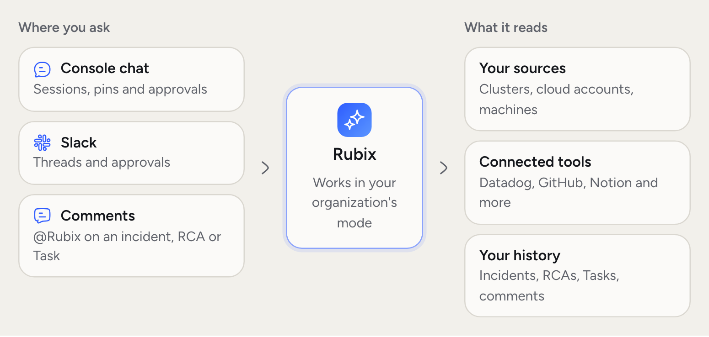
  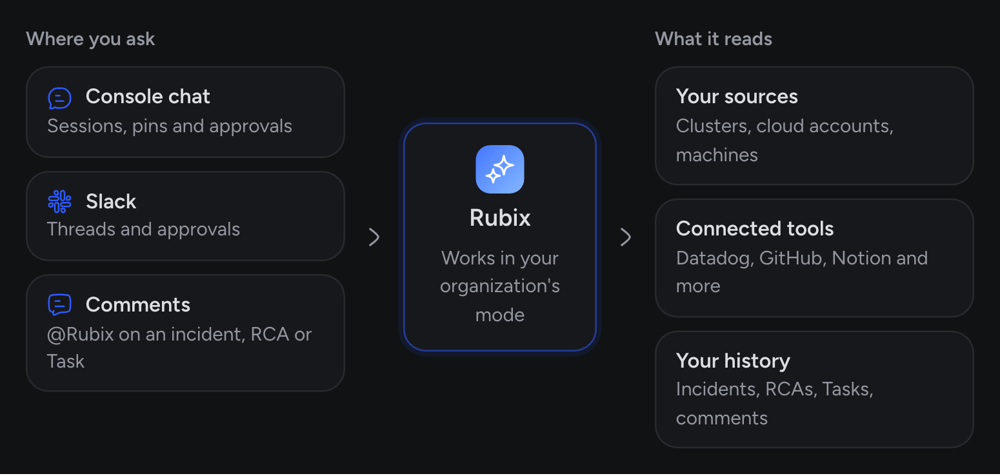
</Frame>

## When you'd use this

- **You have a question, not an incident.** "What changed in `orders-api` today?"
- **You're mid-incident.** "Is it safe to roll back?" with the incident pinned.
- **You want something done.** "Open a pull request that sets `DB_POOL_SIZE` back to 10." Rubix follows your [mode](/using/modes).
- **You need something written.** A runbook, a status update, or a timeline for a review.

See [prompts to try](/tutorials/chat-prompts) for more.

<Frame>
  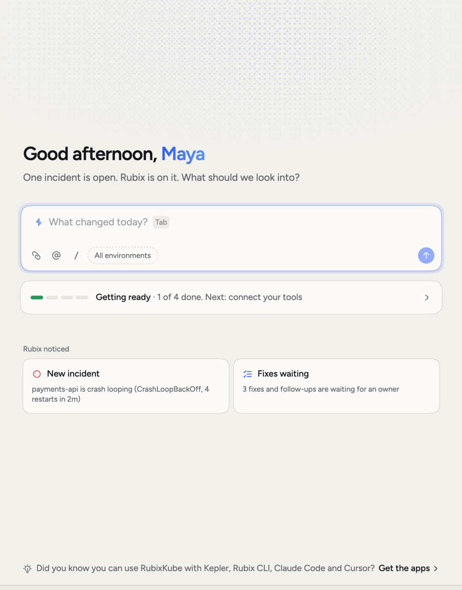
  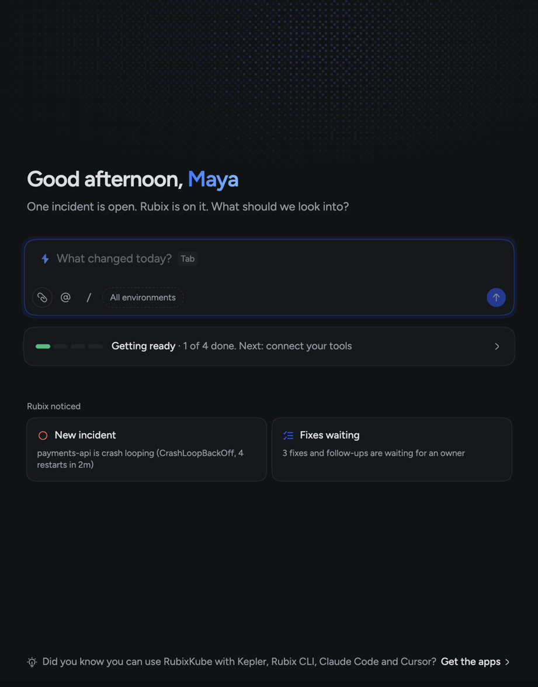
</Frame>

## Start a session

Home is the chat. Type in the box and send. Under the box, **Rubix noticed** shows up to three things worth a look, such as a new incident or Fixes waiting, and there are suggested questions when you don't know where to start.

There are three ways to start or open a session:

- Click **New session** in the sidebar, or press ⌘⇧O.
- Press ⌘J on any page. Rubix opens beside the page, so you can ask about what you're looking at.
- Click **Ask Rubix about this** on a Task or an artifact.

## Point Rubix at the right thing

Type `@` or click the @ button to add context to your message. Rubix looks at what you pin instead of working it out from your words. This is the easiest way to get a better answer.

<Frame>
  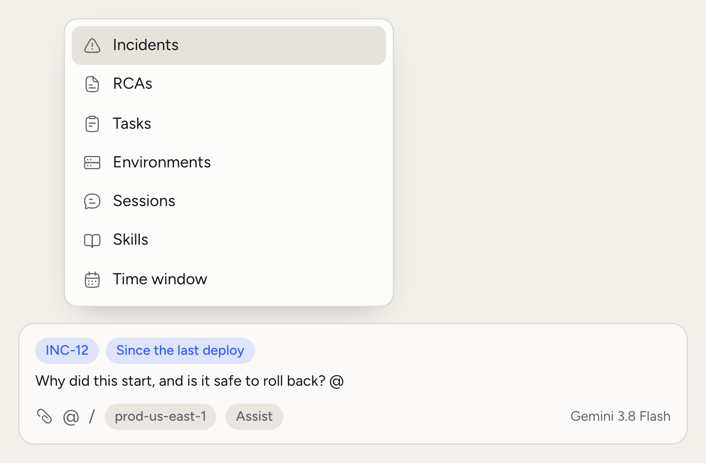
  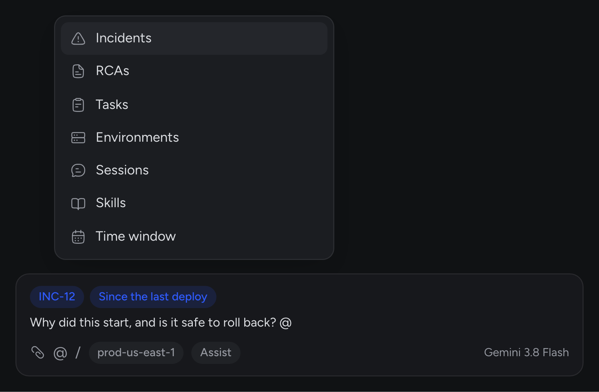
</Frame>

You can pin **Incidents**, **RCAs**, **Tasks**, **Environments**, **Sessions**, **Skills** and a **Time window**. A time window can be one of the listed ones, like "the last hour" or "since the last deploy", or your own. When chat is open beside a page, **This page** comes first.

Pinning a skill tells Rubix to follow it for that message. You can also attach files, such as a screenshot, a log or a config.

## Use / commands

Type `/` in an empty box, or click the / button. The menu lists the commands below, then any commands your organization added in [Customize](/using/customize).

<Frame>
  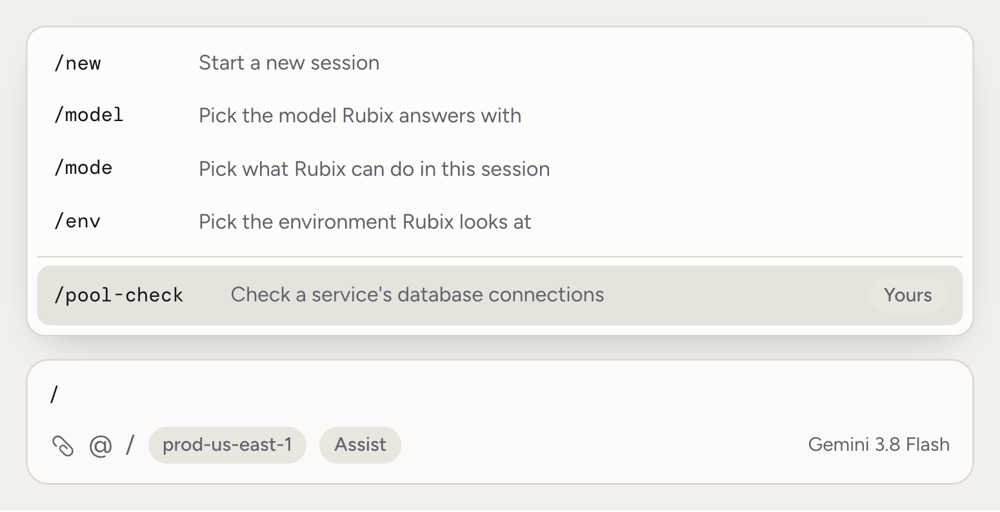
  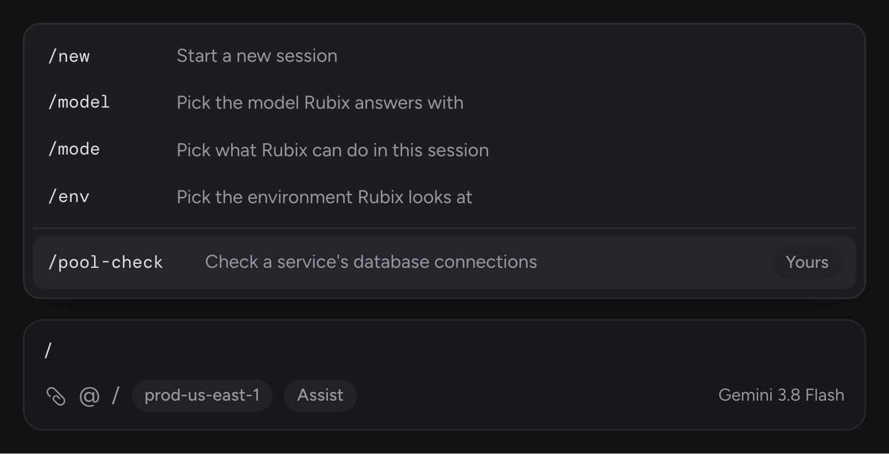
</Frame>

| Command | What it does |
|---|---|
| `/new` | Start a new session |
| `/model` | Pick the model Rubix answers with |
| `/mode` | Pick what Rubix can do in this session. Shows once a session has started |
| `/env` | Pick the environment Rubix looks at |
| `/settings` | Open Settings |
| `/customize` | Open Customize |
| `/shortcuts` | Show keyboard shortcuts |

## Choose the model and environment

The model picker sits on the right of the chat box. A new chat starts on your organization's Primary model. Pick another and it stays for that chat only. The same menu sets **Reasoning** and **Response style**. See [Models](/using/models).

The chip next to the / button shows which environment Rubix is looking at. A new session takes the environment picked in the sidebar. With **All environments**, Rubix works out the environment from your question. Use `/env` to switch during a session. Rubix reads the switch with your next message.

## While Rubix works

Long jobs show **Rubix's plan**, a checklist of its steps. To end a turn early, click the stop button in the chat box.

Sometimes Rubix needs you before it can go on. A card appears above the chat box:

- **Approval needed**: Rubix wants to make a change. Choose **Approve**, **Allow in this chat** or **Deny**. You can add a note for Rubix too. [Modes](/using/modes) explains each choice.
- **Rubix asks**: Rubix has a question. Pick an option, answer in your own words, or click **Skip**.
- **Plan to review**: Rubix wrote a plan. Choose **Execute plan** or **Drop**. This is a good moment to read what it intends to do before anything happens.

<Frame>
  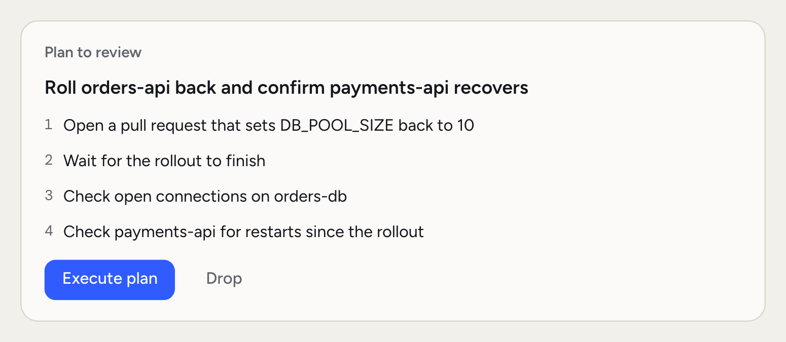
  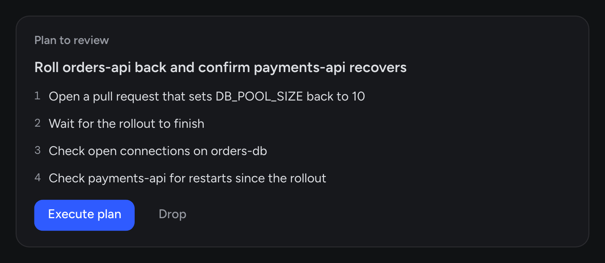
</Frame>

<Frame>
  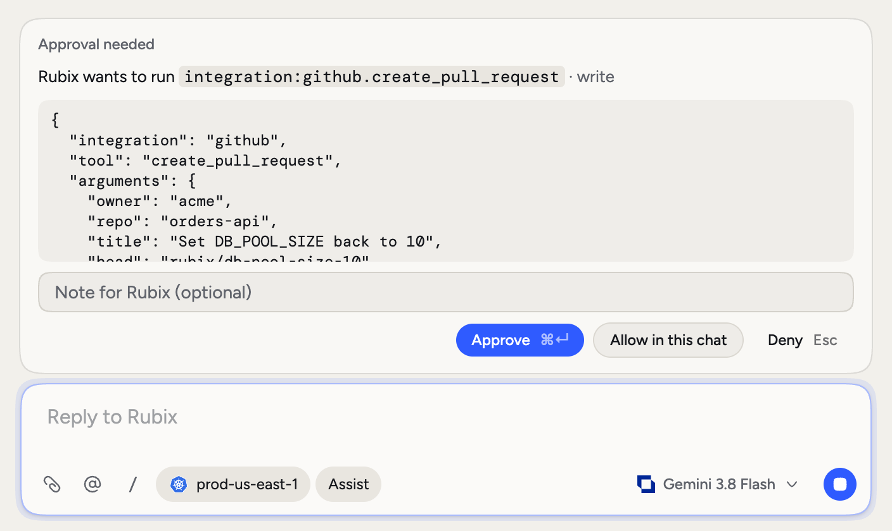
  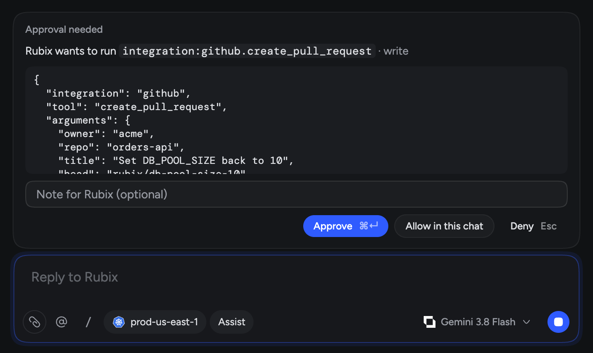
</Frame>

## Artifacts and widgets

Ask for something to keep, like a runbook, a report or a timeline, and Rubix publishes it as an artifact. It shows as a card in the chat and opens beside it. An artifact can be a document, a page, an image or a diagram. If Rubix updates it, the card shows the new version.

<Frame>
  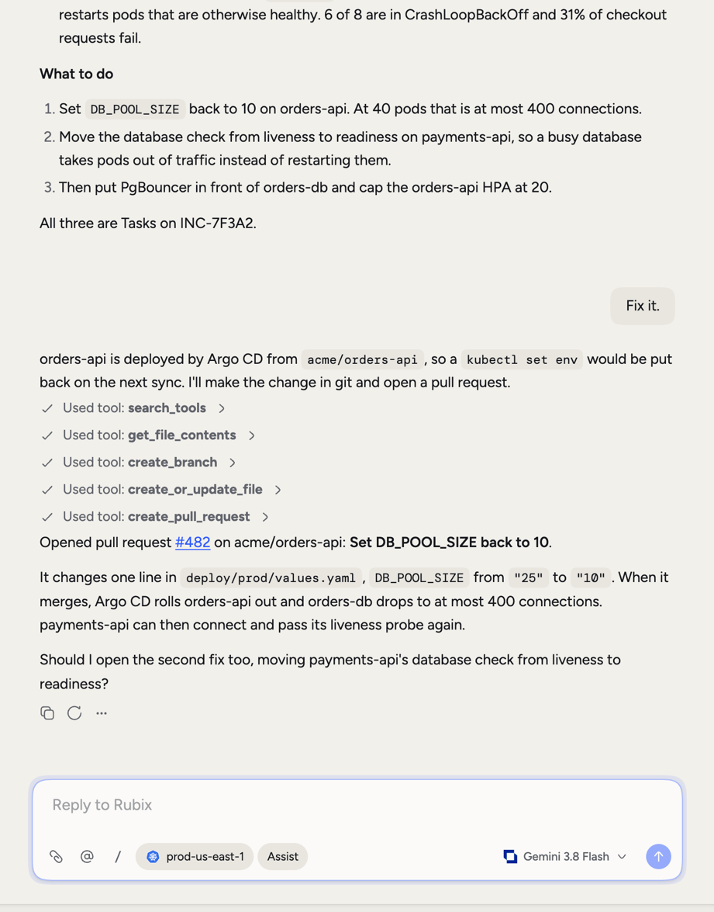
  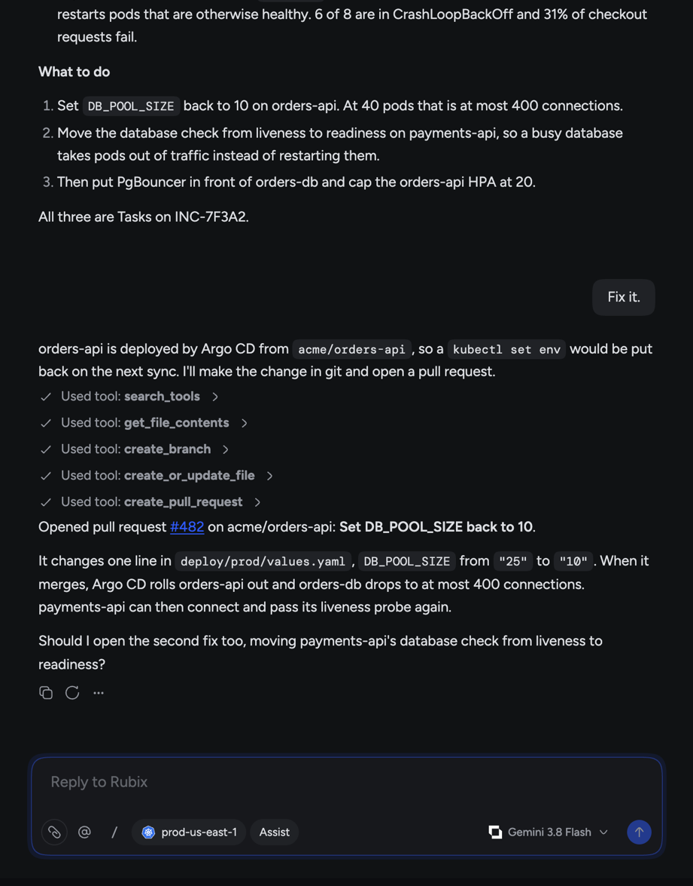
</Frame>

Rubix can also put a small widget in the chat, such as a choice, a short form or a summary with buttons. Using it sends your answer to Rubix.

## Go back to a session

Recent sessions are listed under **Sessions** in the sidebar. Click **Show all** to see the rest, or press ⌘K to search. Each session keeps its own model and mode.

## Other ways to work

- **Slack.** Message Rubix in Slack and it answers with the same tools, models and skills. Approvals show as a card in the thread. See [Slack](/integrations/slack).
- **Your AI tools.** Over [MCP](/integrations/mcp), tools like Claude Code, Cursor or VS Code read and change your RubixKube records directly, as you. That's your AI tool at work, not Rubix.
- **Comments.** Mention @Rubix in a comment on an incident, a Task or an RCA, and Rubix replies in the thread.

## Related pages

<CardGroup cols={2}>
  <Card title="Modes" icon="shield-halved" href="/using/modes">
    What Rubix can do without asking.
  </Card>
  <Card title="Models" icon="microchip" href="/using/models">
    Set the models Rubix uses.
  </Card>
  <Card title="Skills" icon="wand-magic-sparkles" href="/using/skills">
    Teach Rubix how your team works.
  </Card>
  <Card title="Chat prompts" icon="comments" href="/tutorials/chat-prompts">
    Questions that get good answers.
  </Card>
</CardGroup>
