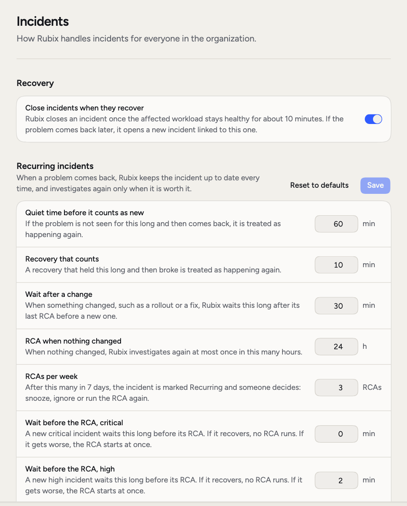
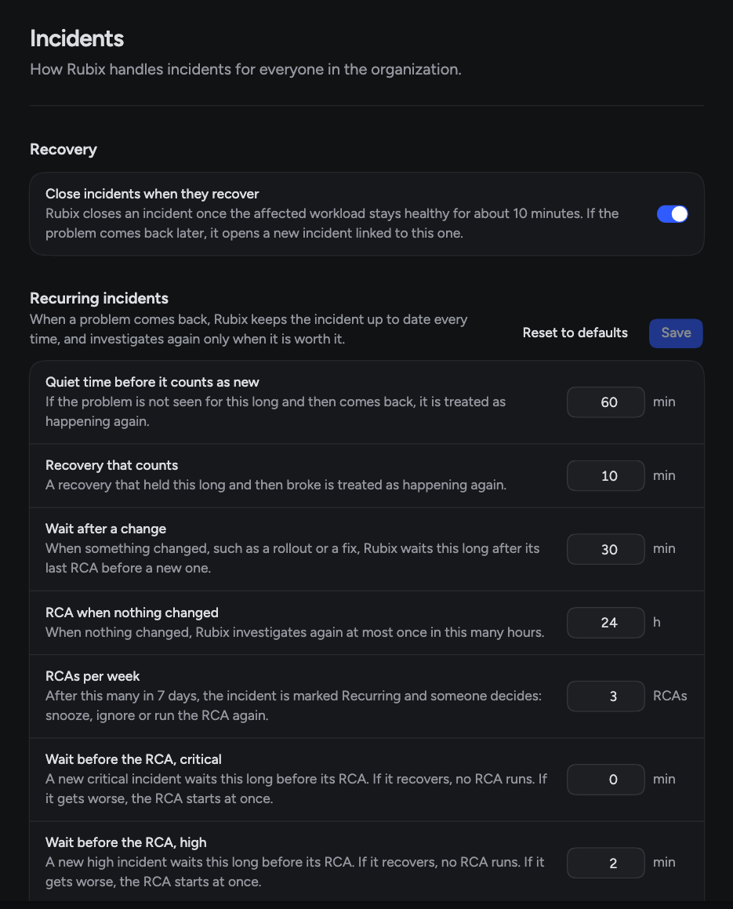
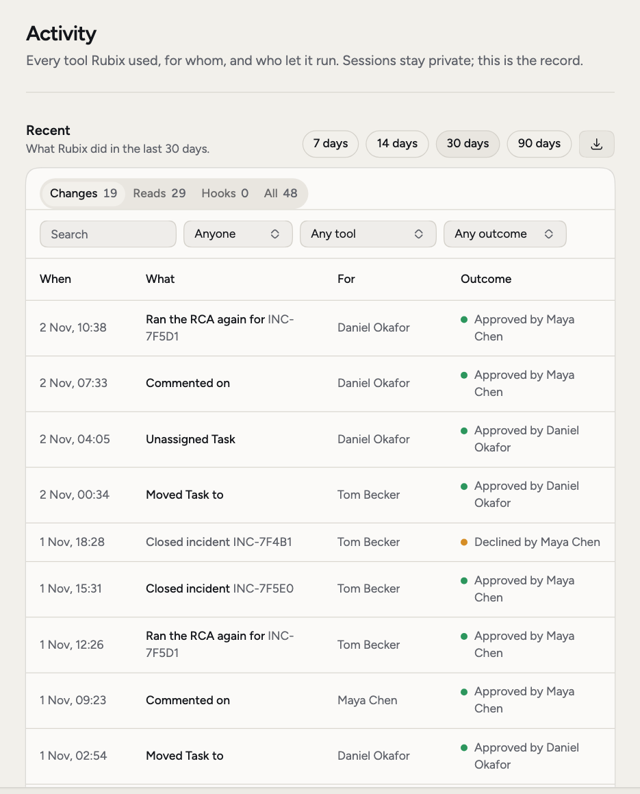
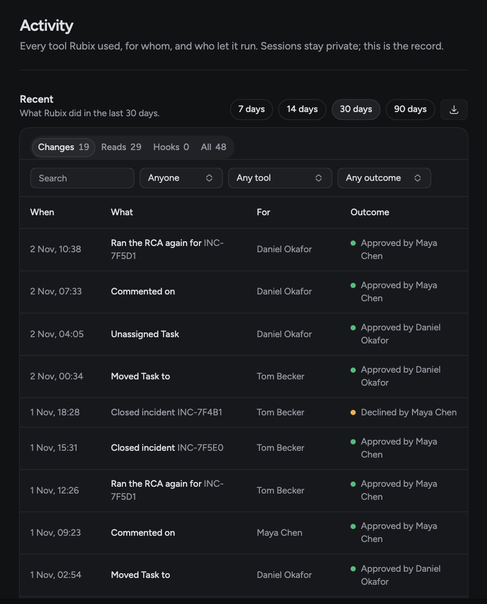

These pages under **Settings** apply to everyone in your organization. Only admins can change them. Other members can read **General** and **Incidents**.

Come here when RubixKube's defaults don't fit how your team works:

- **Incidents stay open after they recover.** Turn on closing them automatically.
- **RCAs start too soon or too late.** Change the wait for each severity.
- **The same problem keeps getting investigated.** Change when it counts as Recurring.
- **Someone asks what Rubix did.** **Activity** has the full record, and you can export it.

## General

**Settings > General** holds your organization's logo, **Name** and **Organization ID**, with a button to copy the ID. **Overview** shows your plan and member count, each with **Manage**.

### Deactivate an organization

<Warning>
**Deactivate** under **Danger zone** removes access for everyone in the organization. Nobody can sign in to it. Nothing is deleted, and the RubixKube team can turn it back on if you ask.
</Warning>

## Incidents

**Settings > Incidents** sets how Rubix handles incidents.

<Frame>
  
  
</Frame>

### Recovery

**Close incidents when they recover** is off by default. Turn it on and Rubix closes an incident once the affected workload stays healthy for about 10 minutes. If the problem comes back later, it opens a new incident linked to this one. Leave it off and incidents stay open until someone closes them.

### Recurring incidents

When a problem comes back, Rubix keeps the incident up to date every time and investigates again only when it's worth it. Save your changes with **Save**. **Reset to defaults** puts them all back.

| Setting | What it does | Default |
|---|---|---|
| **Quiet time before it counts as new** | If the problem isn't seen for this long and then comes back, it's treated as happening again. | 60 min |
| **Recovery that counts** | A recovery that held this long and then broke is treated as happening again. | 15 min |
| **Wait after a change** | When something changed, such as a rollout or a fix, Rubix waits this long after its last RCA before a new one. | 30 min |
| **RCA when nothing changed** | When nothing changed, Rubix investigates again at most once in this many hours. | 24 h |
| **RCAs per week** | After this many in 7 days, the incident is marked Recurring and someone decides: snooze, ignore or run the RCA again. | 3 |

### Waits before the RCA

A new incident waits a while before its RCA, so a problem that clears by itself doesn't use an investigation. If it recovers during the wait, no RCA runs. If it gets worse, the RCA starts at once. Each severity has its own row, from 0 to 60 minutes. Save these with **Save** in the same section.

| Setting | Default |
|---|---|
| **Wait before the RCA, critical** | 0 min |
| **Wait before the RCA, high** | 2 min |
| **Wait before the RCA, medium** | 5 min |
| **Wait before the RCA, low** | 10 min |

### Grouping

When many incidents arrive at once, Rubix groups them so they get one investigation. This section shows when grouping is on for your organization.

| Setting | What it does | Default |
|---|---|---|
| **Incidents in a storm** | New incidents from one source, within the storm window, that become one group. | 10 |
| **Storm window** | The time a storm's incidents arrive within. | 5 min |
| **Storm stays open for** | How long after a storm's group is made later incidents can join it. | 15 min |
| **New kind of incident** | While a storm is open, how many incidents of a type it doesn't have must arrive before they join. | 3 |
| **Incidents before triage waits** | New incidents from one source within 5 minutes that make triage wait a minute for grouping. | 5 |

These are the same values as the settings on the **Classify incidents** and **Triage incident** automations. If **Classify incidents** isn't installed, this section offers **Add** instead.

## Activity

**Settings > Activity** is a record of what Rubix did. It's for admins.

<Frame>
  
  
</Frame>

Choose **7 days**, **14 days**, **30 days** or **90 days**, then a tab: **Changes**, **Reads**, **Hooks** or **All**. Each row shows **When**, **What**, **For** and **Outcome**, and you can open it to see the tool, who decided, and the arguments.

Narrow the list with **Search** and the filters for person, tool and outcome. An outcome is **Ran**, **Blocked**, **Needed approval** or **Failed**.

To keep a copy, open the export menu and choose **Export CSV** or **Export JSON**. The file holds the rows that match your filters.

<CardGroup cols={2}>
  <Card title="Incidents" icon="triangle-exclamation" href="/using/incidents">
    See groups, recovery and recurring incidents at work.
  </Card>
  <Card title="Modes" icon="shield" href="/using/modes">
    Choose what Rubix may do without asking.
  </Card>
  <Card title="Members" icon="users" href="/using/members">
    Manage who has access.
  </Card>
  <Card title="Automations" icon="diagram-project" href="/using/automations">
    See the automations behind grouping.
  </Card>
</CardGroup>
