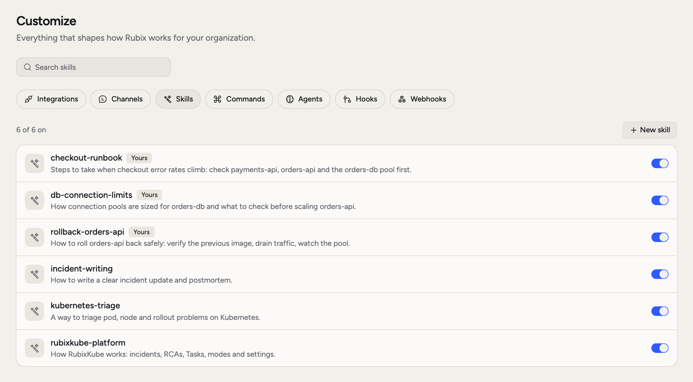
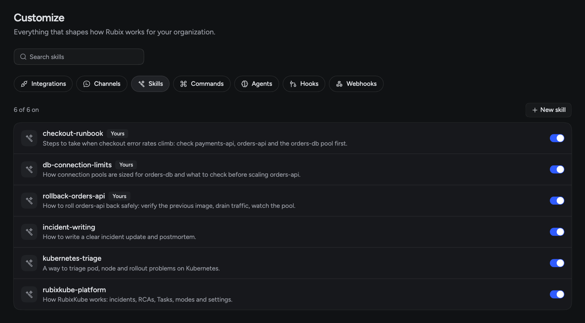

Every team has its own way of doing things: which dashboard to check first, what "healthy" means after a release, who to tell. Rubix doesn't know that until you write it down. A skill is that note. Write one like a runbook, and Rubix follows your way of doing something instead of working it out each time.

## When you'd use this

- **You have a runbook.** Turn it into a skill so Rubix follows it during RCAs and chats.
- **One person knows how.** Write it down, and everyone gets it, including new starters.
- **Rubix keeps missing something.** "Always check the pool size after an `orders-api` release."
- **You want the same check every time.** A release check, a cost review, a handover note.

You manage skills in **Customize > Skills**.

<Frame>
  
  
</Frame>

## What you see

The list shows skills from RubixKube, marked **Built in**, and your organization's own, marked **Yours**. Each row has a name, a description and a switch. The count at the top shows how many are on. Click a skill to read its instructions.

Only admins can add, change or delete skills, or turn them on and off.

## Skills that ship with Rubix

Rubix comes with eight skills. You don't need to turn them on. Rubix loads one when a task fits.

| Skill | What it's for |
|---|---|
| `kubernetes` | Investigating a Kubernetes environment |
| `aws` | Investigating an AWS account |
| `gcp` | Investigating a Google Cloud project |
| `azure` | Investigating an Azure subscription |
| `vm` | Investigating a virtual machine or bare-metal host |
| `incident` | Walking one incident from start to finish |
| `rca-review` | Checking an RCA before you trust it |
| `rubixkube` | Answering questions about RubixKube itself |

## How Rubix uses a skill

Rubix reads each skill's **When to use it** and loads the skill when it fits the task. To make sure it uses one, type `@` in the chat box, open **Skills** and pin it. Rubix follows it for that message.

A skill tells Rubix how to work. It doesn't give Rubix more permissions. [Modes](/using/modes) and [hooks](/using/customize#hooks) still decide what can run.

## Add your own skill

<Steps>
  <Step title="Click New skill">
    Open **Customize > Skills** and click **New skill**. If you already have a `SKILL.md` file, click **Fill from a SKILL.md file**.
  </Step>
  <Step title="Fill in the form">
    The fields are listed below.
  </Step>
  <Step title="Click Create skill">
    Your skill is on as soon as you create it. Use the switch to turn it off. Turning it off doesn't delete it.
  </Step>
</Steps>

| Field | What to enter |
|---|---|
| **Name** | Lowercase letters, numbers and dashes. You can't change it later |
| **When to use it** | One sentence. Rubix reads this to decide when to load the skill, so be specific |
| **Agent** | Leave this on **Any agent** unless the skill is for one [agent](/using/customize#agents) |
| **Tools it may use** | Optional, separated with commas |
| **Instructions** | The steps, in Markdown. The form shows the character limit |

<Note>
  **Tools it may use** is saved with the skill, but Rubix doesn't enforce it. Don't rely on it as a safety limit. Use modes and hooks for that.
</Note>

## Example

Say a new `orders-api` version raised its database pool and connections ran out. You can turn that lesson into a check your team runs after each release.

Save this as `SKILL.md` and use **Fill from a SKILL.md file**, or copy each part into the form. The file format is the open [Agent Skills format](https://agentskills.io/home). The form reads `name`, `description` and the instructions.

```markdown
---
name: orders-api-release-check
description: Check orders-api and orders-db after a new orders-api version goes out
---

# Steps

1. Find the latest orders-api rollout in prod-us-east-1 and when it finished.
2. Compare DB_POOL_SIZE with the previous version. It should be 10.
3. Check open connections on orders-db against its limit.
4. Check payments-api for restarts since the rollout.
5. Answer with: healthy or not, the evidence, and the first thing to do.
```

Now someone can ask "Is the new orders-api version OK?" and Rubix loads the skill.

## Replace a built-in

To change how a built-in skill works, create a skill with the same name, such as `kubernetes`. Your version replaces the built-in for your whole organization. Turn yours off or delete it, and the built-in is back.

On a **Built in** skill in the list, **Make a copy** gives you a starting point. It names the copy `<name>-copy`, so change the name back to the original if you want to replace the built-in. Keep the `-copy` name and you get a separate skill.

## Good to know

Deleting one of your skills can't be undone. Rubix stops using it and the instructions are deleted.

Skills and commands do different jobs. A skill is something Rubix loads by itself. A [command](/using/customize#commands) is a prompt a person puts in the chat box with `/`.

## Related pages

<CardGroup cols={2}>
  <Card title="Add a custom skill" icon="plus" href="/tutorials/add-custom-agent-skills">
    Turn a runbook into a skill, step by step.
  </Card>
  <Card title="About skills" icon="wand-magic-sparkles" href="/concepts/skills">
    What a skill is and when to write one.
  </Card>
  <Card title="Commands, agents and hooks" icon="sliders" href="/using/customize">
    The other ways to shape Rubix.
  </Card>
</CardGroup>
