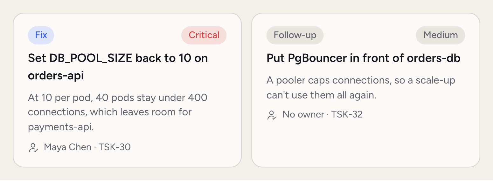
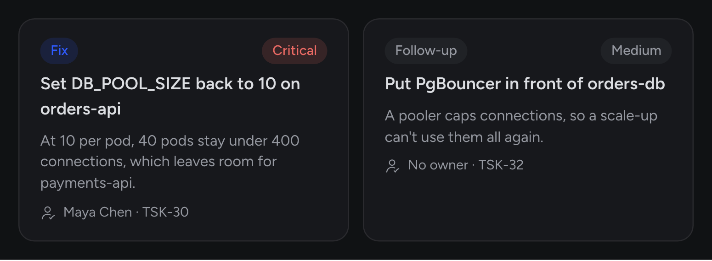
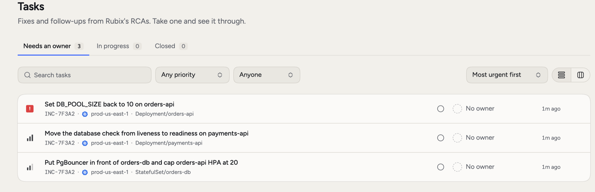
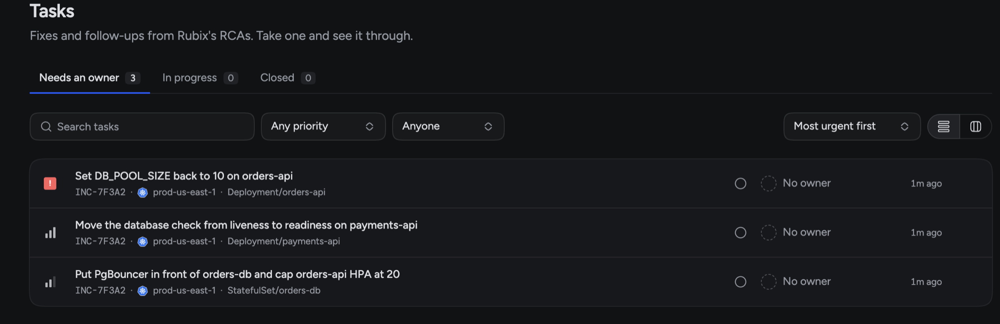
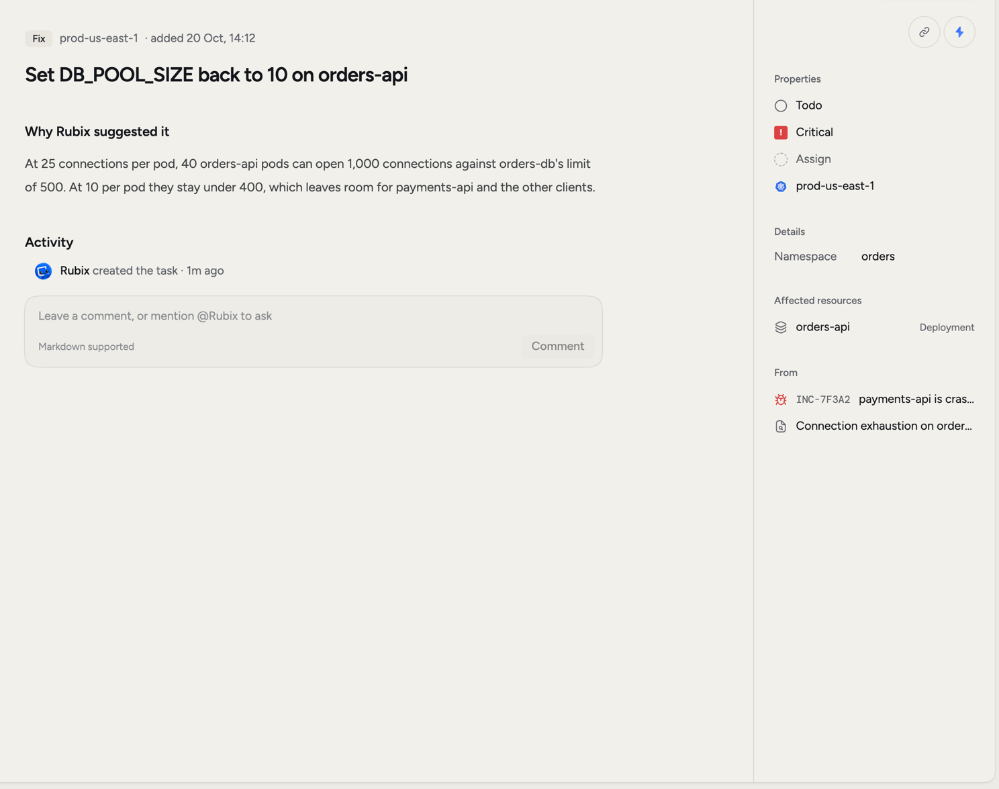
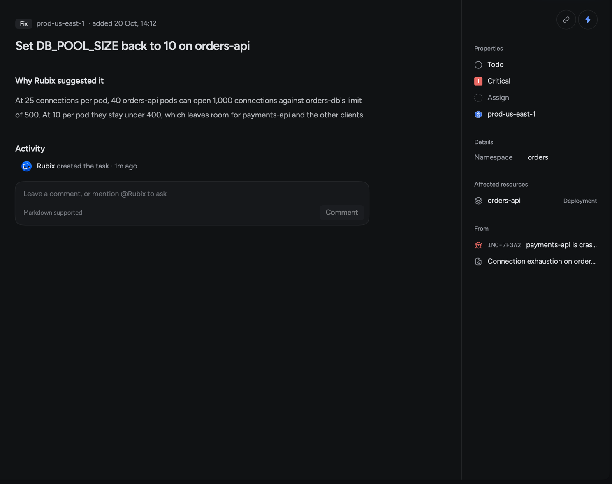
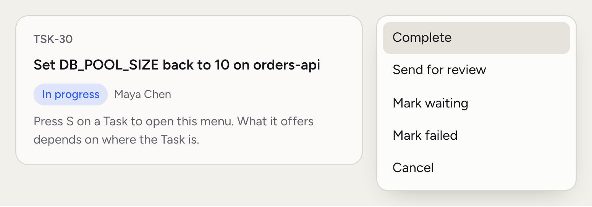
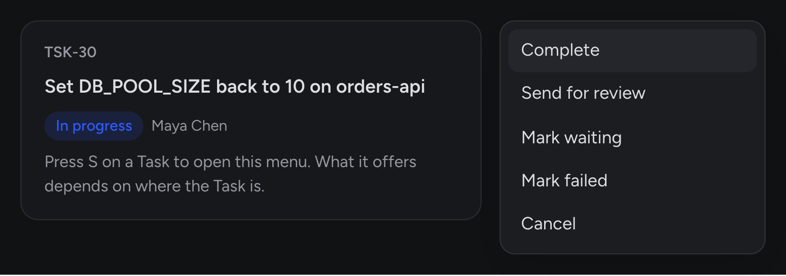

Knowing the cause doesn't fix anything. Tasks turn an RCA into work with an owner, so nothing gets lost once the incident closes and everyone moves on.

Rubix suggests Tasks when it finishes an RCA, and you can add your own. There are two kinds:

- **Fix:** the change that puts this incident right.
- **Follow-up:** work worth doing later, so it doesn't happen again.

<Frame>
  
  
</Frame>

Rubix suggests Tasks only when it has found a cause. An [inconclusive RCA](/using/rca-reports#when-an-rca-is-inconclusive) has none.

## When you'd use this

- **You're on the incident.** Assign the Fix to yourself so the team knows it's taken.
- **The fire's out.** Follow-ups keep the real improvement from being forgotten.
- **You're planning the week.** **My tasks** shows what's yours. **Needs an owner** shows what nobody has picked up.
- **You're not sure how to do it.** Ask Rubix how to make the change safely.

<Frame>
  
  
</Frame>

## The Tasks list

Open **Tasks** in the sidebar. It has three tabs:

- **Needs an owner:** nobody has taken it.
- **In progress:** someone has it, including Tasks that are assigned, waiting or in review.
- **Closed:** completed, cancelled or failed.

**My tasks**, at the top of the sidebar, shows the Tasks you own. It has two tabs, **Open** and **Closed**, and Open is split by stage with the one you're working on first.

**Filter** by Priority, Owner, Environment, Kind or Created. **Display** sets the order (Priority, Created, Last updated) and the grouping (Stage, Priority, Owner, Environment, No grouping). Switch between **List** and **Board** to see Tasks as cards in columns, and drag a card to move it on.

## The Task page

The page shows the kind, the environment, and when it was added. **Why Rubix suggested it** gives the reasoning from the RCA. **Activity** holds every status change and comment.

<Frame>
  
  
</Frame>

The right side holds status, priority, owner, environment, affected resources, and links back to the incident and the RCA under **From**.

## Move a Task along

<Frame>
  
  
</Frame>

Open the status menu on the Task, or press `S`. What you can do depends on where the Task is:

| Status | What you can do |
|---|---|
| Todo | Assign to me, Start, Cancel |
| Assigned | Start, Unassign, Cancel |
| In progress | Complete, Send for review, Mark waiting, Mark failed, Cancel |
| Waiting | Resume, Send for review, Cancel |
| Review | Approve, Back to in progress, Mark waiting, Cancel |
| Completed | Reopen |
| Failed | Retry, Cancel |
| Cancelled | Reopen |

**Complete** finishes it. **Approve** finishes a Task that's in review. **Reopen** brings back a Completed Task as In progress, and a Cancelled one as Todo.

## Assign a Task

Click **Assign** on the right, or press `A`, and pick a teammate. **Assign to me** takes it yourself. You can set the owner when you create a Task too.

On an incident page, the next step points at your Task if you own one. If not, it points at the most urgent Fix nobody has taken.

## Add a Task

Click **New task** on the Tasks page, or **Add task** on an incident, then fill in the title and details. Set the incident, environment, priority, owner and kind, and click **Create task**.

## Ask Rubix for help

Choose **Ask Rubix about this** in the page's menu. It opens a chat with the Task attached and asks how to do it safely and how you'll know it worked. That second part matters: agree on what you'll check before you make the change.

You can also comment on a Task and mention `@Rubix` or a teammate. See [Comments and mentions](/using/incidents#comments-and-mentions).

## Good to know

- **Repeats fold together.** If the RCA runs again and suggests the same Task, the copies show as one row. The Task page lists them under **Filed more than once**, and your changes apply to every copy.
- **Closing an incident leaves its Tasks open.** A Follow-up often outlives the incident.
- **In a group,** Tasks live on the group. Each incident's page shows them, marked **From the group's RCA**.

<Warning>
**Delete** removes a Task for everyone and can't be undone. To keep a record, cancel it instead.
</Warning>

## Tasks outside the console

In [Slack](/integrations/slack), paste a link to a Task and it opens as a card with status, priority, kind and owner.

Over [MCP](/integrations/mcp), your AI tools can list and read Tasks, create them, rename them, change their priority, move them and assign them. Each change is recorded under your name.

## Related pages

<CardGroup cols={2}>
  <Card title="RCAs" icon="magnifying-glass" href="/using/rca-reports">
    See where a Task came from.
  </Card>
  <Card title="Incidents" icon="triangle-exclamation" href="/using/incidents">
    Follow an incident from detection to close.
  </Card>
  <Card title="How Tasks work" icon="list-check" href="/concepts/tasks">
    Fixes, Follow-ups and who does what.
  </Card>
  <Card title="Modes" icon="sliders" href="/using/modes">
    Choose how much Rubix does without asking.
  </Card>
</CardGroup>
