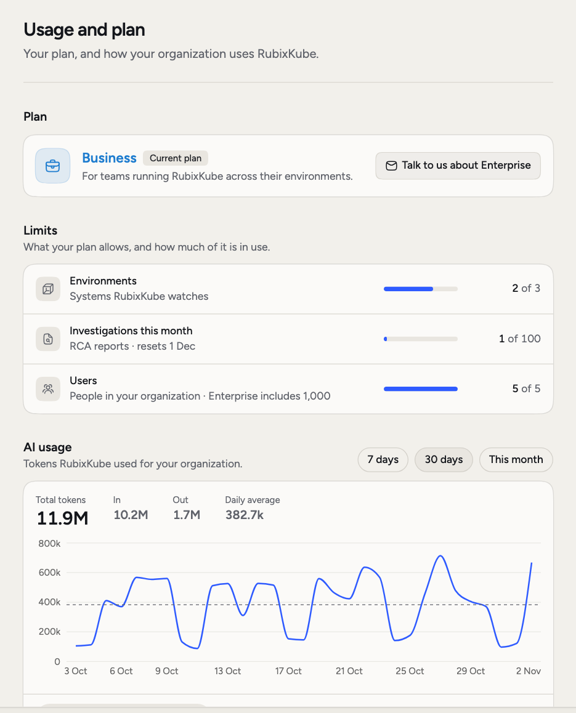
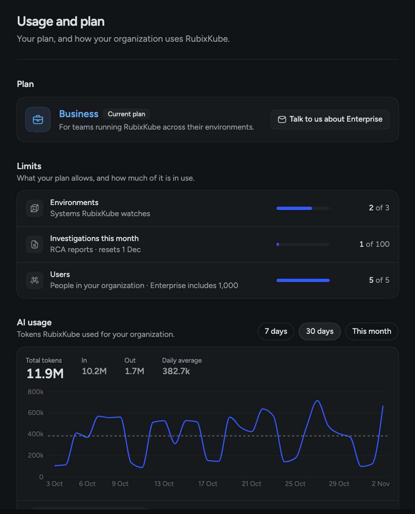

Come here to see if you're near a limit, what your plan includes, or where your AI usage is going. **Settings > Usage and plan** shows your plan, how close you are to its limits and, for admins, how many AI tokens your organization used. For prices, see [rubixkube.ai/pricing](https://rubixkube.ai/pricing).

<Frame>
  
  
</Frame>

## The three plans

| | Individual | Business | Enterprise |
|---|---|---|---|
| Environments | 1 | 3 | No limit |
| Investigations a month | 10 | 100 | 300 |
| Users | 1 | 5 | 1,000 |

Enterprise limits are set for your organization, so yours can differ. If your organization has its own limit for environments or users, the page shows that one.

Only Individual has limits on features. **Business and Enterprise** add:

- Automations
- Hooks
- Webhooks
- Slack
- Your own model providers
- Custom integrations
- Inviting people to your organization
- More than one environment

On Individual, these pages tell you the feature comes with Business.

## Limits

The **Limits** section shows three rows, each with how much is in use:

- **Environments**: the systems RubixKube watches.
- **Investigations this month**: RCA reports this calendar month. The row shows when the count resets, on the first of the next month in UTC.
- **Users**: the people in your organization.

A row reads **Near limit**, **At limit** or **Over limit** as it fills up. When a row is full, it also says what the next plan includes.

## What counts as an investigation

One RCA report is one investigation. Chat with Rubix isn't an investigation, and neither is an automation that only sends a message.

## AI usage

**AI usage** is for admins. It shows the tokens RubixKube used for your organization over **7 days**, **30 days** or **This month**.

You see **Total tokens**, **In**, **Out**, **Daily average** and a chart per day. Three tabs split the same tokens:

- **Activity**: **Conversations**, **Investigations** and **Automations**.
- **People**: who used them.
- **Models**: which models, and which provider.

## Change your plan

An admin sees one button on the plan card: **Upgrade to Business**, **Talk to us about Enterprise** or **Contact RubixKube**. It starts an email to the RubixKube team. Anyone else sees "Ask an admin to upgrade".

<CardGroup cols={2}>
  <Card title="Members" icon="users" href="/using/members">
    Invite people to your organization.
  </Card>
  <Card title="Models" icon="microchip" href="/using/models">
    Choose models and add your own provider.
  </Card>
  <Card title="Automations" icon="diagram-project" href="/using/automations">
    Run steps when something happens.
  </Card>
  <Card title="RCAs" icon="file-lines" href="/using/rca-reports">
    What an investigation produces.
  </Card>
</CardGroup>
